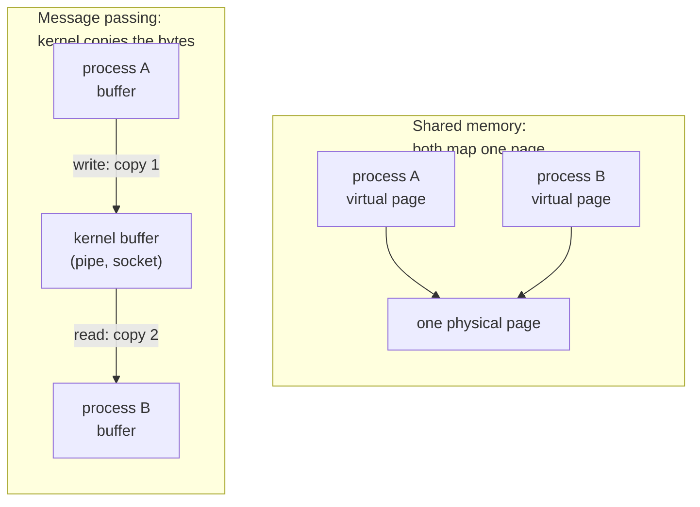

## Mental Model

Processes live in sealed houses (separate address spaces). To communicate, they either:

- **pass notes through the kernel's mail slot** — pipes, sockets, message queues: the kernel copies bytes from one process into a kernel buffer and then into the other process. Safe and simple, but every byte is copied twice and every exchange costs system calls; or
- **share a room** — shared memory: the kernel maps the *same physical pages* into both address spaces. No copying at all, but now both processes can trample each other's data, so they must coordinate with synchronization primitives.

Everything in IPC is a trade-off between these two ideas: **copying through the kernel (safe, simple) vs sharing memory (fast, dangerous)**.



## Definition

**Inter-process communication (IPC)** is any mechanism that lets separate processes exchange data or synchronize. The main mechanisms on Unix-like systems are pipes, named pipes (FIFOs), Unix domain sockets, network sockets, message queues, shared memory, memory-mapped files, signals and semaphores.

## Why It Exists

**The problem.** Process isolation is a feature, but real systems are built from cooperating processes. Examples: a shell pipeline, a web server and its workers, a database's postmaster and backends, a browser's renderer and GPU processes, microservices on one host.

**Without it.** Isolation would be total: two processes could not exchange a single byte. Every system would have to be one giant process, where one crash takes down everything.

**The idea.** Keep the walls, but cut a door the kernel guards. IPC restores communication *selectively* and under the kernel's control. There are only two ways to build that door. Either the kernel *carries the data across* (pipes, sockets: safe, a copy each way), or the kernel *lets both sides see the same memory* (shared memory: no copy, but now they must coordinate).

:::callout[That's all it is]{type=insight}
Every IPC mechanism is either "hand the bytes to the kernel, which hands them to the other process" or "map the same RAM into both". The long table below is variations on those two.
:::

## How It Works

### The mechanisms at a glance

| Mechanism | Data model | Direction | Related processes only? | Copies | Typical use |
|---|---|---|---|---|---|
| **Pipe** (`pipe()`) | Byte stream | One-way | Yes (inherited fds) | 2 (user→kernel→user) | Shell pipelines |
| **FIFO** (named pipe) | Byte stream | One-way | No (filesystem name) | 2 | Simple unrelated producers/consumers |
| **Unix domain socket** | Stream or datagram | Two-way | No (path or abstract name) | 2 | Local client/server: Docker daemon, PostgreSQL local connections, X11 |
| **TCP/UDP socket (loopback)** | Stream / datagram | Two-way | No | 2 + protocol overhead | Services that may later move to another host |
| **Message queue** (POSIX `mq_*`) | Discrete messages with priority | Many-to-many | No | 2 | Structured messages without framing |
| **Shared memory** (`shm_open`+`mmap`, `mmap(MAP_SHARED)`) | Raw memory | Any | No | 0 | High-throughput data sharing (PostgreSQL shared buffers, Chrome compositing) |
| **Signals** | A number | One-way | No | — | Notifications only |
| **Semaphores / futexes on shared memory** | Counters | — | No | — | Synchronizing access to shared memory |

### Pipes

The simplest possible kernel-carried channel: a fixed-size buffer in the kernel with one end to write and one to read. `pipe(fds)` returns two file descriptors: `fds[1]` for writing, `fds[0]` for reading. The kernel holds a bounded buffer (64 KB by default on Linux):

- writer blocks when the buffer is full (backpressure);
- reader blocks when it's empty;
- when all write ends are closed, the reader gets **EOF** (read returns 0);
- when all read ends are closed, a writer gets `SIGPIPE`/`EPIPE`.

Writes of up to `PIPE_BUF` bytes (4096 on Linux) are **atomic** — they won't interleave with other writers' data. Larger writes might.

### Message passing: the textbook design choices

Every message-passing system answers three questions:

- **Who is addressed?** *Direct* communication names the other process (`send(P, msg)`). *Indirect* communication goes through a mailbox or port that several processes can share (a message queue, a socket path).
- **Does send or receive wait?** *Blocking* (synchronous) send waits until the message is received; *non-blocking* (asynchronous) send returns at once. Receive can likewise wait for a message or return "nothing yet".
- **How much can be buffered?** *Zero capacity*: the sender must wait for the receiver every time. When both send and receive block, this is called a **rendezvous**. *Bounded capacity*: the sender waits only when the buffer is full; a 64 KB pipe is this case. *Unbounded*: the sender never waits, and memory is the limit.

### Pipes in Java

Java runs a shell-style pipeline with `ProcessBuilder.startPipeline`, which connects each process's stdout to the next one's stdin with a pipe:

```java
List<Process> pipeline = ProcessBuilder.startPipeline(List.of(
        new ProcessBuilder("cat", "access.log"),
        new ProcessBuilder("grep", " 500 "),
        new ProcessBuilder("wc", "-l")));
Process last = pipeline.get(pipeline.size() - 1);
String errors = new String(last.getInputStream().readAllBytes()).trim();   // read the final pipe
```

### Unix domain sockets

Pipes are one-way and only work between related processes (the fds have to be inherited). A local *server* needs something unrelated clients can find by name and talk to in both directions. Same API as network sockets (`socket(AF_UNIX, …)`, `bind` to a path, `listen`, `accept`, `connect`) but the data never touches the network stack — the kernel moves it between socket buffers directly. Bonus features: passing **file descriptors** between processes (`SCM_RIGHTS`) and learning the peer's UID/PID (`SO_PEERCRED`) for authentication. PostgreSQL local connections via `/var/run/postgresql/.s.PGSQL.5432` are Unix sockets — measurably faster than TCP loopback.

Java supports them since Java 16, through the same `SocketChannel` API used for TCP:

```java
var address = UnixDomainSocketAddress.of("/tmp/app.sock");
try (SocketChannel ch = SocketChannel.open(address)) {       // connect to a local server by path
    ch.write(ByteBuffer.wrap("ping\n".getBytes(StandardCharsets.UTF_8)));
}
```

### Shared memory

When copying through the kernel is too slow (gigabytes per second, or millions of tiny messages), remove the kernel from the data path entirely. In Java, two JVMs share memory by mapping the same file. Files under `/dev/shm` live in RAM (tmpfs), so nothing is written to disk:

```java
Path file = Path.of("/dev/shm/ringbuf");
try (FileChannel ch = FileChannel.open(file, StandardOpenOption.CREATE,
        StandardOpenOption.READ, StandardOpenOption.WRITE)) {
    // READ_WRITE mode is mmap(MAP_SHARED): both processes see the same physical pages
    MappedByteBuffer shared = ch.map(FileChannel.MapMode.READ_WRITE, 0, 1 << 20);  // 1 MB
    shared.putLong(0, 42L);   // a plain memory write, visible to the other process
}   // the mapping stays valid after the channel is closed
```

After setup, reads and writes are plain memory accesses — no system calls, no copies. But the processes now face every problem of multithreaded programming: races, visibility, ordering. They typically use atomic operations, process-shared mutexes (`PTHREAD_PROCESS_SHARED`), or semaphores in the shared region, and a well-defined layout (e.g., a ring buffer with head/tail indices). In Java, atomic operations on a shared mapping go through a `VarHandle` or the `MemorySegment` API; libraries such as Chronicle Queue build cross-process queues this way.

## Internal Mechanism

### Where the copies happen

For a pipe or socket, `write()` copies from the sender's user buffer into kernel memory; `read()` copies from kernel memory into the receiver's buffer. Each call is also a syscall (mode switch), and blocking may cause context switches. For small messages the syscall overhead dominates; for large transfers the copies dominate.

Shared memory avoids both after setup, and the cost moves into **synchronization**. The consumer must learn that new data is available. That takes polling (burns CPU), a futex wait/wake (syscalls only when actually blocking), or an eventfd or pipe notification.

:::depth{level=advanced}
### Zero-copy tricks

- `splice()`/`vmsplice()` move pages between pipes and files without copying through user space.
- `sendfile()` sends file contents to a socket directly from the page cache (used by Nginx for static files and by Kafka to serve log segments).
- `SCM_RIGHTS` passes an open fd (e.g., a memfd full of data) to another process: the receiver gets its own descriptor to the same object.
- `memfd_create()` gives an anonymous file that can be sealed and shared.
:::

## Example

A shell pipeline is IPC in action:

```bash
$ cat access.log | grep " 500 " | awk '{print $7}' | sort | uniq -c | sort -rn | head
```

Six processes, five pipes, each process blocking on read or write as data flows. Backpressure is automatic: if `sort` is slow, the pipe buffers fill and `grep` blocks.

## Complexity & Performance

Rough local throughput/latency (order of magnitude; hardware dependent):

| Mechanism | Latency (small message round trip) | Throughput (large transfers) |
|---|---|---|
| Pipe | ~5–10 µs | several GB/s |
| Unix domain socket | ~5–10 µs | several GB/s |
| TCP loopback | ~10–25 µs | a few GB/s |
| Shared memory + busy polling | < 1 µs | limited by memory bandwidth |

## Trade-offs

- **Message passing** (pipes, sockets, queues): simple mental model, isolation preserved, natural backpressure; costs copies and syscalls.
- **Shared memory**: fastest; but a bug in one process can corrupt the other, and synchronization is hard (and must survive a process crashing while holding a lock — robust mutexes).
- **Local sockets vs TCP**: Unix sockets are faster and support credential checks; TCP lets you move the service to another machine without code changes.

## Failure Modes

- **Pipe deadlock**: parent writes a lot to a child's stdin while the child writes a lot to stdout that the parent isn't reading yet — both buffers fill, both block. (In Java, read the child's output on another thread, or send it to a file with `ProcessBuilder.redirectOutput`.)
- **Hang waiting for EOF**: some process still holds a write end open (forgot to close inherited fds).
- **Stale shared memory / sockets**: `/dev/shm` segments or socket files left behind after a crash block restart ("address already in use").
- **Crashed process holding a lock in shared memory** → everyone else blocks forever unless using robust mutexes.

## In Production

- **PostgreSQL**: backends are separate processes that communicate through a large **shared memory** region (shared buffers, lock tables, WAL buffers), coordinated with lightweight locks and semaphores.
- **Nginx**: master and workers share memory zones for rate limiting and caches.
- **Docker/containerd**, **systemd**: control via Unix domain sockets (`/var/run/docker.sock` — access to it is effectively root).
- **Sidecars and service meshes**: local proxies (Envoy) talk to apps over loopback TCP or Unix sockets.

## Deeper Connections

- Sockets are the bridge from IPC to networking: the same API connects to a process on the same host or across the world ([Sockets](lesson:cn-sockets)).
- Shared memory IPC needs the same synchronization theory as threads ([Critical Sections](lesson:os-critical-section-problem)).
- Memory-mapped files are how shared memory and the page cache meet ([Copy-on-Write & mmap](lesson:os-cow-mmap)).

## Common Misconceptions

- **"Shared memory is always the best IPC."** It's fastest for bulk data, but synchronization cost and complexity often erase the gain for small messages.
- **"Pipes are two-way."** A pipe is unidirectional; use two pipes or a socketpair for bidirectional communication.
- **"Local TCP is as fast as Unix sockets."** Loopback TCP still runs the TCP/IP stack (checksums optional, but segmentation, ACK logic, etc.).

## Interview Questions

### [L1 · conceptual] What is IPC and why is it needed?

Inter-process communication is the set of OS mechanisms that let processes exchange data and synchronize — pipes, sockets, message queues, shared memory, signals. It's needed because processes have isolated address spaces by design, but real applications are built from cooperating processes (pipelines, client/server, worker pools).

### [L1 · compare] Pipe vs named pipe (FIFO)?

A pipe is anonymous: it exists only as file descriptors inherited through fork, so only related processes can use it. A FIFO has a name in the filesystem (created with `mkfifo`), so unrelated processes can open it. Both are unidirectional byte streams with a kernel buffer.

### [L2 · compare] Compare shared memory and message passing.

Message passing (pipes, sockets, queues) copies data through the kernel: simpler, isolated, built-in blocking and backpressure, but each message costs syscalls and two copies. Shared memory maps the same physical pages into both processes: no copies or syscalls per access, so it's fastest for large data, but processes must synchronize explicitly (locks, atomics, semaphores) and can corrupt each other's data.

### [L2 · how] What happens when a process reads from a pipe whose write ends are all closed? And writes to one whose read ends are all closed?

Reading returns 0 (EOF) once the buffer is drained. Writing raises SIGPIPE (default: terminate); if SIGPIPE is ignored, `write` fails with `EPIPE`.

### [L3 · debugging] A parent process spawns a child, writes 1 MB to its stdin, then reads its stdout. It hangs forever. Why?

Classic pipe deadlock: the child reads some input and writes output; the stdout pipe buffer (64 KB) fills because the parent isn't reading yet, so the child blocks on write and stops reading stdin; the stdin pipe fills, so the parent blocks on write. Both wait on each other. Fix: read and write concurrently (a second thread draining `process.getInputStream()`, or non-blocking I/O with poll), or redirect one side to a temporary file.

### [L2 · compare] What is the difference between direct and indirect communication, and between blocking and non-blocking message passing?

In **direct** communication the sender names the receiving process; in **indirect** communication messages go through a mailbox or port that any authorized process can use, so senders and receivers don't need to know each other (a POSIX message queue, a Unix socket path). **Blocking** send waits until the message is accepted and **blocking** receive waits until one arrives; non-blocking versions return immediately with success or "would block". With a zero-capacity buffer and both sides blocking, every exchange is a **rendezvous**: the sender and receiver meet. Pipes and sockets use bounded buffers, so senders block only when the buffer is full, which is the backpressure that keeps a fast producer from outrunning a slow consumer.

### [L3 · why] Why does PostgreSQL use shared memory between its backend processes?

Backends must share the buffer cache (so a page read by one is available to all), lock tables, WAL buffers and transaction status. Copying these through message passing would be prohibitively slow. Shared memory lets all backends access them directly, coordinated by spinlocks/LWLocks and semaphores — while keeping process isolation for each connection's private state.

### [L4 · design] Two processes on the same host must exchange ~2 million small messages per second with low latency. Which IPC would you choose?

A shared-memory ring buffer (single-producer/single-consumer, lock-free with atomic head/tail indices and proper memory ordering) avoids syscalls and copies per message. Notification: busy-poll if latency is critical and a core can be dedicated; otherwise spin briefly then wait on a futex/eventfd. Batch messages to amortize notifications. If simplicity or crash isolation matters more, Unix domain datagram sockets with batching (`sendmmsg`) might suffice. Measure both.

## Practice

### [mcq] Which IPC mechanism can pass an open file descriptor from one process to another?

- [ ] Pipe
- [ ] Signal
- [x] Unix domain socket (SCM_RIGHTS)
- [ ] POSIX message queue

Unix domain sockets support ancillary data including open file descriptors.

### [mcq] Which mechanism involves zero data copies per message after setup?

- [ ] Pipe
- [ ] TCP loopback
- [x] Shared memory
- [ ] Message queue

Both processes access the same physical pages directly.

### [numeric 2 unit=GB] One process sends 1 GB to another through a pipe. In total, how many gigabytes does the kernel copy?

:::answer
Each byte is copied twice: from the writer's buffer into the pipe's kernel buffer on `write`, then from the kernel buffer into the reader's buffer on `read`. 1 GB × 2 = **2** GB of copying, plus a system call for every chunk. Shared memory would copy nothing after setup.
:::

### [numeric 65536 unit=bytes] A child process writes 200 KB to its stdout, which is a pipe to the parent. The parent is in `waitFor()` and never reads. The pipe holds 64 KiB. How many bytes does the child write before it blocks?

:::answer
The pipe accepts writes until its buffer is full: 64 KiB = 64 × 1024 = **65536** bytes. The child's next `write` blocks, and since the parent is waiting for the child to exit, both wait forever.
:::

### [mcq] A message-passing system has zero buffer capacity. What does that mean for a sender?

- [ ] Messages are dropped if the receiver isn't ready
- [x] The sender waits until the receiver takes the message, so each exchange is a rendezvous
- [ ] The sender never waits
- [ ] The kernel stores messages on disk instead

With no buffer there is nowhere to leave the message, so send and receive must meet. A `SynchronousQueue` in Java behaves the same way between threads: `put` waits for a `take`.

### [exercise] For each situation, choose an IPC mechanism and name the Java API you would use: (a) a Java service talks to a local logging sidecar on the same host; (b) two JVMs on one machine exchange about 1 GB per second of market data; (c) a Java batch job needs the output of `grep` over a large file.

:::solution
- **(a) Unix domain socket**: local only, two-way, faster than TCP loopback, and the socket file's permissions control who can connect. Java 16+: `SocketChannel.open(UnixDomainSocketAddress.of("/run/sidecar.sock"))`. If the sidecar might move to another host later, loopback TCP with the same code shape is the alternative.
- **(b) Shared memory**: at that rate, two copies per byte through the kernel plus a system call per message cost too much. Map the same file under `/dev/shm` in both JVMs with `FileChannel.map(MapMode.READ_WRITE, …)`, lay out a ring buffer with head and tail indices, and update them with atomic `VarHandle` operations (or use a library such as Chronicle Queue).
- **(c) A pipe**: `new ProcessBuilder("grep", "ERROR", "big.log").start()` and read `getInputStream()`, on its own thread if you also write to the child's stdin. The pipe's 64 KiB buffer gives backpressure for free.
:::

### [exercise] A pipe is a bounded buffer that the kernel manages (64 KB by default on Linux). Run the [producer–consumer lab](lab:producer-consumer), fill the buffer and then empty it. Map what you see onto a pipe between two processes: what happens to `write()` when the pipe is full, to `read()` when it is empty, and to each side when the other end is closed?

:::solution
- **Pipe full.** In the lab the producer blocks on `empty`. A pipe does the same: `write()` sleeps until the reader drains some bytes. On a non-blocking descriptor it returns `EAGAIN` instead.
- **Pipe empty.** The consumer blocks on `full`. `read()` on an empty pipe sleeps until data arrives.
- **Writer closes.** Once every write end is closed, a reader blocked on the empty pipe wakes up and `read()` returns 0, meaning end of file. In Java, `InputStream.read()` returns −1.
- **Reader closes.** A `write()` to a pipe with no readers raises `SIGPIPE`, which kills a process by default. The JVM handles SIGPIPE so it doesn't die. The write fails with `EPIPE` instead, which Java reports as `IOException: Broken pipe`.

The kernel does the semaphores' job: the pipe's wait queues play `empty` and `full`, and the pipe's lock plays `mutex`.
:::

## Quick Revision

- IPC = message passing (kernel copies: pipes, sockets, queues) vs shared memory (no copies, needs synchronization).
- **Pipe**: unidirectional byte stream, related processes, EOF when writers close, SIGPIPE when readers close, atomic ≤ 4 KB writes.
- **FIFO**: named pipe for unrelated processes. **Unix socket**: bidirectional, local, fd passing, peer credentials.
- **Shared memory**: fastest, but races and crash-safety are your problem.
- Signals notify; they don't carry data.
- Pipe buffers → backpressure; also → deadlock if both sides block writing.
- Textbook choices: direct vs indirect; blocking vs non-blocking; zero (rendezvous) / bounded / unbounded buffers.
- Java: `ProcessBuilder.startPipeline` (pipes), `UnixDomainSocketAddress` (Java 16+), `FileChannel.map(READ_WRITE)` (shared memory).
