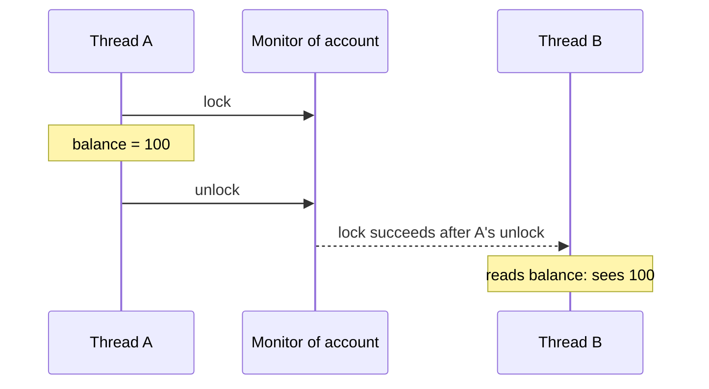

## Mental Model

Each thread works from its own notes: values kept in registers, writes waiting in a store buffer, a copy of a cache line. The JIT compiler and the CPU also reorder reads and writes whenever a single thread couldn't tell the difference. So "thread A wrote it, therefore thread B sees it" is not true by default.

The **Java Memory Model** (JMM) is the contract that says when it *is* true. Its central idea is one relation: **happens-before**. If action A happens-before action B, then B is guaranteed to see A's effects. Synchronization (locks, `volatile`, starting and joining threads) creates happens-before edges between threads. Where no edge exists, the JMM promises very little.

## Definition

- **Memory model**: the rules for which values a read may return in a multithreaded program.
- **Happens-before**: a partial order on actions. If A happens-before B, A's effects are visible to B and A is ordered before B. It comes from these rules (JLS §17.4.5):
  1. **Program order**: each action in a thread happens-before every later action in that thread.
  2. **Monitor lock**: an unlock of a monitor happens-before every later lock of the same monitor.
  3. **Volatile**: a write to a `volatile` field happens-before every later read of that field.
  4. **Thread start**: `t.start()` happens-before every action in thread `t`.
  5. **Thread termination**: every action in `t` happens-before another thread's return from `t.join()`.
  6. **Transitivity**: if A happens-before B and B happens-before C, then A happens-before C.
- **Data race**: two accesses to the same variable from different threads, at least one a write, not ordered by happens-before.
- **Correctly synchronized** (data-race-free) program: one with no data races. The JMM guarantees such programs behave as if all actions ran one at a time in some order (**sequential consistency**).

## Why It Exists

**The problem.** Java promises "write once, run anywhere", and that has to include threads. But CPUs disagree about memory ordering: x86 lets a later read overtake an earlier write, ARM and POWER allow much more. JIT compilers also cache values in registers and move code around. Without a contract, the same program could be correct on a laptop and broken on an ARM server.

**Without it.** Java's original memory model (before Java 5) was weak and confusing, and common idioms were broken under it. `final` fields could be seen changing, and `volatile` didn't stop nearby writes from being reordered around it. JSR-133, in Java 5 (2004), replaced it with today's model.

**The idea.** Let the compiler and CPU optimize freely *between* synchronization points, and make the synchronization points create ordering. Programmers who avoid data races get simple behaviour, as if threads took turns. Everyone else gets precisely specified, but surprising, behaviour.

:::callout[That's all it is]{type=insight}
Writes become visible to another thread only along a chain of happens-before edges: same-thread order, unlock → lock, volatile write → read, start, join. Put one of those between the writer and the reader and you're safe; leave it out and you have a data race.
:::

## How It Works

### volatile: visibility and ordering for one variable

```java
class Worker implements Runnable {
    private volatile boolean running = true;   // without volatile, the loop may never end

    public void run() {
        while (running) {
            doWork();
        }
    }

    public void stop() { running = false; }    // called from another thread
}
```

Without `volatile`, nothing in the loop changes `running`, so the JIT may read it once and keep it in a register forever. With `volatile`, every read goes to memory, and the write in `stop()` happens-before the next read that sees it.

A volatile write also **publishes everything written before it**. Through program order and transitivity, writes that came earlier in the writing thread become visible to a thread that reads the volatile and sees the new value:

```java
private Config current;                      // set once at startup, then read by request threads
private volatile boolean ready = false;

// Thread A (startup)                         // Thread B (request)
current = loadConfig();                       if (ready) {
ready = true;                                     use(current);   // guaranteed to see the loaded config
                                              }
```

`volatile` does **not** make compound actions atomic: `count++` on a volatile field is still a read, an add and a write ([Race Conditions](lesson:os-race-conditions)).

### synchronized: mutual exclusion plus visibility

```java
class Account {
    private long balance;                     // guarded by "this"

    synchronized void deposit(long amount) { balance += amount; }
    synchronized long balance() { return balance; }
}
```

`synchronized` gives two guarantees, not one. Only one thread runs a block guarded by the same monitor at a time, and the unlock at the end of `deposit` happens-before the lock at the start of the next `balance()`. That second guarantee is why the *reader* must synchronize too. An unsynchronized `balance()` could return a stale value even though every writer locks.



### final fields and safe publication

**Publishing** an object means making a reference to it reachable by another thread. If you publish through a plain field, with no happens-before edge, the other thread can see the reference before it sees the constructor's writes to the object's fields.

`final` fields are the exception. When a constructor finishes, its `final` fields are "frozen". Any thread that obtains a reference to the object, even through a data race, sees those fields with their constructed values. That's why immutable objects are thread-safe:

```java
record Point(int x, int y) {}                 // record fields are final: safe to share, even via a race

final class Range {
    private final int low, high;              // frozen when the constructor finishes
    Range(int low, int high) { this.low = low; this.high = high; }
}
```

The guarantee holds only if the constructor doesn't leak `this` before it finishes (for example by registering a listener). A `final` field that refers to a mutable object guarantees the reference is visible, and the referenced object's state as of the end of the constructor, but not later changes to it.

Safe ways to publish a mutable object: store it in a `volatile` field, a `final` field, a field guarded by a lock, a static initializer, or a concurrent collection.

### Lazy initialization, done right

Double-checked locking is correct only with `volatile`:

```java
class Registry {
    private static volatile Registry instance;

    static Registry get() {
        Registry r = instance;                       // one volatile read on the fast path
        if (r == null) {
            synchronized (Registry.class) {
                r = instance;
                if (r == null) instance = r = new Registry();
            }
        }
        return r;
    }
}
```

Without `volatile`, another thread can see a non-null `instance` before the constructor's writes. The simpler alternative relies on class initialization, which the JVM already runs under a lock exactly once:

```java
class Registry {
    private Registry() {}
    private static class Holder { static final Registry INSTANCE = new Registry(); }
    static Registry get() { return Holder.INSTANCE; }    // loaded on first call, thread-safe
}
```

### What java.util.concurrent promises

Every class in `java.util.concurrent` documents its "memory consistency effects", and they are happens-before edges. Actions in a thread before putting an object into a concurrent collection happen-before actions after another thread takes it out. Actions before `executor.submit(task)` happen-before the task runs, and the task's actions happen-before `future.get()` returns. That's why handing work to another thread through a `BlockingQueue` or an `ExecutorService` needs no extra `volatile`.

## Internal Mechanism

### How the JIT implements it

The JMM is a language-level contract. The JIT meets it with whatever the CPU needs:

| Java construct | x86-64 (HotSpot) | ARMv8 |
|---|---|---|
| Plain read/write | `mov` | `ldr` / `str` |
| Volatile read | `mov` (x86 already keeps loads in order) | `ldar` (load-acquire) |
| Volatile write | `mov` followed by `lock addl $0,(rsp)`, a full fence | `stlr` (store-release) |
| `synchronized` enter/exit | A CAS on the object's header; parks via a futex when contended | The same, with acquire/release instructions |

So on x86 a volatile read is almost free, and a volatile write costs a fence (tens of cycles). On ARM both cost a little. Equally important is what the JIT may *not* do: it can't keep a volatile in a register, hoist its read out of a loop, or move other memory accesses across it in the forbidden directions.

:::depth{level=advanced}
### Finer-grained access modes: VarHandle

Since Java 9, `VarHandle` (and the matching methods on `AtomicInteger` and friends) exposes the same access modes as C++ atomics:

| Mode | Guarantee | Typical use |
|---|---|---|
| Plain (`get`/`set`) | None beyond the single thread | Thread-confined data |
| Opaque | Each access really happens and is atomic; no ordering with others | Progress flags, statistics |
| Acquire / release (`getAcquire`, `setRelease`) | A release write publishes earlier writes to an acquire read that sees it | Lock-free queues, single-writer publication |
| Volatile (`getVolatile`, `setVolatile`) | Acquire/release plus one total order of all volatile accesses | The default; same as a `volatile` field |

Release/acquire is enough for the publication pattern above and is cheaper on ARM. Volatile also forbids a later read from overtaking an earlier write, which algorithms such as Peterson's ([Critical Sections](lesson:os-critical-section-problem)) need. Use the weaker modes only with a stress test that proves the code correct.
:::

### Tearing of long and double

The JLS (§17.7) allows a write to a non-volatile `long` or `double` to be split into two 32-bit halves. A racing reader could then see half of each value. 64-bit HotSpot writes them atomically in practice, but the language doesn't promise it; `volatile long` does.

## Example

Reloading configuration while request threads read it, with no locks on the read path:

```java
record Config(int timeoutMs, int maxConnections) {}     // immutable: final fields

class ConfigHolder {
    private volatile Config current = new Config(1000, 50);

    Config get() { return current; }                    // a volatile read: always a complete config

    void reload(Properties p) {
        Config fresh = new Config(                      // build the whole object first
            Integer.parseInt(p.getProperty("timeoutMs")),
            Integer.parseInt(p.getProperty("maxConnections")));
        current = fresh;                                // then publish it with one volatile write
    }
}
```

A request thread sees either the old config or the new one, never a mix, for two reasons. The volatile write happens-before the read that sees it, and an immutable `Config` has nothing half-written to see. This is copy-on-write publication: never modify the shared object; build a new one and swap the reference.

## Complexity & Performance

| Operation | Approximate cost (uncontended) |
|---|---|
| Volatile read on x86 | Same as a plain read |
| Volatile write on x86 | ~20–40 cycles (fence) |
| `synchronized` enter + exit | ~20 ns |
| Contended `synchronized` (thread parks) | Microseconds: futex system calls and context switches |
| `AtomicLong.incrementAndGet()` | ~5–20 ns uncontended; serializes on one cache line under contention |

The bigger cost of missing synchronization is in the optimizations it blocks: a volatile read in a hot loop can't be hoisted, so keep volatile accesses out of tight inner loops when the value can be read once outside.

## Trade-offs

| Tool | Gives | Doesn't give | Use for |
|---|---|---|---|
| `volatile` | Visibility and ordering for one variable | Atomic compound actions | Flags, publishing a reference to an immutable object |
| `synchronized` / `ReentrantLock` | Mutual exclusion and visibility | Lock-free progress | Invariants that span several fields |
| `java.util.concurrent.atomic` | Atomic read-modify-write on one variable | Multi-variable invariants | Counters, CAS loops |
| Immutability (`final`, records) | Safe sharing with no synchronization | Updates in place | Values, configuration, messages |
| Concurrent collections and executors | Documented happens-before edges | Compound actions across calls | Handing data between threads |

## Failure Modes

- **A stop flag without `volatile`**: the worker loops forever, but only after the JIT compiles the loop, so it often passes tests and fails in production.
- **Unsafe publication**: an object stored in a plain field is seen with default (zero or null) field values.
- **Double-checked locking without `volatile`**: rare reads of a half-constructed singleton.
- **Leaking `this` from a constructor**: other threads can see `final` fields before they are frozen.
- **`volatile` counters**: lost updates, because `++` is not atomic.
- **Reading under no lock what is written under a lock**: the reader has no happens-before edge and may see stale values.

## In Production

- Most code should never need to reason about the JMM directly. Use `java.util.concurrent` (concurrent maps, queues, executors, `CompletableFuture`), immutable objects and records; their happens-before guarantees are documented.
- Frameworks rely on safe publication for you: Spring creates singleton beans and publishes them to request threads through synchronized registries.
- To test lock-free code, use **jcstress**, the OpenJDK harness that runs a pattern millions of times on real hardware and reports which outcomes appeared, including the "impossible" ones.
- Code review rule of thumb: every field shared between threads should be `final`, `volatile`, guarded by a named lock, or confined to one thread, and the comment should say which.

## Deeper Connections

- The hardware behaviour the JMM abstracts over (store buffers, reordering, cache coherence) is in [Race Conditions](lesson:os-race-conditions) and [CPU Caches & Contention](lesson:os-cpu-caches-contention).
- CAS and memory fences are the building blocks: [Atomic Instructions](lesson:os-atomic-instructions).
- Database isolation levels are memory models for transactions, and "data-race-free → sequentially consistent" mirrors "serializable → behaves like one transaction at a time" ([Consistency Models](lesson:db-consistency-models)).

## Common Misconceptions

- **"`volatile` makes operations atomic."** It makes single reads and writes visible and ordered; `count++` still races.
- **"`synchronized` is only about mutual exclusion."** It's also a visibility guarantee, so the reader needs it too.
- **"x86 is strongly ordered, so I don't need `volatile`."** The JIT reorders and caches values in registers regardless of the CPU.
- **"`final` means immutable."** A `final` field can refer to a mutable object; only the reference is fixed.
- **"If I can see the reference, I can see the fields."** Only for `final` fields, or if the object was safely published.

## Interview Questions

### [L1 · conceptual] What is the Java Memory Model, and why does Java need one?

It's the part of the language specification that defines which values a read may return when several threads access shared memory. Java needs it because compilers and CPUs reorder and cache memory operations differently on each platform, and Java promises the same behaviour everywhere. It is defined through happens-before: if a write happens-before a read, the read sees it. Programs without data races are guaranteed to behave sequentially consistently.

### [L2 · compare] volatile vs synchronized?

`volatile` applies to one field: every read sees the latest write, a write happens-before later reads that see it, and accesses can't be reordered across it. It doesn't make compound actions atomic and doesn't exclude other threads. `synchronized` provides mutual exclusion for a block of code plus visibility: everything written before an unlock is visible to the next thread that locks the same monitor. Use `volatile` for flags and publishing immutable references; use `synchronized` (or a `Lock`) when an invariant spans several fields or needs read-modify-write.

### [L2 · how] What is happens-before? Name its main rules.

A partial order between actions that guarantees visibility and ordering: if A happens-before B, B sees A's effects. Rules: program order within a thread; an unlock happens-before a later lock of the same monitor; a volatile write happens-before a later read of that field; `Thread.start()` happens-before the started thread's actions; a thread's actions happen-before another thread's return from `join()` on it; and transitivity. `java.util.concurrent` adds documented edges, such as `put` → `take` on a queue and task completion → `Future.get()`.

### [L2 · how] How do you make a lazily initialized singleton thread-safe?

Two correct ways. Double-checked locking with the field declared `volatile`: check without the lock, lock, check again, create and assign. The volatile write publishes the fully constructed object. Or, more simply, the holder idiom: a nested static class with a `static final` field. The JVM initializes a class lazily, on first use, under its own lock exactly once, so the instance is created and safely published without any explicit synchronization. An `enum` singleton works for the same reason.

### [L3 · what-if] An object is created and assigned to a plain field, and another thread reads that field without synchronization. What can it see?

It may see `null`, or the reference with the object's fields still at their default values (0, `null`, `false`), because the assignment of the reference can become visible before the constructor's writes. There is no happens-before edge, so this is a data race. The exceptions are `final` fields, which are guaranteed to be seen as constructed once the constructor has finished, provided `this` didn't escape. Fix by publishing safely: a `volatile` or `final` field, a lock, or a concurrent collection.

### [L3 · how] How do final fields make immutable objects thread-safe without synchronization?

At the end of a constructor, the JMM "freezes" the object's `final` fields. Any thread that later obtains a reference to the object, by any means including a data race, sees those fields with at least the values they had at the freeze, and so does anything reachable through them as of that point. So an immutable object (all fields `final`, nothing modified after construction, `this` not leaked) can be shared freely. The guarantee doesn't cover changes made to mutable objects reachable through those fields after construction.

### [L3 · debugging] A background thread loops on `while (!shutdown)` and never exits after another thread sets `shutdown = true`, but only in production, not in a debugger. Why?

`shutdown` isn't `volatile`, so there is no happens-before edge from the write to the reads. Once the JIT compiles the hot loop, it may read `shutdown` once and keep it in a register, because nothing in the loop changes it. In a debugger or with logging, the code runs interpreted or with method calls that act as barriers, so it happens to work. Declare `shutdown` `volatile`, or use an `AtomicBoolean`, or interrupt the thread and check `Thread.interrupted()`.

### [L4 · design] You must publish a frequently reloaded configuration to hundreds of request threads with no locking on the read path. Design it.

Make the configuration an immutable object (a record, or `final` fields with defensive copies of any collections). Keep the current instance in a `volatile` field. To reload, build and validate a complete new object, then assign it with a single volatile write. Readers do one volatile read per request (nearly free on x86) and always see a complete config, either old or new. Never mutate the published object. If reloads can race, guard the build-and-swap with a lock or use `AtomicReference.compareAndSet`.

## Practice

### [mcq] Thread A runs `data = 42; ready = true;` and thread B runs `if (ready) print(data);`. Which declaration guarantees that B prints 42 whenever it prints anything?

- [ ] `int data` and `boolean ready`, both plain
- [x] `volatile boolean ready` (data can stay plain)
- [ ] `volatile int data` (ready can stay plain)
- [ ] `final boolean ready`

The volatile write of `ready` happens-before B's read that sees `true`. By program order and transitivity, A's earlier write to `data` happens-before B's read of `data`. Making only `data` volatile doesn't help: nothing orders it with the plain `ready`. Try the interleavings in the [race condition lab](lab:race-condition).

### [numeric 4] Fields `x` and `y` are plain `int`s, both 0. Thread A runs `x = 1; y = 1;` and thread B runs `r1 = y; r2 = x;`. How many of the four combinations of (r1, r2) does the JMM allow?

:::answer
All **4**: (0, 0) if B runs first; (1, 1) if A runs first; (0, 1) if B reads `y` before A's writes and `x` after; and (1, 0). That last one means B saw the second write but not the first, which is allowed because there is a data race: the JIT or CPU may reorder A's writes or B's reads.
:::

### [numeric 3] Same program, but `y` is declared `volatile`. How many of the four combinations are allowed now?

:::answer
**3**. If B reads `r1 = 1`, its read of the volatile `y` saw A's volatile write, which creates a happens-before edge. A's `x = 1` comes before it in program order, so B's later read of `x` must return 1. That rules out (1, 0), leaving (0, 0), (0, 1) and (1, 1).
:::

### [mcq] Which statement about `volatile int count` shared by four threads that each run `count++` is true?

- [ ] It always ends at the right total, because volatile makes `++` atomic
- [x] Updates can still be lost, because `++` is a separate read and write; each access is merely visible
- [ ] It doesn't compile
- [ ] It deadlocks

Use `AtomicInteger.incrementAndGet()` or `LongAdder` for counters.

### [exercise] This lazily initialized cache is sometimes seen half-built by request threads. Explain why, then fix it in two different ways.

```java
class PriceCache {
    private static PriceCache instance;
    private final Map<String, Long> prices = new HashMap<>();

    static PriceCache get() {
        if (instance == null) {
            synchronized (PriceCache.class) {
                if (instance == null) instance = new PriceCache();
            }
        }
        return instance;
    }
}
```

:::solution
The first `if (instance == null)` reads `instance` without the lock. Without `volatile`, there's no happens-before edge between the writing thread's construction and that read. A reader can see a non-null `instance` while the writes made in its constructor (and in any loading code that ran before the assignment) aren't yet visible to it.

**Fix 1: double-checked locking with volatile.**

```java
private static volatile PriceCache instance;
```

The volatile write in the synchronized block publishes the constructed object; the unlocked fast-path read is then a volatile read that sees it.

**Fix 2: the holder idiom.**

```java
class PriceCache {
    private PriceCache() { /* load prices */ }
    private static class Holder { static final PriceCache INSTANCE = new PriceCache(); }
    static PriceCache get() { return Holder.INSTANCE; }
}
```

Class initialization runs once, under the JVM's lock, the first time `Holder` is used, and makes its results visible to every thread that later uses the class. Also note that a `HashMap` mutated after publication still needs its own synchronization; if prices change at runtime, use a `ConcurrentHashMap` or publish an immutable `Map.copyOf(...)`.
:::

### [exercise] Request threads read a feature-flag map that an admin thread replaces every few minutes. The current code is `Map<String, Boolean> flags = new HashMap<>();` and the admin thread calls `flags.clear(); flags.putAll(newFlags);`. List what can go wrong and redesign it without locking the read path.

:::solution
What can go wrong:
- Readers access a `HashMap` while it's being modified: a data race that can return stale or missing entries or throw `ConcurrentModificationException`. Older JDKs could even loop forever during a concurrent resize.
- Between `clear()` and `putAll()`, readers see an empty map, so every flag reads as off.
- There's no happens-before edge, so readers might not see the new entries at all.

Redesign: publish an immutable snapshot through a volatile reference.

```java
private volatile Map<String, Boolean> flags = Map.of();

boolean enabled(String name) {
    return flags.getOrDefault(name, false);       // one volatile read, then an immutable map
}

void replace(Map<String, Boolean> newFlags) {
    flags = Map.copyOf(newFlags);                 // build fully, then publish atomically
}
```

Readers always see a complete map, old or new. `Map.copyOf` is immutable, so nothing can change under a reader, and the volatile write gives the happens-before edge.
:::

## Quick Revision

- JMM = which writes a read may see. Core relation: **happens-before** (program order, unlock → lock, volatile write → read, start, join, transitivity).
- **Data-race-free** programs behave sequentially consistently; racy ones can see reordered results.
- `volatile`: visibility + ordering for one field; publishes earlier writes; **not** atomic `++`.
- `synchronized`: mutual exclusion **and** visibility; readers must lock too.
- `final` fields are frozen at the end of the constructor → immutable objects are safe to share; don't leak `this`.
- Lazy singletons: double-checked locking needs `volatile`; the holder idiom needs nothing.
- JIT on x86: volatile read = plain load; volatile write = store + `lock addl` fence. ARM: `ldar`/`stlr`.
- Prefer `java.util.concurrent` and immutability; test lock-free code with jcstress.
