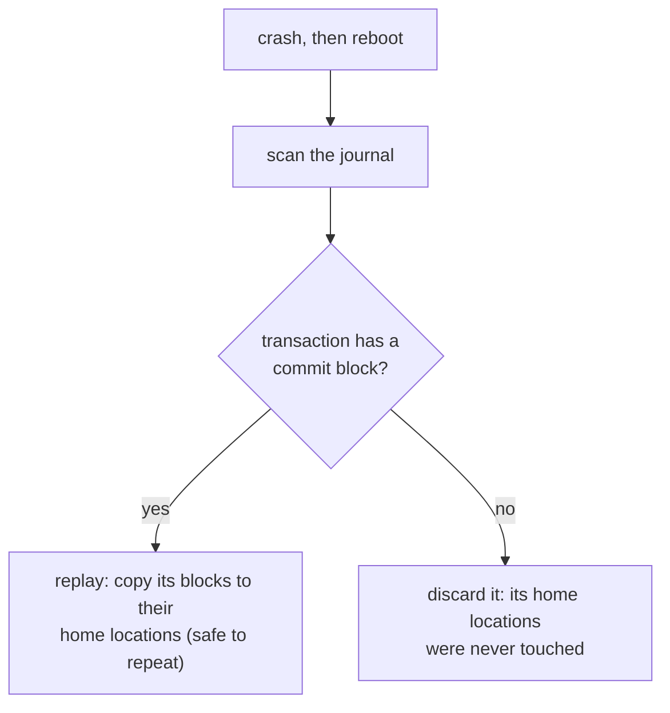

## Mental Model

Appending one block to a file is not one write — it's several: update the **data block**, the **inode** (new size, new block pointer), and the **block bitmap** (mark the block used). The disk writes them one at a time, in an order you don't fully control. If power fails between them, the filesystem is left **half-updated**. Three things can go wrong:

- an inode points to a block still marked free, which will be handed out again (two files sharing a block);
- a block is marked used but nothing points to it (leaked space);
- an inode points to garbage.

**Journaling** is the same trick a careful accountant uses: *first write down in a notebook exactly what you're about to change, then make the changes.* After a crash, read the notebook and redo any change that was recorded completely. Ignore any change that was only half-written in the notebook itself.

## Definition

- **Crash consistency**: the property that on-disk structures are valid after an unexpected crash or power loss at any point.
- **fsck**: a tool that scans the entire filesystem after a crash to find and repair inconsistencies — slow (proportional to disk size).
- **Journaling (write-ahead logging for filesystems)**: before updating on-disk structures, write a description of the update to a **journal**, then a **commit** record; after a crash, **replay** committed transactions.
- **fsync(fd)**: request that all modified data and metadata of a file be written to stable storage before returning. **fdatasync** skips metadata not needed to read the data (like mtime).

## Why It Exists

**The problem.** One logical change ("append a block") is several physical writes, and the disk can only promise each write individually. A crash can land between any two of them.

**Without it.** Every crash requires a full fsck — minutes to hours on large disks — and even fsck can't recover lost data, only make structures consistent.

**The idea.** You can't make several writes atomic, but you *can* make one small write atomic — a single commit block. So first write the whole change somewhere harmless (the journal), then flip one commit block saying "this change is complete", and only then touch the real structures. After a crash, any change with a commit block can be redone; any change without one never touched anything. Journaling makes recovery proportional to the journal size (seconds) and guarantees metadata consistency.

:::callout[That's all it is]{type=insight}
Write down what you're about to do, mark it "committed", then do it. After a crash, redo whatever was committed and ignore the rest. This is the same write-ahead logging databases use.
:::

## How It Works

### The journaling protocol

::::steps[Metadata journaling (ext4 ordered mode) for an append]
1. **Write data** block(s) to their final location (ordered mode: data before metadata commit).
2. **Journal write**: write a transaction-begin block plus the new versions of the inode and bitmap blocks to the journal area.
3. **Journal commit**: after step 2 is durable (a barrier/flush), write a small commit block. Once the commit block is durable, the transaction is committed.
4. **Checkpoint**: later, write the metadata blocks to their home locations.
5. **Free** the journal space once checkpointing is complete.
::::

After a crash, recovery scans the journal. Transactions with a valid commit block are **replayed**: their blocks are written to their home locations, which is idempotent, so replaying twice is harmless. Transactions without a commit block are discarded. Their home locations were never touched, so the old state is intact.



### Journaling modes (ext4)

| Mode | What goes into the journal | Guarantee | Cost |
|---|---|---|---|
| `data=journal` | Data and metadata | Data and metadata consistent | Every data block written twice |
| `data=ordered` (default) | Metadata only; data written before metadata commits | No metadata pointing to garbage | Moderate |
| `data=writeback` | Metadata only, no ordering | Metadata consistent, but files may contain stale/garbage data after crash | Fastest |

::lab{id=journaling}

### Copy-on-write filesystems

A different answer to the same problem: if the danger is a half-overwritten structure, *never overwrite anything*. Btrfs and ZFS never overwrite live blocks. An update writes new copies of data and every metadata block up to the root, then atomically switches the root pointer (the **uberblock/superblock**). A crash leaves either the old tree or the new tree — always consistent, no journal replay needed (ZFS adds an intent log for fast synchronous writes). Bonus: snapshots are free, and checksums detect silent corruption.

## Internal Mechanism

### What fsync really guarantees (and what it doesn't)

Journaling keeps the filesystem *consistent*; it doesn't make your data *durable* the moment you write it — those are different promises. `write()` only copies data into the **page cache**; it returns long before the data is on disk ([Page Cache](lesson:os-page-cache)). Durability requires `fsync`:

- `fsync(fd)` flushes the file's dirty data and metadata and issues a **device cache flush** (or FUA writes) so the drive's volatile cache doesn't lose it.
- **Creating or renaming a file modifies the directory**, so for a new file to survive a crash you must also `fsync` the **directory**.
- If `fsync` returns an error (EIO), the dirty pages may have been dropped — retrying fsync may return success without the data ever reaching disk. PostgreSQL discovered this ("fsyncgate", 2018) and now panics on fsync failure and recovers from WAL.

### The atomic-replace pattern

The problem: overwriting a file in place means a crash can leave it half old, half new. But `rename` is atomic — a name points to one inode or the other, never a mix. So write a complete new file, then swap the name. Updating a config or state file safely, in Java:

```java
static void writeAtomically(Path path, byte[] content) throws IOException {
    Path target = path.toAbsolutePath();
    Path tmp = target.resolveSibling(target.getFileName() + ".tmp");
    try (FileChannel ch = FileChannel.open(tmp, StandardOpenOption.CREATE,
            StandardOpenOption.WRITE, StandardOpenOption.TRUNCATE_EXISTING)) {
        ByteBuffer buf = ByteBuffer.wrap(content);
        while (buf.hasRemaining()) ch.write(buf);
        ch.force(true);                                   // 1. new contents durable (fsync)
    }
    Files.move(tmp, target, StandardCopyOption.ATOMIC_MOVE);  // 2. atomic replace: rename(2) on Linux
    try (FileChannel dir = FileChannel.open(target.getParent(), StandardOpenOption.READ)) {
        dir.force(true);                                  // 3. make the rename itself durable
    }
}
```

`FileChannel.force(true)` is `fsync` (data and metadata); `force(false)` is closer to `fdatasync`. Opening a directory as a `FileChannel` to fsync it works on Linux but not on Windows.

Readers see either the old file or the complete new file — never a partial one. Skipping step 1 can leave a zero-length file after a crash on some filesystems (ext4's "rename" heuristics mitigate but don't guarantee this).

:::depth{level=advanced}
### Write ordering, barriers and lying disks

Journaling depends on ordering: the commit block must not reach stable storage before the journal contents. Drives reorder writes in their caches, so filesystems issue **flush** commands (or use **FUA** — force unit access — writes) at the right points. If a drive acknowledges flushes without honoring them (some consumer drives, some virtualized storage configurations), journaling's guarantees silently disappear. Enterprise drives with **power-loss protection** can safely acknowledge writes from capacitor-backed cache, which makes fsync fast.
:::

## Example

Why `fsync` latency matters: a database commit must wait for its WAL record to be durable. On an NVMe drive with power-loss protection, `fdatasync` may take ~20–100 µs; on a consumer SSD that truly flushes its cache, several milliseconds; on network block storage, ~1 ms. That number caps single-client commit throughput (1 / fsync latency) unless commits are batched (**group commit**) — see [WAL & Durability](lesson:db-wal-durability).

## Complexity & Performance

- Journaling adds writes (metadata twice; data twice in `data=journal`), but journal writes are sequential.
- Recovery time ∝ journal size (seconds) vs fsck ∝ disk size (minutes–hours).
- `fsync` cost is dominated by the device flush; frequent small fsyncs are expensive — batch them.

## Trade-offs

- **Journaling vs COW**: journaling keeps data in place (good for DB random updates) at the cost of double writes; COW gives snapshots and checksums but fragments and has its own write amplification.
- **Ordered vs writeback mode**: safety vs speed.
- **Durability vs latency**: applications choose how often to fsync (every commit, every second, never) — e.g., Redis AOF `appendfsync always|everysec|no`.

## Failure Modes

- **Lost writes** because the application never called fsync (data sat in the page cache when the machine lost power).
- **Zero-length or truncated files** after crash when replacing files without fsync-before-rename.
- **Missing new files** after crash because the parent directory wasn't fsync'd.
- **Silent corruption** (bit rot) undetected by non-checksumming filesystems.
- **fsync error handling bugs** leading to acknowledged-but-lost data.

## In Production

- Databases take durability into their own hands with a WAL and explicit `fsync`/`fdatasync`, often with `O_DIRECT` for data files ([WAL](lesson:db-wal-durability)).
- Message brokers expose the trade-off: Kafka relies on replication rather than per-message fsync by default; RabbitMQ quorum queues fsync.
- Cloud disks: "durable" depends on the provider's replication below the block device; instance-local NVMe is lost with the instance.

## Deeper Connections

- Filesystem journaling is exactly database write-ahead logging applied to metadata ([Crash Recovery](lesson:db-crash-recovery)).
- The whole chain from `write()` to durable bytes, across OS, DB and replication: [Durability Chain](lesson:x-durability-chain).

## Common Misconceptions

- **"write() returning success means the data is on disk."** It's in the page cache.
- **"Journaling protects my file contents."** In the default ordered mode, it protects metadata consistency; your application still needs fsync for durability of its data.
- **"fsync on the file is enough for a new file."** The directory entry needs a directory fsync.

## Interview Questions

### [L2 · why] Why do filesystems need journaling?

A single logical operation (append, create, rename) updates several on-disk structures — data blocks, inode, bitmaps, directory — that are written separately. A crash in between leaves them inconsistent. Journaling writes the intended changes to a log and commits them atomically first; recovery replays committed transactions and discards incomplete ones, restoring consistency quickly without a full fsck.

### [L2 · compare] Compare data=journal, data=ordered and data=writeback modes.

`data=journal` logs both data and metadata: strongest, but data is written twice. `data=ordered` logs only metadata and forces data blocks to disk before the metadata transaction commits, so metadata never points to uninitialized data. `data=writeback` logs metadata without ordering data writes: fastest, but after a crash a file may contain stale or garbage blocks.

### [L2 · conceptual] What does fsync guarantee?

That when it returns successfully, all previously written data and metadata of that file have been transferred to stable storage (including flushing the device's volatile write cache). It doesn't guarantee the directory entry of a newly created file is durable — that needs an fsync on the directory — and if it returns an error, the data may be lost.

### [L3 · how] How do you atomically and durably replace a file's contents?

Write the new contents to a temporary file in the same directory, fsync it, rename it over the target (rename is atomic on POSIX filesystems), then fsync the directory so the rename is durable. Readers see either the old or the new file.

### [L3 · compare] How does a copy-on-write filesystem stay consistent without a journal?

It never modifies live blocks in place. Changes are written to new locations, including new copies of every metadata block up the tree to the root; finally the root pointer is switched atomically. If a crash happens before the switch, the old consistent tree is used; after, the new one.

### [L4 · incident] After a power outage, a service's local state file is zero bytes and it fails to start. The code writes the file with open(path, "w") and write(). What went wrong and how do you fix it?

Opening with "w" truncates the file immediately; the new contents lived only in the page cache when power failed. The truncation (metadata) reached the journal but the data didn't. Fix: write to a temp file, fsync it, atomically rename over the original, fsync the directory; add checksums/versioning to detect corruption; and keep a previous good copy.

## Practice

### [mcq] A journaled transaction was fully written to the journal but its commit block was not written before a crash. During recovery:

- [ ] The transaction is replayed
- [x] The transaction is discarded; home locations still hold the old state
- [ ] fsck must scan the entire disk
- [ ] The journal is corrupted and the filesystem can't mount

Only committed transactions are replayed.

### [mcq] After creating a new file, writing to it and calling fsync on its fd, what else is needed to guarantee the file exists after a crash?

- [ ] Nothing
- [ ] Calling sync() on the whole system
- [x] fsync on the parent directory
- [ ] Closing the file

The directory entry is part of the directory's data.

### [numeric 500] Each `fsync` on a server's disk takes 2 ms. A single thread commits transactions one at a time, each waiting for its own fsync. What is the maximum number of commits per second?

:::answer
1 / 0.002 s = **500** commits per second, no matter how fast the CPU is. Durable commits are limited by flush latency.
:::

### [numeric 25000] The same database adds group commit: one `fsync` makes 50 waiting transactions durable together. What is the maximum commit rate now?

:::answer
500 fsyncs per second × 50 commits each = **25000** commits per second. Each commit waits about the same time, but the flush cost is shared, which is why databases batch commits.
:::

### [mcq] What is the difference between `FileChannel.force(true)` and `force(false)` in Java?

- [ ] `force(true)` also closes the channel
- [x] `force(true)` flushes the file's content and its metadata (like `fsync`); `force(false)` may skip metadata not needed to read the data (like `fdatasync`)
- [ ] `force(false)` only flushes to the page cache
- [ ] They are identical on Linux

Both make the file's data durable. Skipping metadata such as the modification time can save a write, which is why logs that preallocate their file use `force(false)`. A size change, though, is metadata that matters, so appending to a file still has to write it.

### [exercise] A Java service saves its state with `Files.writeString(Path.of("state.json"), json)` every minute. After a power cut, `state.json` is empty and the service won't start. Explain what happened at the filesystem level and rewrite the save so a crash leaves either the old or the new file, complete.

:::solution
`Files.writeString` opens the file with truncation, writes, and closes, but never calls `fsync`. Truncating to zero changed metadata, which the journal committed quickly. The new contents were still only in the page cache when the power failed, so after the reboot the file was empty.

The fix is the atomic-replace pattern from this lesson: write the new JSON to `state.json.tmp`, `force(true)` it, `Files.move(tmp, target, ATOMIC_MOVE)`, then `force(true)` on the directory (the `writeAtomically` method above). A crash before the rename leaves the old file intact; a crash after it leaves the complete new file. Also validate the file on startup (a checksum or a version field) and keep the previous version as a fallback.
:::

### [exercise] In the [journaling lab](lab:journaling), choose *No journal*. Find every combination of surviving writes (D, I, B) that leaves the filesystem inconsistent, and the one that leaves it consistent but wrong. Then switch to `data=writeback` and find the crash point that gives the same wrong result. Why can `data=ordered` never give it?

:::solution
**No journal.** The filesystem is inconsistent whenever I and B disagree:
- I alone, or I and D: the inode uses a block the bitmap calls free, so the block could be handed to another file too.
- B alone, or B and D: a block is marked in use that no file uses, so the space leaks.

**Consistent but wrong: I and B without D.** The metadata agrees, but the file's new block holds whatever stale bytes were there before, possibly another file's deleted data. fsck can't detect this, because nothing is inconsistent. (D alone is harmless: the append is lost, and D sits in a block that is still free.)

**Writeback.** Crash after the commit (step 2) or the checkpoint (step 3), before the data write. The transaction committed, so recovery replays I′ and B′, and the file now points at a block that never got its data.

**Ordered.** Step 1 puts D on disk before the commit block can be written. Any transaction recovery replays therefore already has its data in place. A crash before the commit discards the metadata, and the file is simply unchanged.
:::

## Quick Revision

- One operation = several block writes → crash leaves inconsistency → fsck (slow) or journaling (fast).
- Journal: write intent → commit block → checkpoint to home → free. Recovery replays committed, discards uncommitted (idempotent).
- ext4 modes: journal (data+meta), **ordered** (default: data before meta commit), writeback.
- COW filesystems: write new tree, atomically switch root; snapshots + checksums.
- `write()` ≠ durable; **fsync** file (+ directory for new names). Atomic replace: temp → fsync → rename → fsync dir.
- Drive caches must honor flushes; fsync errors can mean lost data.
- Java: `FileChannel.force(true)` = fsync, `force(false)` ≈ fdatasync, `Files.move(..., ATOMIC_MOVE)` = rename; `Files.writeString` never fsyncs.
