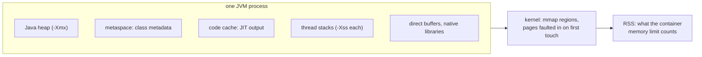

## Mental Model

The kernel has never heard of Java. To Linux, a running JVM is **one ordinary process**: a few dozen to a few thousand kernel threads, a large collection of memory mappings, some file descriptors and a set of signal handlers. Everything Java-specific is built from those parts. The heap is a big `mmap`. A platform thread is a kernel thread. The garbage collector is a group of threads that walk memory, and `NullPointerException` in compiled code starts life as a `SIGSEGV`.

So when a Java service misbehaves in production, you can ask the OS directly. Which thread is burning CPU? How big is the process really? Is it being throttled or swapped? Then map the answer back to Java.

## Definition

- **Platform thread**: a `java.lang.Thread` backed one-to-one by a kernel thread, created with `pthread_create`. The JVM's own threads (GC, JIT compilers, VM thread) are platform threads too.
- **Virtual thread**: a Java thread scheduled by the JVM onto a few platform "carrier" threads; the kernel doesn't see it ([Threads](lesson:os-threads)).
- **Java heap**: the region where objects live, reserved with `mmap` at startup (`-Xmx`) and committed as it grows.
- **Native (non-heap) memory**: everything else the JVM maps: metaspace (class metadata), code cache (JIT output), thread stacks, GC data structures, direct `ByteBuffer`s and memory used by native libraries.
- **RSS** (resident set size): the process's memory actually in RAM, heap and native together. This is what the kernel and a container's memory limit count.
- **Safepoint**: a point at which every Java thread has stopped in a known state, so the JVM can do work that needs the world paused, such as some GC phases.

## Why It Exists

**The problem.** Java's promise is that you don't have to think about the OS. That holds for correctness, but not for operations. Most production failures of Java services live in the OS layer. A container is killed for memory although the heap was half empty. GC threads exhaust a CPU quota. The host swaps the heap out, or a thread limit is hit.

**Without the mapping.** Engineers tune `-Xmx` when the problem is thread stacks, or add threads when the problem is a CPU quota. They read `RUNNABLE` in a thread dump and miss that the thread is asleep in the kernel.

**The idea.** Each Java concept has an OS counterpart you can measure: Java threads are tasks in `top -H`, the heap is a mapping in `/proc/<pid>/maps`, GC pauses are threads stopped at a safepoint. Learn the mapping once, and the standard OS tools from this course become Java tools.

:::callout[That's all it is]{type=insight}
A JVM is a normal Linux process. Its threads are kernel threads, its heap and everything else are `mmap` regions, and the kernel charges all of it to the process. Diagnose it with OS tools, then translate the answer into Java terms.
:::

## How It Works

### Anatomy of a JVM process

```text
$ ps -o pid,nlwp,rss,cmd -p 4321
  PID NLWP    RSS CMD
 4321  241 2.9G   java -Xmx2g -jar app.jar          ← 241 kernel threads, 2.9 GB resident

$ ls /proc/4321/task | wc -l                          ← the same 241 threads
$ jcmd 4321 Thread.print | grep '^"' | cut -d'"' -f2 | sort | uniq -c | sort -rn | head
    200 http-nio-8080-exec-…      request threads (Tomcat's pool)
     10 HikariPool-1 …           connection pool housekeeping
      8 GC Thread#…              parallel GC workers
      2 C2 CompilerThread…       JIT compilers
      1 VM Thread                runs safepoint operations
      1 Signal Dispatcher        receives SIGTERM, SIGQUIT and friends
      1 Reference Handler, Finalizer, Common-Cleaner, process reaper …
```

Every line is a kernel thread with its own Linux thread ID (TID). A thread dump prints that TID in hex as `nid=0x…`, which is how you match a thread in `top -H` to a Java stack (see the example below).

### Memory: the heap is only one region



Native Memory Tracking (NMT) shows the whole budget. Start the JVM with `-XX:NativeMemoryTracking=summary`, then:

```text
$ jcmd 4321 VM.native_memory summary          (abridged; numbers illustrative)
Total: reserved=6.8GB, committed=2.9GB
-         Java Heap (reserved=2048MB, committed=2048MB)
-             Class (reserved=1.1GB,  committed=160MB)     metaspace: ~25,000 loaded classes
-            Thread (reserved=245MB,  committed=245MB)     241 threads
-              Code (reserved=240MB,  committed=70MB)      JIT-compiled methods
-                GC (reserved=150MB,  committed=150MB)     card tables, remembered sets
-             Other (reserved=200MB,  committed=200MB)     direct ByteBuffers (Netty)
```

*Reserved* is address space ([Address Spaces](lesson:os-address-spaces)); *committed* is memory the JVM has asked the kernel to back. RSS is close to committed once the pages have been touched. Here the heap is 2 GB of a 2.9 GB process. A container limit of 2.5 GB would OOM-kill this service while its heap looks healthy ([Thrashing & OOM](lesson:os-thrashing-working-set)).

### Threads: what the kernel schedules

| Java | What the kernel sees |
|---|---|
| `new Thread(...).start()` | `pthread_create` → `clone()`: one new kernel thread with a stack mapping and a guard page |
| Thread in `RUNNABLE`, computing | A running or runnable task (state `R` in `top -H`) |
| Thread in `RUNNABLE` inside a socket read | A sleeping task (state `S`) on the socket's wait queue |
| `BLOCKED` / `WAITING` | A sleeping task parked on a futex |
| A virtual thread | Nothing: only its carrier thread is visible, and only while it runs |
| GC and JIT compiler threads | Ordinary tasks competing for the same CPUs and the same CPU quota |

The last row matters in containers. A JVM in a 2-CPU container may run 8 GC threads during a pause; their CPU time counts against the quota like any other thread's ([Real Schedulers](lesson:os-mlfq-real-schedulers)).

### GC and the operating system

The garbage collector is where Java and the OS meet most often:

- **Page faults**: a fresh heap is reserved, not resident. The first time the GC or the program touches each page, the kernel faults it in. `-XX:+AlwaysPreTouch` moves those faults to startup ([Page Faults](lesson:os-page-faults)).
- **Swap**: a GC walks most of the live heap. Any swapped-out heap page becomes a major fault during the pause, turning milliseconds into seconds. Keep JVMs out of swap.
- **Returning memory**: G1 gives unused heap back to the kernel after a full GC, or periodically with `-XX:G1PeriodicGCInterval`; ZGC uncommits unused memory by default. Until then, RSS stays at its high-water mark.
- **Huge pages**: a large heap with random access benefits from 2 MB pages (`-XX:+UseTransparentHugePages` or `-XX:+UseLargePages`) ([Huge Pages & NUMA](lesson:os-hugepages-numa)).
- **CPU**: concurrent collectors (G1's concurrent marking, ZGC, Shenandoah) do most work on background threads while the application runs. That shortens pauses but uses CPU the application would otherwise get.

### I/O and signals

- `java.io` and JDBC drivers make **blocking system calls**; NIO's `Selector` is **epoll**; virtual threads park on a JDK poller that also uses epoll ([epoll & Event Loops](lesson:os-epoll-event-loops)).
- `FileChannel.transferTo` is `sendfile`, and `FileChannel.map` is `mmap` ([Page Cache](lesson:os-page-cache)).
- **SIGTERM** runs shutdown hooks (exit code 143); **SIGQUIT** prints a thread dump; **SIGKILL** ends the process with no Java code running (exit code 137); **SIGSEGV** is used internally for implicit null checks ([Signals](lesson:os-signals)).

## Internal Mechanism

### How the JVM stops every thread: safepoints

Some work needs all Java threads stopped at known points, for example to move objects or scan stacks. HotSpot can't pause a thread at an arbitrary instruction, because it must know where every object reference is. So JIT-compiled code contains **safepoint polls**: cheap checks at method returns and loop back-edges. To stop the world, the VM thread arms the poll (a per-thread flag since JDK 10's thread-local handshakes). Each thread notices at its next poll and parks. When all threads have arrived, the operation runs; then they are released.

The catch is **time to safepoint**. One thread in a long loop that the JIT compiled without a poll keeps everyone else waiting, so a "10 ms GC" can be a 500 ms pause. Measure it with `-Xlog:safepoint`, which reports how long reaching the safepoint took separately from the operation itself.

:::depth{level=advanced}
### Why `RUNNABLE` can mean asleep, and `nid` can find it

The JVM sets a thread's Java state when it crosses into native code: a thread entering a native socket read is marked `RUNNABLE` (Java can't know whether the kernel will block it). The kernel's view is in `/proc/<pid>/task/<tid>/stat` (state `S` for sleeping, `R` for running) and in `top -H`. To reconcile the two, convert the TID from `top -H` to hex and search the thread dump for `nid=0x…`. The same TID appears in `perf` and async-profiler output, so per-thread CPU, stacks and kernel state can all be joined on it.
:::

## Example

A Java service suddenly uses one full core more than usual. Find the thread and the code:

```text
$ top -H -p 4321                          # per-thread CPU inside the JVM
  PID USER     %CPU COMMAND
 4398 app      99.7 http-nio-8080-e        ← one request thread stuck at 100%

$ printf '%x\n' 4398                       # thread dumps print the TID in hex
112e

$ jcmd 4321 Thread.print | grep -A6 'nid=0x112e'
"http-nio-8080-exec-7" #57 daemon prio=5 os_prio=0 ... nid=0x112e runnable
   java.lang.Thread.State: RUNNABLE
        at java.util.regex.Pattern$Loop.match(Pattern.java:5045)
        at java.util.regex.Pattern$GroupTail.match(Pattern.java:4863)
        ...
        at com.example.EmailValidator.isValid(EmailValidator.java:42)
```

One request's input triggered catastrophic backtracking in a regular expression. The OS showed *which* thread; the thread dump showed *which code*. Take two or three dumps a few seconds apart to confirm the thread stays there.

## Complexity & Performance

| Operation | Typical cost |
|---|---|
| Start a platform thread | ~20–50 µs, a kernel thread plus a stack mapping |
| Start a virtual thread | ~1 µs, a heap object |
| JVM startup to `main` | ~50–100 ms; frameworks add class loading (CDS and AOT caches reduce it) |
| Young-generation GC pause (G1) | A few ms to tens of ms, depending on live data |
| ZGC / Shenandoah pause | Usually under 1 ms; costs extra CPU and memory instead |
| Safepoint with a slow-to-arrive thread | Bounded by the slowest thread's next poll |

## Trade-offs

- **Platform vs virtual threads**: platform threads are visible to every OS tool and preempted by the kernel; virtual threads scale to millions of blocking tasks but hide from `top -H` and don't time-slice CPU-bound work.
- **Throughput vs pause-time collectors**: Parallel GC uses the least CPU overall but pauses longest; G1 balances; ZGC and Shenandoah cut pauses to sub-millisecond at a cost in CPU and memory.
- **Heap size vs headroom**: a bigger heap means fewer collections, but less room for native memory and the page cache within a fixed limit.
- **Pre-touching**: `AlwaysPreTouch` gives predictable runtime latency in exchange for slower startup and full RSS from the first second.

## Failure Modes

- **OOMKilled with a healthy heap**: native memory (threads, metaspace, direct buffers, code cache) pushed RSS over the container limit.
- **`OutOfMemoryError: unable to create native thread`**: `pthread_create` failed. Usually the process or user hit a thread limit (`ulimit -u`, cgroup `pids.max`), sometimes memory for stacks. Look for a thread leak before raising limits.
- **GC + swap**: pauses of seconds to minutes when the collector touches swapped-out pages.
- **CPU throttling from GC**: parallel GC threads exhaust the container's CPU quota during a pause, stretching it.
- **Long time-to-safepoint**: one thread delays every other thread's progress.
- **File descriptor leaks**: unclosed streams and sockets until `Too many open files` ([File Descriptors](lesson:os-file-descriptors)).

## In Production

A starting set of JVM flags for a containerized service:

```bash
java -XX:MaxRAMPercentage=70 \
     -XX:NativeMemoryTracking=summary \
     -Xlog:gc*,safepoint:file=/logs/gc.log:time,uptime \
     -XX:+HeapDumpOnOutOfMemoryError -XX:HeapDumpPath=/dumps \
     -XX:+ExitOnOutOfMemoryError \
     -jar app.jar
```

- `MaxRAMPercentage=70`: the heap gets 70% of the container's memory limit, leaving the rest for native memory.
- `NativeMemoryTracking=summary`: makes non-heap memory measurable, for about 1–2% overhead.
- `-Xlog:gc*,safepoint`: GC pauses and time-to-safepoint, with timestamps.
- `HeapDumpOnOutOfMemoryError` and `ExitOnOutOfMemoryError`: keep the evidence, then let the orchestrator restart a broken JVM instead of leaving it half-working.

Monitor RSS against the limit (not just heap usage), cgroup CPU throttling (`cpu.stat`), GC pause times and frequency, thread count, and open file descriptors. The JVM's `-XshowSettings:system` shows the limits it detected ([VMs & Containers](lesson:os-virtualization-containers)).

## Deeper Connections

- The threading model behind platform and virtual threads: [Threads](lesson:os-threads), [Context Switching](lesson:os-context-switch).
- Memory regions and paging: [Address Spaces](lesson:os-address-spaces), [Page Faults](lesson:os-page-faults), [Dynamic Allocation](lesson:os-dynamic-allocation) (TLABs and compaction).
- What `volatile` and `synchronized` compile to: [The Java Memory Model](lesson:os-java-memory-model).
- The profiling toolkit (JFR, async-profiler, thread dumps): [Profiling & Observability](lesson:os-profiling-observability).

## Common Misconceptions

- **"The JVM's memory use is `-Xmx`."** The heap is one region; the process also maps metaspace, code cache, stacks, GC structures and direct buffers.
- **"A Java thread is a lightweight process managed by the JVM."** A platform thread is a full kernel thread; only virtual threads are scheduled by the JVM.
- **"GC pauses are the only cost of garbage collection."** Concurrent collectors spend significant CPU on background threads, which counts against CPU quotas.
- **"`RUNNABLE` in a thread dump means using CPU."** It includes threads asleep inside native I/O calls.
- **"Freed heap returns to the OS."** Only when the collector uncommits it; RSS often stays at its peak.

## Interview Questions

### [L2 · how] How does a Java thread relate to an operating-system thread?

A platform `java.lang.Thread` maps one-to-one onto a kernel thread: `start()` calls `pthread_create`, which calls `clone()`. The kernel schedules it, gives it a TID visible in `top -H` and in thread dumps as `nid`, and its stack is an `mmap` region sized by `-Xss`. The JVM's own GC, JIT and VM threads are also kernel threads. Virtual threads (Java 21) are different: the JVM runs them on a few carrier kernel threads and parks them in user space when they block, so the kernel only sees the carriers.

### [L2 · compare] What is the difference between the Java heap size and the JVM's RSS?

The heap (`-Xmx`) is the region where objects live. RSS is all of the process's memory resident in RAM: the heap's touched pages plus metaspace, the JIT code cache, every thread's stack, GC bookkeeping, direct buffers and native libraries. RSS is commonly 20–50% larger than the heap. Container memory limits and the OOM killer act on RSS, so a heap sized to the limit guarantees an OOM kill. Native Memory Tracking (`jcmd <pid> VM.native_memory summary`) shows the breakdown.

### [L2 · how] A JVM process uses 100% of one CPU core. How do you find the responsible Java code?

Run `top -H -p <pid>` to see CPU per thread, and note the TID of the hot thread. Convert it to hex (`printf '%x' <tid>`) and search a thread dump (`jcmd <pid> Thread.print`) for `nid=0x<hex>`; its stack shows what it is executing. Take several dumps a few seconds apart to confirm it is stuck in the same place rather than passing through. For a fuller picture, run async-profiler's CPU mode, which reports the same TIDs and builds a flame graph.

### [L3 · why] What is a safepoint, and how can it make a short GC pause long?

A safepoint is a moment when every Java thread has stopped at a point where the JVM knows where all object references are, which some GC phases and other VM operations require. Compiled code polls for a safepoint request at method returns and loop back-edges. If one thread is in a long-running loop the JIT compiled without a poll, every other thread waits at the safepoint until it arrives. The pause the application sees is time-to-safepoint plus the operation, so `-Xlog:safepoint` reporting both is the way to tell them apart.

### [L3 · debugging] A service throws `OutOfMemoryError: unable to create native thread` although the heap is mostly free. What is going on?

The JVM asked the kernel for a new thread and `pthread_create` failed. That has nothing to do with the heap. The usual causes are the process or user hitting a thread limit (`ulimit -u` on the host, `pids.max` in the container's cgroup), or not enough memory for another thread stack. Check the thread count (`ls /proc/<pid>/task | wc -l`) and its trend. A steadily rising count means a thread leak, such as executors created per request and never shut down. Fix the leak; raise limits only if the steady-state count is legitimate.

### [L3 · why] Why can enabling swap make a JVM's GC pauses catastrophic?

A collector visits most of the live heap during a cycle. If the kernel has swapped out idle heap pages, every one the GC touches is a major page fault, read back from disk one 4 KB page at a time while the application is paused. A pause that should take milliseconds can take seconds or minutes. Prevent it by keeping the JVM's memory resident: disable swap for the service (`vm.swappiness=0`, or `memory.swap.max=0` in its cgroup), size heap plus native memory below RAM, and optionally pre-touch the heap.

### [L4 · design] Define the memory and CPU configuration for a Java service in a 4 GB, 2-CPU Kubernetes pod, and the signals you would alert on.

Memory: set `-XX:MaxRAMPercentage` around 65–70% so the heap is about 2.6–2.8 GB, leaving 1.2–1.4 GB for metaspace, stacks, code cache, GC and direct buffers. Cap direct memory if Netty is used, and enable Native Memory Tracking to verify the budget under load. CPU: the JVM detects 2 CPUs and sizes GC and JIT threads accordingly. Keep CPU-bound pools near 2, and use virtual threads or a bounded pool for blocking I/O. Consider dropping the CPU limit but keeping the request, to avoid throttling during GC. Alert on RSS approaching the limit, `OOMKilled` restarts, cgroup throttling, GC pause p99 and frequency, thread count growth and open file descriptors.

## Practice

### [numeric 500] A thread dump shows a stuck thread with `nid=0x1f4`. Which Linux TID should you look for in `top -H`?

:::answer
0x1f4 = 1 × 256 + 15 × 16 + 4 = 256 + 240 + 4 = **500**. `top -H -p <pid>` lists that thread with PID column 500.
:::

### [numeric 2823 unit=MB] A JVM has a 2,048 MB heap, 200 MB of metaspace, 100 MB of code cache, 250 threads each using 0.5 MB of stack, 150 MB of GC data and 200 MB of direct buffers. Roughly how much resident memory does it need?

:::answer
2,048 + 200 + 100 + (250 × 0.5 = 125) + 150 + 200 = **2823** MB. In a 3 GB (3,072 MB) container that leaves under 250 MB of headroom, and a spike in direct buffers or threads would trigger an OOM kill while the heap looks fine.
:::

### [mcq] A service logs `java.lang.OutOfMemoryError: unable to create native thread`. Which is the most likely cause?

- [ ] The Java heap is full
- [x] The process hit a thread limit (`ulimit -u` or cgroup `pids.max`), often because of a thread leak
- [ ] Metaspace is full
- [ ] The garbage collector is disabled

The error comes from `pthread_create` failing, not from the heap. Count threads over time with `ls /proc/<pid>/task | wc -l`; steady growth points to a leak, such as executors created and never shut down.

### [mcq] A Java thread is reading from a slow database socket. What do `jstack` and `top -H` show for it?

- [ ] `BLOCKED` in jstack, `R` (running) in top
- [x] `RUNNABLE` in jstack, `S` (sleeping) in top
- [ ] `WAITING` in jstack, `D` in top
- [ ] It is not listed in either

The JVM marks a thread `RUNNABLE` when it enters native code, and can't tell that the kernel then put it to sleep on the socket's wait queue. The kernel's state, `S`, is the truth about CPU use.

### [exercise] A Spring Boot service in a 2 GB container is restarted several times a day with reason `OOMKilled` (exit code 137). GC logs show the heap (`-Xmx1536m`) never above 1.2 GB. Describe how you'd find where the memory goes, using OS and JVM tools, and what the likely fixes are.

:::solution
The kernel's cgroup OOM killer acts on the whole process's RSS, which here exceeded 2 GB while the heap stayed under 1.2 GB, so the missing memory is native.

1. **Confirm**: compare RSS (`ps -o rss`, or the container's memory metric) with the 2 GB limit over time, and check `memory.events` for `oom_kill`.
2. **Break it down**: restart with `-XX:NativeMemoryTracking=summary`, then run `jcmd <pid> VM.native_memory baseline` and later `summary.diff`. The categories that grow show the culprit: Thread (thread count rising), Class (metaspace, e.g. a classloader leak from repeated redeploys or dynamic proxies), Other or Internal (direct `ByteBuffer`s, e.g. Netty pools), Code.
3. **Memory NMT can't see**: if RSS exceeds NMT's committed total, the growth is in native libraries or malloc fragmentation. Compare `pmap -x <pid>` snapshots and try `MALLOC_ARENA_MAX=2` or jemalloc.

Fixes: lower the heap to leave room (`-XX:MaxRAMPercentage=65` instead of a fixed 1.5 GB), cap direct memory (`-XX:MaxDirectMemorySize`) and metaspace (`-XX:MaxMetaspaceSize`), bound thread pools, fix any leak found, or raise the container limit if the steady-state need is legitimate.
:::

### [exercise] During GC pauses, a latency-sensitive service in a container with a 2-CPU limit shows p99 spikes of 150 ms, although GC logs report pauses of about 30 ms. Explain how OS-level scheduling could stretch the pauses, and what you would check and change.

:::solution
The GC runs several parallel worker threads (the JVM sizes them from the detected CPU count, but frameworks or flags may raise it), plus any concurrent GC threads and request threads still running. All of their CPU time counts against the container's quota of 200 ms per 100 ms period. During a pause, parallel GC threads can use up the period's quota early. Then every thread in the container, GC threads included, is throttled until the next period, so a pause that needs 30 ms of work spans several periods. The GC log may report the work time, while users see the throttled wall-clock time. Long time-to-safepoint can add to it.

Check: cgroup `cpu.stat` (`nr_throttled`, `throttled_usec`) correlated with GC times, `-Xlog:safepoint` for time-to-safepoint, and the actual GC thread counts (`-XX:ParallelGCThreads`, `-XX:ConcGCThreads`).

Change: remove the CPU limit and keep only a CPU request (common for latency-sensitive services), or raise it. Make sure GC thread counts match the real CPU budget, and consider a low-pause collector (ZGC, Generational ZGC in JDK 21+) whose pauses don't depend on heap size. Fix any loop that delays safepoints.
:::

## Quick Revision

- A JVM is one Linux process: platform threads = kernel threads (TID = `nid` in hex in thread dumps); virtual threads are invisible to the kernel.
- Memory = heap **plus** metaspace, code cache, stacks, GC data, direct buffers. Containers count **RSS**. Measure with Native Memory Tracking.
- `top -H` → hot TID → hex → `nid=0x…` in `jcmd Thread.print`.
- GC meets the OS through page faults (pre-touch), swap (keep it off), huge pages and CPU quotas.
- Safepoints stop all Java threads; one slow-to-arrive thread stretches every pause (`-Xlog:safepoint`).
- `unable to create native thread` = thread limits or a thread leak, not the heap.
- Signals: SIGTERM → hooks (143); SIGQUIT → thread dump; SIGKILL → nothing runs (137).
