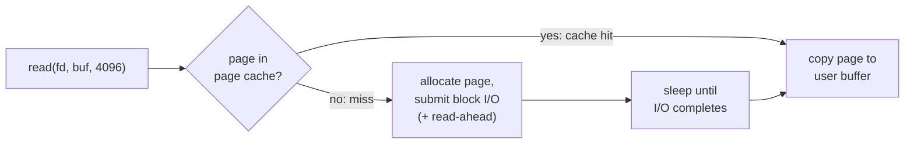

## Mental Model

The page cache is the kernel's **short-term memory of file contents**. Every file read goes through it: if the data is already there, the read is a memory copy (nanoseconds per byte); if not, the kernel reads from disk into the cache first. Every file write lands in the cache and is marked **dirty**; the kernel writes it back to disk later, in the background, in efficient batches.

Linux uses **all otherwise-unused RAM** for this cache. That's why a healthy server shows almost no "free" memory — and why that's good.

## Definition

- **Page cache**: kernel memory caching pages of files (and block devices), indexed by (inode, offset). Serves `read`, `write` and `mmap`.
- **Buffer cache** (historical): a separate cache of raw disk blocks. In modern Linux it's unified with the page cache ("Buffers" in `/proc/meminfo` is metadata-block caching); many textbooks still use the term.
- **Dirty page**: a cached page modified in memory but not yet written to storage.
- **Writeback**: the kernel flushing dirty pages to storage (by flusher threads, triggered by age and dirty thresholds, or explicitly by fsync/sync).
- **Read-ahead**: speculatively reading pages following a sequential access.
- **O_DIRECT**: an open flag that bypasses the page cache, transferring directly between user buffers and the device.

## Why It Exists

**The problem.** Disk access is 1,000–100,000× slower than RAM.

**The observation that makes a fix possible.** Most workloads re-read the same data (code, configs, hot database pages, static assets) and write in small pieces that are better batched.

**The idea.** Keep recently used file pages in RAM, and let writes land in RAM first and reach the disk later in bulk. Caching and write batching turn many slow device operations into a few fast ones. RAM that no program is using would otherwise do nothing, so the cache costs nothing until memory is needed — then it shrinks.

:::callout[That's all it is]{type=insight}
The page cache keeps file contents in spare RAM. Reads that hit it skip the disk; writes go into it and are flushed later. `fsync` is how you say "don't wait — flush mine now".
:::

## How It Works

### Read path



Sequential readers trigger **read-ahead**: the kernel notices the pattern and prefetches increasingly large windows (up to `read_ahead_kb`, default 128 KB per device, adjustable), so later reads hit the cache.

### Write path

Why writes don't go straight to disk: a program writing a log line at a time would turn into thousands of tiny device writes per second, each paying full latency. Holding writes briefly lets the kernel merge them. The trade-off is that "written" no longer means "safe".

1. `write()` copies data into page-cache pages, marks them dirty, returns immediately.
2. Flusher threads write dirty pages back when:
   - they're older than `dirty_expire_centisecs` (30 s by default), or
   - dirty memory exceeds `dirty_background_ratio` (e.g., 10% of available memory) — background writeback starts;
   - dirty memory exceeds `dirty_ratio` (e.g., 20%) — **writers are throttled** (blocked in `write()` until writeback catches up).
3. `fsync(fd)` forces the file's dirty pages (and metadata) out now and waits.

This is **write-back caching**: great for throughput, dangerous for durability if the application assumes `write()` means "saved" ([Journaling & fsync](lesson:os-journaling)).

### Eviction

Page-cache pages are reclaimed under memory pressure using the kernel's LRU approximations ([Page Replacement](lesson:os-page-replacement)). Clean pages are simply dropped; dirty pages must be written first. `MemAvailable` in `/proc/meminfo` estimates how much memory could be freed for applications — the right number to watch, not `MemFree`.

## Internal Mechanism

### The same pages serve read(), write() and mmap()

`mmap` maps page-cache pages directly into the process ([Copy-on-Write & mmap](lesson:os-cow-mmap)); `read()` copies from them; `sendfile()` sends them to a socket without a user-space copy. All three see one coherent cache, so a `write()` by one process is immediately visible to another process that has the file mmap'd.

In Java, `FileChannel.transferTo` uses `sendfile` on Linux when the target is a socket, so file bytes go from the page cache to the network without passing through the Java heap. Kafka serves consumers this way:

```java
try (FileChannel segment = FileChannel.open(Path.of("00000000000000000000.log"), StandardOpenOption.READ)) {
    long position = 0, size = segment.size();
    while (position < size) {
        position += segment.transferTo(position, size - position, socketChannel);   // sendfile(2)
    }
}
```

### Double buffering and O_DIRECT

A conflict between two caches that each make sense alone. A database with its own buffer pool that reads through the page cache ends up with the same page cached **twice**: once in its buffer pool and once in the page cache. That wastes RAM and adds a memory copy. Options:

- **O_DIRECT** (InnoDB `innodb_flush_method=O_DIRECT`, most commercial databases): bypass the page cache; the DB's buffer pool is the only cache and gets most of the RAM. Requires aligned buffers and makes the DB responsible for read-ahead and write batching.
- **Buffered I/O** (PostgreSQL's traditional approach): a modest `shared_buffers` (often ~25% of RAM) plus the OS page cache as a second-level cache. Simpler, relies on the kernel's read-ahead and writeback; costs double buffering. (PostgreSQL has been adding asynchronous and direct I/O support in recent releases.)

Java can open a file with `O_DIRECT` too, since JDK 10: `FileChannel.open(path, StandardOpenOption.READ, ExtendedOpenOption.DIRECT)`. As in C, the buffer address, file position and transfer size must be multiples of the device's block size (`Files.getFileStore(path).getBlockSize()`), so in practice it's for engines that run their own cache.

:::depth{level=advanced}
### Writeback stalls and latency

When dirty data exceeds `dirty_ratio`, every writing thread is throttled — including latency-sensitive ones that just log a line. Large amounts of dirty data also mean a later `fsync` must flush much more than the caller wrote (ext4's ordered mode can make one file's fsync flush others' data). Tuning `dirty_background_bytes`/`dirty_bytes` to smaller absolute values smooths writeback on big-RAM machines; cgroup v2 attributes writeback to the cgroup that dirtied the pages, preventing one container's writes from stalling another.
:::

## Example

Observe the cache at work:

```bash
$ free -h
              total   used   free  shared  buff/cache  available
Mem:           62Gi   14Gi  1.2Gi   1.1Gi        47Gi       46Gi
$ time cat big.log > /dev/null     # first read: from disk
real 0m9.84s
$ time cat big.log > /dev/null     # second read: from page cache
real 0m0.61s
$ grep -E 'Dirty|Writeback:' /proc/meminfo
Dirty:            182340 kB
Writeback:           512 kB
$ fincore big.log                  # how much of a file is cached (util-linux)
```

`free` shows 1.2 GiB "free" but 46 GiB "available" — the page cache is reclaimable.

## Complexity & Performance

| Operation | Cost |
|---|---|
| Cached read (per 4 KB page) | ~1 µs (syscall + memory copy) |
| Uncached read | Device latency (~100 µs NVMe, ~10 ms HDD) |
| Buffered write | ~memory copy; durability deferred |
| fsync | Device flush latency; proportional to dirty data of the file |

## Trade-offs

- **Buffered I/O**: easy, benefits from kernel caching/read-ahead/write batching; double buffering for DBs; unpredictable flush timing.
- **O_DIRECT**: predictable, no double caching; application must implement caching, read-ahead and alignment; small unaligned I/O is slow.
- **Large dirty thresholds**: better write throughput; bigger data loss window and bigger stall risk.

## Failure Modes

- **Cache pollution** by one-off large scans (backups, log processing) evicting hot data — use `posix_fadvise(POSIX_FADV_DONTNEED)`, O_DIRECT, or cgroup limits.
- **Writeback storms** throttling unrelated writers.
- **Data loss** on crash for applications relying on `write()` without fsync.
- **Misreading free memory**: panicking over low `MemFree` and "fixing" it with `drop_caches`, which only makes the next reads slower.

## In Production

- Kafka deliberately relies on the page cache: producers write to the cache, consumers usually read recent data straight from it, and `sendfile` ships it to sockets — very high throughput with little JVM heap.
- Elasticsearch/Lucene recommends leaving ~50% of RAM for the page cache (index files are mmap'd).
- Container memory accounting includes page cache charged to the cgroup; a container that reads large files may approach its limit, but that cache is reclaimable before OOM (unlike anonymous memory).

## Deeper Connections

- Database buffer pools reimplement this cache with DB-specific knowledge ([Buffer Pool](lesson:db-buffer-pool)).
- The same "cache in front of slow storage, write back later" pattern appears in CPU caches, CDNs and application caches — with the same consistency and durability questions ([Caching Everywhere](lesson:x-caching-everywhere)).
- The durability boundary between page cache and disk is a key link in the [Durability Chain](lesson:x-durability-chain).

## Common Misconceptions

- **"Linux is using all my RAM — there's a memory leak."** Page cache fills free RAM on purpose and is released under pressure.
- **"Buffer cache and page cache are separate caches of the same data."** In modern Linux they're unified.
- **"O_DIRECT is always faster."** Only when the application manages caching and I/O better than the kernel for its workload.

## Interview Questions

### [L1 · conceptual] What is the page cache?

Kernel memory that caches the contents of files in page-sized units. Reads are served from it when possible; writes go into it and are flushed to disk later by writeback. It uses otherwise-free RAM and is reclaimed under memory pressure.

### [L2 · trace] What happens when a process calls write() on a regular file? When is the data on disk?

The kernel copies the data into page-cache pages, marks them dirty, updates the file size/metadata in memory, and returns — typically without any disk I/O. The data reaches disk later when flusher threads write back dirty pages (after ~30 s, or when dirty thresholds are exceeded), or immediately when the application calls fsync/fdatasync (or opened with O_SYNC/O_DSYNC).

### [L2 · why] Why might a database use O_DIRECT?

To avoid double buffering (the same pages cached in both the DB's buffer pool and the OS page cache), to give the buffer pool most of the RAM, and to control I/O timing, ordering and read-ahead itself — at the cost of implementing caching and prefetching in the database and requiring aligned I/O.

### [L2 · how] How does Kafka, a JVM application, serve hundreds of MB/s to consumers without a huge heap?

It lets the kernel do the work. Producers' writes go into the page cache through ordinary buffered file writes (Kafka doesn't fsync each message; it relies on replication for durability). Consumers usually read recent data, which is still in the page cache. To send it, Kafka calls `FileChannel.transferTo`, which uses `sendfile` on Linux: the kernel moves bytes from page-cache pages to the socket, never copying them into the JVM. The heap stays small, GC has little to do, and the cache is whatever RAM the OS has free. (With TLS, the data must be encrypted in user space, so that zero-copy path is lost.)

### [L3 · debugging] free shows 500 MB free on a 64 GB server and the team wants to add RAM. What do you check?

The `available` column/MemAvailable (page cache counts as reclaimable), PSI memory pressure, major page faults, swap activity, and cgroup OOM events. If available memory is high and there's no pressure, the "used" memory is mostly cache doing its job — no RAM needed. Add RAM only if the working set doesn't fit (sustained major faults, pressure, OOMs).

### [L3 · incident] A service writes 5 GB of logs per hour; periodically every thread in the service stalls for seconds, including request handlers that barely write. Explain.

Dirty page throttling: logs accumulate dirty data until it crosses `dirty_ratio`, at which point any thread calling write() (even a small log line) is blocked until writeback catches up. On large-RAM machines the ratio translates into many GB of dirty data and long stalls. Mitigations: lower `dirty_background_bytes`/`dirty_bytes` for smoother writeback, write logs asynchronously from a dedicated thread, reduce log volume, put logs on a separate device, or use cgroup v2 writeback isolation.

## Practice

### [mcq] Which /proc/meminfo field best indicates how much memory applications can still obtain without swapping?

- [ ] MemFree
- [x] MemAvailable
- [ ] Cached
- [ ] Buffers

MemAvailable estimates reclaimable cache plus free memory.

### [mcq] Two processes: one writes to a file with write(), the other has the same file mapped with MAP_SHARED. When does the second see the new data?

- [ ] After the writer calls fsync
- [ ] After writeback to disk
- [x] Immediately — both use the same page-cache pages
- [ ] Never, until it remaps

The page cache is the single coherent copy.

### [numeric 12.8 unit=GB] A server has 64 GB of available memory and `vm.dirty_ratio` = 20. Roughly how much dirty data can accumulate before processes calling `write()` start being throttled?

:::answer
20% × 64 GB = **12.8** GB. On big-memory machines that is a lot of unwritten data: at 500 MB/s it takes about 26 seconds to flush, which is why such hosts often set smaller absolute limits (`vm.dirty_bytes`).
:::

### [numeric 26 ±1 unit=s] The disk behind that server writes at 500 MB/s. About how long does it take to flush 12.8 GB of dirty pages?

:::answer
12.8 GB / 0.5 GB/s = 25.6 ≈ **26** seconds. Any thread that writes during that time may be throttled, and an `fsync` issued then may have to wait behind the backlog.
:::

### [mcq] A Java file server sends large files with `FileChannel.transferTo(position, count, socketChannel)`. What does this avoid compared with reading into a `byte[]` and writing it to the socket?

- [ ] It avoids the page cache entirely
- [x] Copying the data into the Java heap and back out: on Linux the kernel moves it from the page cache to the socket with `sendfile`
- [ ] It avoids TCP's congestion control
- [ ] It makes the transfer durable

With a `byte[]` the data crosses the kernel boundary twice: page cache → heap on `read`, heap → socket buffer on `write`. `transferTo` keeps it in the kernel, saving CPU and memory bandwidth and creating no garbage.

### [exercise] A colleague benchmarks a Java log parser on a 4 GB file: the first run takes 9.8 s, the next three take about 0.6 s, and they report "0.6 s". What is wrong with the measurement, and how would you measure properly?

:::solution
After the first run, the whole file is in the page cache, so later runs never touch the disk: 0.6 s is the parser's speed on RAM-resident data, while 9.8 s includes reading 4 GB from the device. In production the file may or may not be cached, so neither number alone is "the" answer.

Measure both, deliberately:
- **Cold**: on a test machine, flush the cache between runs (`sync; echo 3 > /proc/sys/vm/drop_caches`), or use a fresh file larger than RAM. Check with `fincore file.log` that it isn't cached.
- **Warm**: run once to load the cache, then measure several runs (and use JMH-style warm-up for the JIT as well).

Report both numbers. If production files are usually fresh, the cold number is the one that matters, and the parser is I/O-bound: making the parsing code faster would barely help.
:::

## Quick Revision

- Page cache = file pages in RAM (unified with the old buffer cache); uses free memory; reclaimable.
- Read: hit → copy; miss → disk read (+ read-ahead).
- Write: copy into cache, mark dirty, return; flushers write back (30 s age, background/dirty ratios → throttling); fsync forces it.
- `MemAvailable`, not `MemFree`.
- DBs: buffered I/O (double buffering) vs **O_DIRECT** (own cache).
- Pollution from big scans → `fadvise DONTNEED`/O_DIRECT; writeback stalls → tune dirty bytes.
- Java: `FileChannel.transferTo` = sendfile (Kafka's zero-copy path); `ExtendedOpenOption.DIRECT` = O_DIRECT (aligned I/O).
