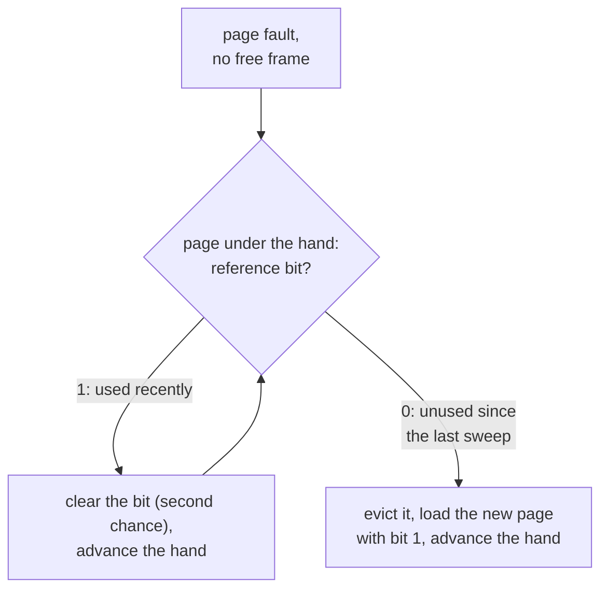

## Mental Model

RAM is a small bookshelf; the disk is the warehouse. When a new book must come in and the shelf is full, **which book do you send back?** Ideally the one you won't need for the longest time — but you can't see the future. So you guess from the past: *the book you haven't touched for the longest time will probably stay untouched* (LRU). Every replacement algorithm is a way of making that guess cheaply.

This is the same decision made by CPU caches, the TLB, database buffer pools, CDNs and Redis — which is why page replacement is worth understanding deeply.

## Definition

When a page fault occurs and no frame is free, the **page-replacement algorithm** selects a **victim** page to evict. If the victim is **dirty** (modified since it was loaded), it must be written back to disk before its frame is reused.

Algorithms are evaluated on a **reference string** (sequence of page numbers accessed) with a fixed number of frames, counting **page faults**.

## Why It Exists

**The problem.** Demand paging lets programs use more memory than exists, but only if evicting pages rarely hurts. When RAM is full and a new page must come in, an old one must go out.

**Without a good policy.** A bad choice (evicting a page that's needed right away) doubles the I/O. Page-fault costs are huge ([Page Faults](lesson:os-page-faults)), so replacement quality directly determines performance under memory pressure.

**The idea.** The perfect choice (evict the page needed furthest in the future) needs the future. The past is the next-best predictor: what hasn't been used for a while probably won't be used soon. Every practical algorithm is a cheaper and cheaper approximation of that guess.

:::callout[That's all it is]{type=insight}
When memory is full, throw out whatever you haven't used in the longest time. LRU is that rule; Clock is a cheap way of guessing it with one bit per page.
:::

## How It Works

Reference string (classic): **7, 0, 1, 2, 0, 3, 0, 4, 2, 3, 0, 3, 2, 1, 2, 0, 1, 7, 0, 1** with **3 frames**. "F" marks a fault.

### FIFO — evict the page that was loaded earliest

| Ref | 7 | 0 | 1 | 2 | 0 | 3 | 0 | 4 | 2 | 3 | 0 | 3 | 2 | 1 | 2 | 0 | 1 | 7 | 0 | 1 |
|---|---|---|---|---|---|---|---|---|---|---|---|---|---|---|---|---|---|---|---|---|
| F? | F | F | F | F | | F | F | F | F | F | F | | | F | F | | | F | F | F |

**15 faults.** FIFO ignores usage: page 0 is evicted at the 7th reference even though it's heavily used.

### Optimal (OPT / MIN / Bélády) — evict the page whose next use is farthest in the future

Frames evolve: [7], [7,0], [7,0,1] (3 faults). At ref 2 the next uses are 7 at position 18, 0 at 5 and 1 at 14, so evict 7 → [2,0,1]. Continuing yields **9 faults**, the minimum possible for this string and frame count.

OPT is unimplementable (needs the future) but is the **yardstick**: "LRU is within X% of optimal".

### LRU — evict the page not used for the longest time

**12 faults** on this string. LRU exploits temporal locality and tracks OPT well for most real workloads.

### Summary

| Algorithm | Faults (3 frames) | Implementable? | Belady's anomaly? |
|---|---|---|---|
| FIFO | 15 | Yes, trivially | **Yes** |
| OPT | 9 | No (needs future) | No |
| LRU | 12 | Expensive exactly; approximated | No |
| Clock (below) | 14 | Yes: one reference bit per page | Possible (it can behave like FIFO) |

::viz{id=page-replacement}

### Belady's anomaly

Intuition says more frames → fewer faults. **FIFO can violate this.** Reference string **1, 2, 3, 4, 1, 2, 5, 1, 2, 3, 4, 5**:

- 3 frames, FIFO: **9 faults**
- 4 frames, FIFO: **10 faults**

LRU and OPT never show the anomaly, because they are **stack algorithms**. The set of pages in memory with n frames is always a subset of the set with n+1 frames, so adding frames can't cause extra faults.

## Internal Mechanism

### Why exact LRU isn't used

Exact LRU must update an ordering on **every memory access** — billions per second. Options like per-page timestamps (search for the minimum on eviction) or a linked-list "stack" (move to front on every access) are far too expensive in hardware or software. Instead, the hardware provides a cheap signal: the **accessed (reference) bit** in each PTE, set automatically when the page is used.

### Clock (second chance)

The goal: get close to LRU using only the one bit the hardware gives us for free. Arrange frames in a circle with a "hand":

1. On eviction, look at the page under the hand.
2. If its reference bit is **1**, clear it (give a second chance) and advance.
3. If it's **0**, evict it.



A frequently used page keeps getting its bit set again and survives; a page not referenced during one full sweep is evicted. Clock approximates LRU with O(1) amortized work and no per-access bookkeeping.

A short trace with 3 frames and reference string **1, 2, 3, 2, 4, 1, 3**. A newly loaded page gets reference bit 1, and the hand moves past it. Bits are shown after each page:

```text
ref 1   fault  [1¹  ·   ·  ]   hand → frame 1
ref 2   fault  [1¹  2¹  ·  ]   hand → frame 2
ref 3   fault  [1¹  2¹  3¹ ]   hand → frame 0
ref 2   hit    [1¹  2¹  3¹ ]   (2's bit was already 1)
ref 4   fault  hand clears 1, 2, 3 and comes back to frame 0, now bit 0 → evict 1
               [4¹  2⁰  3⁰ ]   hand → frame 1
ref 1   fault  frame 1 holds 2 with bit 0 → evict 2
               [4¹  1¹  3⁰ ]   hand → frame 2
ref 3   hit    [4¹  1¹  3¹ ]
```

5 faults. Because every page had been referenced when the first eviction came, the hand cleared all the bits and Clock evicted in loading order, exactly like FIFO. LRU would take 6 faults on this string (it evicts 1, then 3, then 2), and OPT 4.

**Enhanced clock** uses (reference, dirty) pairs, preferring to evict (0,0) — not recently used and clean — before (0,1) — needs writeback — to avoid I/O.

:::depth{level=advanced}
### What real systems do

- **Linux** uses two LRU lists per memory cgroup and NUMA node — **active** and **inactive** — for file-backed and anonymous pages separately. New pages start inactive; a second access promotes them to active. Eviction takes from the inactive tail. Since Linux 6.1, **MGLRU** (multi-generational LRU) uses several generations and page-table scanning for better accuracy and lower CPU cost. `vm.swappiness` biases reclaim between file-backed pages (can be dropped/re-read) and anonymous pages (must be swapped).
- **Scan resistance**: plain LRU is destroyed by a one-time sequential scan (a backup reads 500 GB once, evicting the hot set). The two-list design, **LRU-K** (evict by K-th most recent access), **2Q**, and **ARC** (adaptive replacement cache, used in ZFS) protect frequently used pages from one-time scans.
- **Database buffer pools** implement their own replacement. PostgreSQL uses a clock-sweep with usage counts (0–5) and a small ring buffer for large sequential scans. InnoDB splits its LRU into young and old sublists with midpoint insertion: new pages enter at the old sublist's head and must survive a time window to become young. See [Buffer Pool](lesson:db-buffer-pool).
:::

### Frame allocation

How many frames does each process get? **Global replacement** lets a process evict any page (even another process's) — better throughput, less isolation. **Local replacement** limits a process to its own frames — predictable, but inflexible. Linux is global with cgroup limits providing local-like isolation per container.

## Example

LRU trace for the first 8 references (3 frames), showing recency order (most recent first):

| Ref | Frames after (MRU → LRU) | Fault? | Evicted |
|---|---|---|---|
| 7 | 7 | F | |
| 0 | 0, 7 | F | |
| 1 | 1, 0, 7 | F | |
| 2 | 2, 1, 0 | F | 7 |
| 0 | 0, 2, 1 | hit | |
| 3 | 3, 0, 2 | F | 1 |
| 0 | 0, 3, 2 | hit | |
| 4 | 4, 0, 3 | F | 2 |

## Complexity & Performance

| Algorithm | Per-access cost | Eviction cost | Quality |
|---|---|---|---|
| FIFO | none | O(1) | Poor |
| Exact LRU (hash map + doubly linked list) | O(1) but on *every access* | O(1) | Good |
| Clock | Hardware sets a bit | O(1) amortized | Close to LRU |
| OPT | — | — | Optimal (theoretical) |

For application caches (not hardware pages), exact LRU with a hash map + doubly linked list is standard — the classic "implement an LRU cache" interview problem — because the per-access cost is acceptable at that level.

## Trade-offs

- **Accuracy vs overhead**: exact recency tracking is too costly for hardware pages; approximations trade a little accuracy for large savings.
- **Recency vs frequency**: LRU favors recently used; LFU favors frequently used (but adapts poorly to changing popularity). ARC/LRU-K balance both.
- **Clean vs dirty**: evicting clean pages is cheaper; preferring them may keep useless dirty pages longer.

## Failure Modes

- **Sequential-scan flooding**: a large scan evicts the hot working set (fixed with scan-resistant policies or `posix_fadvise(DONTNEED)`, O_DIRECT).
- **Belady's anomaly** with FIFO-like policies.
- **Thrashing** when the working set exceeds available frames regardless of algorithm ([Thrashing](lesson:os-thrashing-working-set)).
- **Dirty-page storms**: evicting many dirty pages at once saturates the disk with writeback.

## In Production

- Redis `maxmemory-policy` (`allkeys-lru`, `allkeys-lfu`, `volatile-ttl`…) uses sampled approximations of LRU/LFU — not exact — exactly for overhead reasons.
- CDNs and HTTP caches pick victims similarly (LRU, LFU, size-aware policies).
- Case study: [Memory Leak & OOM](case:memory-leak) shows what happens when no replacement can free enough memory.

## Deeper Connections

- The same algorithms run the database buffer pool ([Buffer Pool](lesson:db-buffer-pool)), the page cache ([Page Cache](lesson:os-page-cache)) and every application cache ([Caching Everywhere](lesson:x-caching-everywhere)).
- Stack-algorithm property explains why adding cache memory never hurts LRU caches.

## Common Misconceptions

- **"More memory always means fewer page faults."** Not for FIFO (Belady's anomaly); true for stack algorithms like LRU and OPT.
- **"Operating systems use LRU."** They use approximations (clock, active/inactive lists, MGLRU).
- **"LRU is always best."** It fails badly on large cyclic scans slightly bigger than memory (every access faults); MRU or scan-resistant policies do better there.

## Interview Questions

### [L1 · compare] Compare FIFO, LRU and Optimal page replacement.

FIFO evicts the oldest loaded page regardless of use: simple, poor, and subject to Belady's anomaly. LRU evicts the page unused for the longest time, exploiting temporal locality; good in practice but expensive to implement exactly. Optimal evicts the page whose next use is farthest in the future: fewest faults possible but requires knowledge of future references, so it's a benchmark only.

### [L1 · conceptual] What is Belady's anomaly?

The phenomenon where increasing the number of frames increases the number of page faults under FIFO replacement. Example: reference string 1,2,3,4,1,2,5,1,2,3,4,5 gives 9 faults with 3 frames and 10 with 4. Stack algorithms (LRU, OPT) never exhibit it.

### [L2 · numerical] Reference string 1, 2, 3, 4, 1, 2, 5, 1, 2, 3, 4, 5 with 3 frames under LRU: how many faults?

1F 2F 3F 4F(evict 1) 1F(evict 2) 2F(evict 3) 5F(evict 4) 1 hit, 2 hit, 3F(evict 5), 4F(evict 1), 5F(evict 2) → **10 faults**.

### [L2 · how] How does the clock (second-chance) algorithm approximate LRU?

Pages sit in a circular list with a hand. Each page has a hardware-set reference bit. On eviction, if the page under the hand has its bit set, the algorithm clears it and advances (a second chance); the first page found with bit 0 is evicted. Pages used since the last sweep survive; pages not used for a whole sweep go — approximating "least recently used" without per-access bookkeeping.

### [L2 · why] Why is exact LRU not implemented for OS page replacement?

It would require updating a recency ordering on every memory access, which the hardware doesn't support and which would be enormously expensive in software. The hardware only sets a reference bit, so OSes use approximations like clock and active/inactive lists.

### [L3 · compare] Why do dirty pages matter in replacement decisions?

Evicting a dirty page requires writing it back to disk before reuse — doubling the I/O compared to a clean page, which can simply be dropped (file pages) or already has a copy in swap. Enhanced clock prefers clean, unreferenced pages; background writeback cleans pages ahead of time.

### [L3 · debugging] After a nightly batch job reads a 1 TB dataset once, the database's latency is terrible for an hour. Why, and how would you prevent it?

The sequential read flooded the OS page cache (and possibly the DB buffer pool), evicting the hot working set under LRU-like policies. Afterward, normal queries miss cache until the hot set is re-read. Prevention: scan-resistant caching (DB ring buffers for large scans, midpoint insertion), reading with `O_DIRECT` or `posix_fadvise(DONTNEED)`, running the batch in a memory-limited cgroup, or on a replica.

### [L4 · design] Design a cache eviction policy for a CDN edge node that serves both viral content and a long tail, and occasionally large one-off downloads.

Pure LRU is polluted by one-off large objects and the long tail; pure LFU clings to formerly viral content. Use a scan- and size-aware admission + eviction design: an admission filter (e.g., TinyLFU — admit a new object only if its estimated frequency beats the victim's) with a windowed LRU in front (W-TinyLFU), size-aware cost (evicting one large object may free space for many small popular ones), and TTL/freshness constraints. Measure byte hit ratio vs request hit ratio because they conflict.

## Practice

### [numeric 15] Reference string 7,0,1,2,0,3,0,4,2,3,0,3,2,1,2,0,1,7,0,1 with 3 frames under FIFO: how many page faults?

:::answer
**15** faults (the classic textbook result). Only references 5 (0), 12 (3), 13 (2), 16 (0) and 17 (1) hit.
:::

### [numeric 9] Same reference string and 3 frames under the Optimal algorithm: how many faults?

:::answer
**9** faults — the minimum possible.
:::

### [numeric 10] Reference string 1,2,3,4,1,2,5,1,2,3,4,5 with 4 frames under FIFO: how many faults?

:::answer
**10** faults (vs 9 with 3 frames) — Belady's anomaly.
:::

### [exercise] Implement an LRU cache with O(1) get and put.

:::solution
Use a hash map from key → node in a doubly linked list ordered by recency (head = most recent).

- `get(k)`: if absent return miss; else move the node to the head and return its value.
- `put(k, v)`: if present, update and move to head; else create a node at the head and insert into the map; if size exceeds capacity, remove the tail node (least recently used) from the list and the map.

```java
class LruCache<K, V> {
    private final class Node {
        final K key; V value; Node prev, next;
        Node(K key, V value) { this.key = key; this.value = value; }
    }

    private final int capacity;
    private final Map<K, Node> map = new HashMap<>();
    private final Node head = new Node(null, null), tail = new Node(null, null);  // sentinels

    LruCache(int capacity) {
        this.capacity = capacity;
        head.next = tail;
        tail.prev = head;
    }

    V get(K key) {
        Node n = map.get(key);
        if (n == null) return null;            // miss
        unlink(n);
        addFirst(n);                           // now the most recently used
        return n.value;
    }

    void put(K key, V value) {
        Node n = map.get(key);
        if (n != null) {
            n.value = value;
            unlink(n);
            addFirst(n);
            return;
        }
        n = new Node(key, value);
        map.put(key, n);
        addFirst(n);
        if (map.size() > capacity) {           // evict the least recently used
            Node lru = tail.prev;
            unlink(lru);
            map.remove(lru.key);
        }
    }

    private void unlink(Node n) { n.prev.next = n.next; n.next.prev = n.prev; }
    private void addFirst(Node n) { n.next = head.next; n.prev = head; head.next.prev = n; head.next = n; }
}
```

Both operations are O(1): the map finds the node, and the list moves or removes it without searching. In real Java code, `LinkedHashMap` with `accessOrder = true` and an overridden `removeEldestEntry` gives the same behaviour in a few lines.
:::

### [numeric 5] Using Clock with 3 frames, a reference bit set to 1 when a page is loaded or used, and the hand advancing past each newly loaded frame, how many faults does the reference string 1, 2, 3, 2, 4, 1, 3 cause?

:::answer
**5** faults: 1, 2, 3 (cold), then 4 (evicts 1 after the hand clears every bit) and 1 (evicts 2). The final 3 hits. Replay it step by step in the [page replacement lab](lab:page-replacement), choosing CLOCK.
:::

### [mcq] When does the Clock algorithm make exactly the same choices as FIFO?

- [ ] Never; Clock always matches LRU
- [x] When every page's reference bit is 1 at eviction time: the hand clears them all and evicts in loading order
- [ ] When the number of frames is a power of two
- [ ] Only when pages are dirty

A reference bit carries one bit of recency. If everything was used recently, Clock has nothing to tell pages apart, so it falls back to the order they sit in the circle, which is loading order.

## Quick Revision

- Victim choice on a full-memory fault; dirty victims need writeback.
- **FIFO**: oldest loaded; Belady's anomaly. **OPT**: farthest future use; benchmark only. **LRU**: least recently used; stack algorithm.
- Classic string (3 frames): FIFO 15, LRU 12, OPT 9. Belady: 1,2,3,4,1,2,5,1,2,3,4,5 → 9 (3 frames) vs 10 (4 frames) under FIFO.
- **Clock/second chance**: reference bit + circular hand ≈ LRU; enhanced clock also uses the dirty bit.
- Real systems: active/inactive lists, MGLRU, scan resistance (LRU-K, 2Q, ARC); DBs run their own (clock-sweep, midpoint LRU).
- Clock with every bit set = FIFO. Java LRU cache = `HashMap` + doubly linked list, or `LinkedHashMap(accessOrder = true)`.
