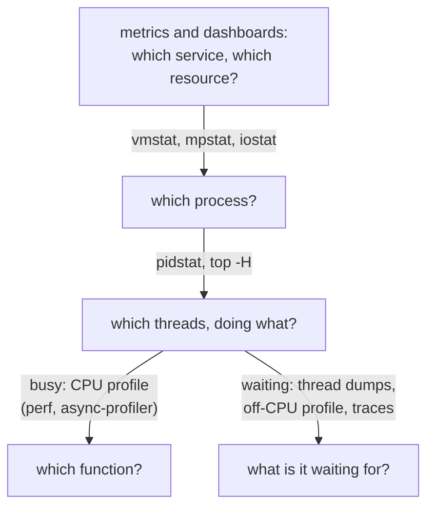

## Mental Model

Diagnosing performance is detective work with two kinds of evidence:

- **Metrics** tell you *that* something is wrong and *where to look* (which resource is saturated, which endpoint is slow).
- **Profiles and traces** tell you *why* (which code burns CPU, which call waits, which request path is slow).

The skill is moving quickly from broad to specific: **system → process → thread → function → line**. At each level, form a hypothesis and test it with the cheapest tool that can confirm or reject it.



## Definition

- **Profiling**: measuring where time (or memory, allocations, locks) goes in a program. **Sampling profilers** interrupt periodically (e.g., 99 Hz) and record stacks; **instrumenting profilers** record every call (precise, high overhead).
- **Tracing**: recording individual events (syscalls, function calls, I/O requests, RPCs) with timestamps.
- **On-CPU vs off-CPU analysis**: where threads spend time *running* vs where they spend time *blocked* (I/O, locks, sleep).
- **Observability**: the ability to understand a system's internal state from its outputs — typically **metrics, logs and traces**.

## Why It Exists

**The problem.** Intuition about performance is usually wrong: the "obvious" slow part often isn't.

**Without it.** Engineers optimise the code they suspect, ship it, and the latency doesn't move — because the time was going somewhere else (a lock, a DNS lookup, a retry).

**The idea.** Don't guess; *sample*. Ask the system, many times per second, "what are you doing right now?" and count the answers. Whatever shows up most is where the time goes. Measurement-driven diagnosis avoids wasted optimization and gets to root causes during incidents, when time matters.

:::callout[That's all it is]{type=insight}
Metrics say *something* is slow; profiles say *which code* runs; traces say *where a request waited*. Go from broad to narrow and let counts, not hunches, pick the next step.
:::

## How It Works

### The first 60 seconds on a slow Linux machine

```bash
uptime                 # load averages: rising or falling? compare with core count
dmesg -T | tail        # OOM kills, disk errors, network link issues, throttling
vmstat 1               # r (runnable), b (blocked), si/so (swap), us/sy/wa/id, cs
mpstat -P ALL 1        # per-CPU: one hot core? high %sys, %iowait, %soft?
pidstat 1              # which processes use CPU
iostat -xz 1           # per-device r/s, w/s, await, aqu-sz, %util
free -m                # available memory, cache
sar -n DEV 1           # network throughput per interface
sar -n TCP,ETCP 1      # connection rates, retransmits
top / htop             # overview; press H for threads
```

(Adapted from Brendan Gregg's checklist.) Within a minute you usually know which resource family — CPU, memory, disk, network, or "none of them: something is waiting" — to pursue ([USE method](lesson:os-performance-method)).

### CPU: sampling profiles and flame graphs

```bash
perf record -F 99 -g -p <pid> -- sleep 30     # sample stacks at 99 Hz for 30 s
perf script | stackcollapse-perf.pl | flamegraph.pl > cpu.svg
```

A **flame graph**: each box is a function; the x-axis is the share of samples (not time order); the y-axis is stack depth; **wide towers** are where CPU goes. Language-specific equivalents: `async-profiler` (JVM), `py-spy` (Python), `pprof` (Go), `0x`/`--cpu-prof` (Node.js). They're safe in production at low sampling rates.

### The JVM's own toolkit

For a Java service, the JVM can answer most of these questions itself, safely in production:

```bash
jcmd <pid> Thread.print                               # thread dump (same as jstack, or kill -3)
jcmd <pid> JFR.start duration=60s filename=app.jfr    # Flight Recorder: CPU samples, allocations,
                                                       # locks, file and socket I/O, GC — about 1% overhead
jcmd <pid> GC.heap_info                                # heap occupancy per generation
asprof -d 30 -e cpu  -f cpu.html  <pid>                # async-profiler: CPU flame graph, no safepoint bias
asprof -d 30 -e wall -f wall.html <pid>                # wall-clock mode: includes threads that are waiting
asprof -d 30 -e alloc -f alloc.html <pid>              # where objects are allocated (GC pressure)
```

Open the `.jfr` file in JDK Mission Control. Its "Method Profiling", "Lock Instances" and "Socket I/O" pages cover on-CPU, lock and network waits in one recording.

### Off-CPU: why is it waiting?

A CPU profiler only sees threads that are *running*. But a slow request is often a thread that is *not* running — it's waiting. Those waits are invisible to a CPU profile, so they need a different tool. If CPU is low but latency is high, sample where threads **block**:

- **Thread dumps** (`jstack`, `py-spy dump`, `pstack`, `kill -3` for JVM): taken a few times seconds apart, they show threads stuck in the same place — lock waits, socket reads, pool acquisition.
- **Off-CPU flame graphs** with eBPF (`offcputime` from BCC) show blocked stacks weighted by blocked time.
- **strace** (`strace -f -tt -T -p <pid>`) shows syscalls with timestamps and durations — which reads or connects are slow. Heavy overhead; use briefly, or `strace -c` for a summary.

### eBPF: safe, low-overhead kernel tracing

The old trade-off was: detailed tracing (strace) is too slow for production; cheap metrics are too coarse. eBPF breaks it by running small, verified programs *inside* the kernel. They count and summarise events where they happen and ship out only the summary. eBPF programs attach to kernel/user events and aggregate in-kernel:

```bash
biolatency           # histogram of block I/O latency
execsnoop            # every new process (find short-lived process storms)
tcpretrans           # every TCP retransmit with addresses
runqlat              # scheduler run-queue latency histogram (CPU saturation)
opensnoop            # files being opened (config reloads, missing files)
bpftrace -e 'tracepoint:syscalls:sys_enter_openat { @[comm] = count(); }'
```

### Application observability: metrics, logs, traces

| Signal | Answers | Cost | Example |
|---|---|---|---|
| **Metrics** | Is something wrong? How much? Trends | Cheap, aggregated | `http_request_duration_seconds` histogram, pool utilization |
| **Logs** | What exactly happened for this event? | Expensive at volume | Structured JSON with request ID |
| **Traces** | Where did this request spend its time across services? | Sampled | OpenTelemetry spans: API → auth → DB → cache |

A **distributed trace** breaks one slow request into spans — often revealing that the "slow service" was waiting on another service, a connection pool, or a retry.

## Internal Mechanism

### How sampling profilers see stacks

`perf` uses the PMU (performance monitoring unit) or timer interrupts to capture the instruction pointer and walk the stack (frame pointers, DWARF unwinding, or LBR). Missing frame pointers produce broken stacks — many distributions now compile with frame pointers again for this reason. JIT-compiled code (JVM, V8) needs symbol maps (perf-map-agent, `--perf-basic-prof`) or runtime-aware profilers.

:::depth{level=advanced}
### Profiling pitfalls

- **Safepoint bias** (JVM): profilers that sample only at safepoints misattribute time; async-profiler avoids it.
- **Observer effect**: strace can slow a process 10–100×; instrumenting profilers distort hot small functions.
- **Averages hide bimodality**: a function averaging 1 ms may be 0.1 ms usually and 50 ms occasionally — use histograms (latency heat maps).
- **Sampling frequency aliasing**: sample at 99 Hz rather than 100 Hz to avoid lockstep with periodic timers.
:::

## Example

**Incident**: CPU at 95% on all API nodes after a deploy; latency doubled.

1. `pidstat` → the Java service; `top -H` → many request threads busy.
2. async-profiler flame graph → 40% of samples in `Pattern.compile` called from a request filter.
3. Code review: a new filter compiles a regex **per request**. Fix: compile once (static field). CPU drops to 45%.

**Incident 2**: latency up, CPU 20%.

1. `vmstat`: low `wa`; no swapping.
2. Thread dump ×3: 180 of 200 request threads in `HikariPool.getConnection` — waiting for DB connections.
3. DB side: `pg_stat_activity` shows many `idle in transaction` sessions — a code path opens a transaction and then calls an external API. Connections are held while waiting on the network. See [Connection Pool Exhaustion](case:pool-exhaustion).

## Complexity & Performance

| Tool | Overhead | Production-safe? |
|---|---|---|
| Metrics (Prometheus scrape) | Negligible | Yes |
| Sampling profiler at 49–99 Hz | ~1–5% | Yes (bounded time) |
| eBPF aggregated tools | Low | Mostly (watch high-frequency probes) |
| strace | Very high | Briefly, carefully |
| Debug logging at high volume | High | No (sample instead) |

## Trade-offs

- Always-on low-overhead signals (metrics, continuous profiling like Parca/Pyroscope) vs on-demand deep tools.
- Trace sampling rates: more coverage vs cost; tail-based sampling keeps the slow/error traces.
- Log verbosity: debuggability vs cost and noise.

## Failure Modes

- Diagnosing from dashboards of averages; missing per-core or per-host skew.
- Changing multiple things at once during an incident — you won't know what fixed it.
- Profiling the wrong process (a sidecar, a GC thread) or a non-representative time window.
- High-cardinality metric labels (user IDs) exploding the metrics system.

## In Production

- Standard practice: RED metrics per endpoint, USE metrics per resource, SLO-based alerting on latency/error budgets, distributed tracing with OpenTelemetry, continuous profiling for CPU hot spots.
- Runbooks start with the 60-second checklist, then targeted tools.

## Deeper Connections

- Use the framework from [Performance Fundamentals](lesson:os-performance-method); apply it end-to-end in [Why a Query Gets Slow](lesson:x-slow-query) and [Overloaded Servers](lesson:x-overloaded-server).
- Network-specific measurement: [Tail Latency](lesson:cn-tail-latency).

## Common Misconceptions

- **"Profilers show where latency comes from."** CPU profilers show on-CPU time; waiting (locks, I/O, downstream calls) needs off-CPU analysis or tracing.
- **"Flame graph x-axis is time."** It's sample proportion, sorted alphabetically per level.
- **"strace is fine in production."** It can dramatically slow the traced process.

## Interview Questions

### [L2 · how] How would you find which function is using the most CPU in a production service?

Use a sampling profiler with low overhead: `perf record -F 99 -g` for native code or a runtime-aware profiler (async-profiler for JVM, py-spy for Python, pprof for Go) for a representative window, then look at a flame graph — the widest frames are the hottest code paths. Validate against request metrics and fix the top contributor.

### [L2 · compare] Metrics vs logs vs traces?

Metrics are aggregated numbers over time (cheap, good for alerting and trends). Logs are discrete event records with detail (good for forensics, expensive at volume). Traces follow individual requests across components as spans (good for locating latency across services). Together they answer "is something wrong", "what happened" and "where did the time go".

### [L2 · how] How would you profile a Java service in production?

Start with Java Flight Recorder: `jcmd <pid> JFR.start duration=60s filename=app.jfr` records CPU samples, allocation, lock contention, socket and file I/O and GC events at around 1% overhead, and JDK Mission Control shows the hot methods and the longest waits. For CPU flame graphs, use async-profiler (`asprof -e cpu`), which samples with `perf_events` plus JVM stack walking, so JIT-compiled frames are named and there's no safepoint bias. Its wall-clock mode (`-e wall`) also samples blocked threads, which finds waits a CPU profile can't see. Add a few thread dumps (`jcmd <pid> Thread.print`) several seconds apart to see where threads are stuck. All of these are safe on a live instance for short windows.

### [L3 · debugging] A service's latency is high but CPU usage is low. How do you investigate?

It's waiting, not computing. Take several thread dumps to see where threads block (locks, pool acquisition, socket reads), check pool/queue metrics, look at distributed traces for slow downstream spans, check DB lock waits and slow queries, and use off-CPU profiling (eBPF offcputime) if needed. Also check network (retransmits via `tcpretrans`, DNS latency) and disk (`biolatency`).

### [L3 · what-if] What are the risks of running strace on a busy production process?

strace uses ptrace, stopping the process at every syscall entry and exit — slowing syscall-heavy processes by 10–100×, potentially causing timeouts, failed health checks and cascading failures. Prefer eBPF-based tools (low overhead, in-kernel aggregation) or strace with filters (`-e trace=`) for very short durations on a drained instance.

### [L4 · design] Design an observability strategy for a new microservice platform so that most incidents can be diagnosed within 15 minutes.

Standardize: RED metrics per endpoint and per dependency (with histograms), USE metrics per host/container (CPU, throttling, memory/PSI, disk, network, fd counts), pool and queue metrics (active, waiting, wait time), structured logs with request/trace IDs, distributed tracing with tail-based sampling of slow/error requests, continuous profiling, SLOs with burn-rate alerts, dashboards linking service → dependency → host, and runbooks with the first-60-seconds checklist. Control cardinality and cost.

## Practice

### [mcq] In a CPU flame graph, what does the width of a frame represent?

- [ ] Wall-clock duration of one call
- [x] The proportion of samples in which that function (and its callees) was on the stack
- [ ] The time at which the function ran
- [ ] Memory allocated by the function

Width = share of samples.

### [mcq] Which tool would you use to see which kernel stacks threads are blocked in, weighted by blocked time?

- [ ] perf top
- [x] An off-CPU profiler (e.g., eBPF offcputime)
- [ ] iostat
- [ ] free

Off-CPU analysis shows where time is spent waiting.

### [numeric 23760] A profiler samples every CPU at 99 Hz for 30 seconds on an 8-core machine where all cores are busy. How many stack samples does it collect?

:::answer
99 samples/s × 30 s × 8 cores = **23760** samples. That's enough for a stable picture: a function using 1% of the CPU still appears in about 240 samples.
:::

### [numeric 20 unit=%] In that profile, `Pattern.compile` appears in 4,752 of the samples. What share of CPU time is it responsible for?

:::answer
4,752 / 23,760 = 0.2 = **20**%. A flame graph would draw its tower one fifth of the full width.
:::

### [mcq] A Java service is slow, CPU is at 10%, and a CPU flame graph from async-profiler shows nothing unusual. Which async-profiler mode helps most next?

- [ ] `-e alloc` (allocation profiling)
- [x] `-e wall` (wall-clock sampling, including threads that are blocked or waiting)
- [ ] `-e cpu` with a higher sampling rate
- [ ] `-e cache-misses`

A CPU profile only sees threads that are running. Wall-clock mode samples every thread whatever its state, so time spent waiting on locks, sockets or a connection pool shows up as wide towers.

### [exercise] A Spring Boot service on Tomcat has p99 latency of 3 s and CPU at 15%. Three thread dumps taken 5 seconds apart show 150 of the 200 `http-nio-8080-exec-*` threads in `RUNNABLE` state with stacks topped by `sun.nio.ch.SocketDispatcher.read` called from `com.mysql.cj.protocol.ReadAheadInputStream`. Interpret the evidence and say what you'd check next.

:::solution
The threads are inside a socket read in the MySQL JDBC driver, so they are waiting for the database to answer. `RUNNABLE` is misleading: the JVM can't tell that the kernel has put a thread to sleep in a native read. The same picture in three dumps means the waits are long, not momentary. With 150 threads stuck there and CPU at 15%, the service isn't computing; it's queued behind slow queries.

Next checks, moving to the database:
- Which queries are slow right now: MySQL `SHOW PROCESSLIST` or `performance_schema` statement digests, and the slow query log.
- Whether they are blocked on locks (`performance_schema.data_lock_waits`) or doing large scans (EXPLAIN).
- The connection pool's metrics: if it has, say, 150 connections, they are all in use and the database may be overloaded by the concurrency itself.

On the service side, add a query timeout so a slow database can't hold every request thread.
:::

## Quick Revision

- Broad → specific: system → process → thread → function.
- First 60 s: `uptime`, `dmesg`, `vmstat`, `mpstat`, `pidstat`, `iostat -xz`, `free`, `sar -n DEV/TCP`.
- On-CPU: sampling profiler + flame graph (width = samples). Off-CPU: thread dumps, offcputime, tracing.
- eBPF tools: biolatency, runqlat, tcpretrans, execsnoop, opensnoop.
- Metrics (what/how much), logs (what exactly), traces (where across services).
- strace is heavy; profilers at ~99 Hz are safe.
- JVM: `jcmd Thread.print` (dumps), `JFR.start` (~1% overhead, everything), async-profiler `-e cpu` / `-e wall` / `-e alloc`. `RUNNABLE` in a socket read = waiting.
