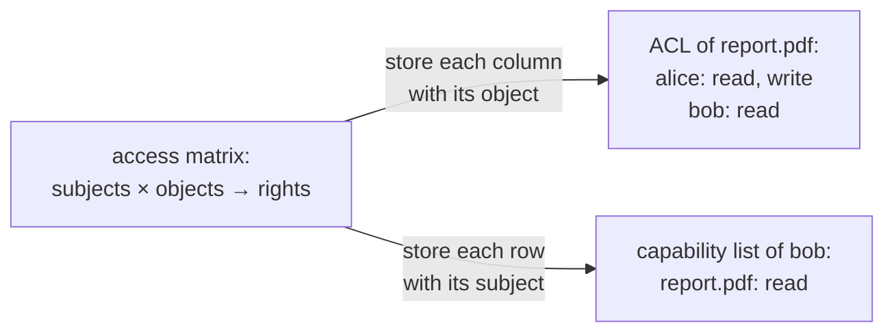
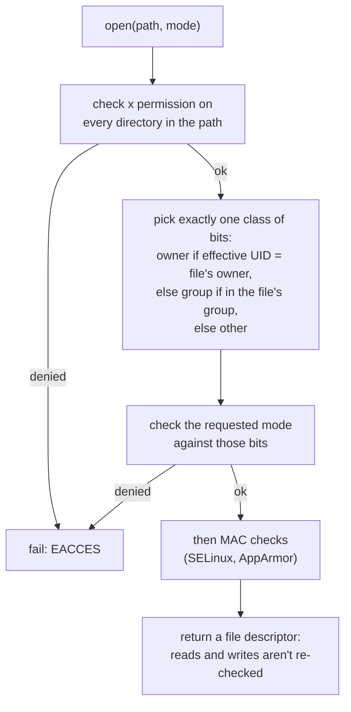

## Mental Model

A hotel can control its rooms in two ways. It can post a **guest list at every door**: the guard checks your name against the list. Or it can hand out **key cards**: whoever holds the card gets in, and the door doesn't care who you are. Operating systems use both. File permissions are guest lists, called **access control lists**. Open file descriptors are key cards, called **capabilities**.

Two words get mixed up. **Protection** is the mechanism: the rules the OS enforces about which process may touch which resource. **Security** is the bigger goal of keeping those rules meaningful against someone who is actively trying to get around them, by stealing a password, exploiting a bug, or tricking a privileged program.

## Definition

- **Subject**: an active entity that requests access, normally a process running with a user ID (UID), group IDs and privileges.
- **Object**: something protected: a file, directory, socket, device, process or memory region.
- **Rights**: what may be done to an object, such as read, write, execute, delete or send a signal.
- **Access matrix**: rows are subjects, columns are objects, and each cell lists the subject's rights on that object.
- **Access control list (ACL)**: the matrix stored by column; each object keeps a list of who may do what.
- **Capability list**: the matrix stored by row; each subject holds unforgeable tokens, each granting rights to one object.
- **DAC** (discretionary access control): an object's owner decides who gets access (Unix permissions). **MAC** (mandatory access control): a system-wide policy decides, and even the owner or root can't override it (SELinux, AppArmor).
- **Principle of least privilege**: give each program only the rights it needs, for only as long as it needs them.

## Why It Exists

**The problem.** One machine runs many users' programs, plus services that hold secrets. Each must be able to use its own files and nobody else's. A bug in one program, or a malicious one, must not be able to read other people's data or take over the machine.

**Without it.** Any program could read `/etc/shadow` (the password hashes), kill other users' processes or overwrite system binaries. On a shared server, one compromised web app would mean every tenant compromised.

**The idea.** The hardware already provides the enforcement tools: privileged and user mode, and per-page permissions in the MMU ([What an OS Does](lesson:os-what-an-os-does)). On top of them, the kernel attaches an identity to every process and checks that identity against a policy whenever a process asks for access through a system call. Everything else in this lesson is either a way of writing the policy down (ACLs, capabilities, labels) or a way of defending the checks against attacks.

:::callout[That's all it is]{type=insight}
Every access is a question: may *this subject* do *this action* to *this object*? The kernel answers it at the system-call boundary, using a guest list stored with the object (ACL) or a token held by the subject (capability). Security is keeping those answers right when someone is trying to cheat.
:::

## How It Works

### The access matrix, stored two ways

| | `/etc/shadow` | `report.pdf` | printer |
|---|---|---|---|
| alice | — | read, write | print |
| bob | — | read | — |
| `passwd` program (setuid root) | read, write | — | — |

A real matrix would be enormous and almost empty (thousands of users × millions of files), so systems store only its non-empty cells:



| | ACL (per object) | Capability list (per subject) |
|---|---|---|
| "Who can access this file?" | Easy: read its list | Hard: search every subject |
| "What can this process access?" | Hard: search every object | Easy: read its list |
| Revoking one user's access | Easy: edit one list | Hard: tokens are already handed out |
| Delegating access | Must change the object's list | Just pass the token |
| Example | Unix permissions, POSIX ACLs, Windows ACLs | Open file descriptors, Capsicum, seL4 |

### Unix permissions: a compressed ACL

Each file has an owner, a group and nine permission bits: read, write and execute for the owner, the group and everyone else ([Filesystem Internals](lesson:os-filesystem-internals)). Full POSIX ACLs (`setfacl`) add entries for specific users and groups when three classes aren't enough.

The kernel checks permissions **when the file is opened**, and the resulting file descriptor works as a capability afterwards:



Two consequences surprise people. Only *one* class of bits is used, so an owner whose owner bits forbid reading is refused even if the group bits allow it. And `chmod` doesn't affect a process that already has the file open: its descriptor is a key card, already issued.

Java uses the same model. `Files.setPosixFilePermissions(path, PosixFilePermissions.fromString("rw-------"))` is `chmod 600`, and a `FileInputStream` keeps working after the file's permissions change.

### Privilege: root, setuid and Linux capabilities

Traditionally the superuser (UID 0, **root**) bypasses almost every check. Two mechanisms control when a process has that power:

- **setuid programs.** Each process has a *real* UID (who started it) and an *effective* UID (whose rights it uses). An executable with the setuid bit runs with the file owner's effective UID. `passwd` is owned by root and setuid (`-rwsr-xr-x`), so when alice runs it, it can write `/etc/shadow`, but only in the narrow ways its code allows.
- **Linux capabilities.** Root's power is split into about 40 separate privileges. `CAP_NET_BIND_SERVICE` allows binding ports below 1024, `CAP_KILL` allows signalling any process, `CAP_SYS_ADMIN` covers a large set of administrative operations. A process can hold just the ones it needs. Container runtimes start containers with a small default set and drop the rest.

Say a Java server must listen on port 443 without running as root. The options are a reverse proxy or load balancer on 443, a port redirect, or giving the `java` binary that one capability: `setcap 'cap_net_bind_service=+ep' /path/to/java`.

### DAC vs MAC

Under DAC, a file's owner can give it away, and any program running as that user can do anything the user can. That's a problem when the program is a compromised web server. **MAC** adds a policy the owner can't change. SELinux labels every process and file (for example `httpd_t`, `httpd_sys_content_t`) and allows only the interactions the policy lists. A compromised web server running as `httpd_t` can't read users' home directories even if the Unix permissions would allow it, and even if it runs as root.

### Defending against exploits

Many attacks don't break the rules directly. They take over a program that already has rights. The classic route is a **buffer overflow** in C code:

```text
a function's stack frame (the stack grows down)
┌──────────────────────────┐
│ return address           │ ← overwritten with an address the attacker chose
│ saved frame pointer      │ ← overwritten
│ char buf[64]             │ ← strcpy(buf, input) copies 72+ bytes from the attacker
└──────────────────────────┘
when the function returns, the CPU jumps to the attacker's address
```

The OS, compiler and hardware stack up defences, each making the next step harder:

| Defence | What it does | Defeats |
|---|---|---|
| **Stack canary** | A random value placed before the return address and checked before returning | Simple overwrites of the return address |
| **NX / W^X** | Memory pages are writable or executable, never both | Injected code on the stack or heap |
| **ASLR** | Stack, heap, libraries and executable load at random addresses each run | Jumps to known addresses |
| **CFI, shadow stacks (Intel CET)** | Hardware checks that returns go back where they came from | Return-oriented programming |

Java code itself can't overflow a buffer: every array access is bounds-checked and there are no raw pointers. That removes a whole class of exploits, but not the attack surface. Native libraries loaded by the JVM are still C. And Java applications have their own classic holes, such as unsafe deserialization of untrusted `ObjectInputStream` data, or Log4Shell (2021), where a crafted log message made Log4j load and run remote code.

### Sandboxing: least privilege enforced by the kernel

A **sandbox** limits what a process can do even if it is fully compromised:

- **seccomp** filters which system calls a process may make; Docker's default profile blocks dozens of rarely needed, risky ones ([System Calls](lesson:os-syscalls-interrupts)).
- **Namespaces and cgroups** limit what it can see and use ([VMs & Containers](lesson:os-virtualization-containers)).
- **Dropping capabilities and running as a non-root user** limits what it can change.

Java's own in-process sandbox, the `SecurityManager`, was deprecated in JDK 17 and permanently disabled in JDK 24. Isolating Java code now means isolating the JVM process with these OS mechanisms.

## Internal Mechanism

### Where the checks run

Every protected operation enters the kernel through a system call, so that is where the checks live. Linux runs them in two stages. First the classic DAC check (UIDs, permission bits, capabilities such as `CAP_DAC_OVERRIDE`, which lets root skip it). Then the **Linux Security Module** hooks, where SELinux, AppArmor and others can refuse an operation DAC allowed. A refusal at either stage returns `EACCES` or `EPERM`.

### Time-of-check to time-of-use (TOCTOU)

A privileged program that checks first and acts later leaves a gap:

```text
setuid program                        attacker (same user as the caller)
access("/tmp/report", W_OK) → ok      
                                      rm /tmp/report; ln -s /etc/shadow /tmp/report
open("/tmp/report", O_WRONLY)         ← now opens /etc/shadow, with root's rights
```

The fix is to make the check and the use one operation. Drop to the caller's privileges before opening, open with `O_NOFOLLOW`, or open first and then check the open file (`fstat`) instead of the path. It's the same check-then-act race as in [Race Conditions](lesson:os-race-conditions), with an attacker choosing the timing.

## Example

Why `passwd` can change your password although you can't read the password file:

```bash
$ ls -l /etc/shadow /usr/bin/passwd
-rw-r-----  1 root shadow  1392 Oct  3 09:12 /etc/shadow        # owner root: only root may write
-rwsr-xr-x  1 root root   68208 Mar 14  2024 /usr/bin/passwd    # "s": setuid, owned by root

$ cat /etc/shadow
cat: /etc/shadow: Permission denied                               # alice's EUID is 1000

$ passwd
Changing password for alice.                                      # passwd runs with EUID 0
```

`passwd` runs with real UID 1000 (alice) and effective UID 0 (root). The kernel lets it write `/etc/shadow` because the check uses the effective UID. `passwd` itself uses the real UID to decide that alice may change only her own password. Any bug in it is a path to root, which is why setuid programs are kept few and small.

## Complexity & Performance

- Permission checks cost almost nothing: they happen once per `open`, on cached inodes, and later reads and writes skip them.
- MAC (SELinux) adds a lookup per checked operation, cached in its access vector cache; overhead is usually a few percent at most.
- seccomp filters run on every system call; small filters cost tens of nanoseconds.
- Some mitigations are expensive: kernel page-table isolation (KPTI, against Meltdown) added noticeable cost to syscall-heavy workloads on older CPUs.

## Trade-offs

- **ACLs vs capabilities**: ACLs make review and revocation easy; capabilities make delegation and least privilege easy. Real systems mix them: ACLs at `open`, capabilities (descriptors) afterwards.
- **DAC vs MAC**: DAC is flexible and owner-controlled but can't contain a compromised program; MAC contains it but needs policy written and maintained.
- **Root vs capabilities**: capabilities shrink the damage a program can do, but some (`CAP_SYS_ADMIN`) are nearly as powerful as root.
- **Mitigations vs speed and compatibility**: each layer costs a little and occasionally breaks software (JITs need writable-then-executable memory, which is why W^X JIT support exists).

## Failure Modes

- **Bugs in setuid programs or privileged daemons**: a direct path to root.
- **Overly broad permissions**: world-writable files or directories, secrets readable by group or other (`chmod 644` on a private key).
- **Services running as root** when they don't need to, multiplying the damage of any bug.
- **Privileged containers** (`--privileged`, `CAP_SYS_ADMIN`, a mounted Docker socket) that let a compromised container control the host.
- **Leaked file descriptors**: a capability passed to a child process by accident, because it wasn't opened with close-on-exec ([File Descriptors](lesson:os-file-descriptors)).
- **TOCTOU races** in programs that check a path and then use it.

## In Production

Hardening a containerized Java service:

```dockerfile
FROM eclipse-temurin:21-jre
RUN useradd --system --uid 10001 app
COPY --chown=app:app app.jar /app/app.jar
# never run the JVM as root
USER 10001
ENTRYPOINT ["java", "-jar", "/app/app.jar"]
```

And in Kubernetes, the pod's `securityContext`: `runAsNonRoot: true`, `readOnlyRootFilesystem: true`, `allowPrivilegeEscalation: false`, `capabilities: { drop: ["ALL"] }` and `seccompProfile: { type: RuntimeDefault }`. Keep secrets in files readable only by the service's user (mode `0600`) or in a secrets manager, listen on a high port behind the load balancer, and scan dependencies for known vulnerabilities, since most Java breaches start in a library.

## Deeper Connections

- Hardware enforcement (user/kernel mode, page permissions) is the foundation: [What an OS Does](lesson:os-what-an-os-does), [Paging](lesson:os-paging).
- File descriptors as capabilities, and close-on-exec: [File Descriptors](lesson:os-file-descriptors).
- Containers combine namespaces, cgroups, capabilities and seccomp: [VMs & Containers](lesson:os-virtualization-containers).
- Databases apply the same ideas with roles, grants and row-level security: [Database Security](lesson:db-security).

## Common Misconceptions

- **"Root runs in kernel mode."** Root processes run in user mode; the kernel simply grants them more in its checks.
- **"chmod immediately revokes access."** Processes that already have the file open keep their descriptors.
- **"An owner can always read their own file."** If the owner bits deny it, the kernel doesn't fall back to the group bits.
- **"Containers are as isolated as VMs."** They share the host kernel; a kernel bug or a privileged container breaks the boundary.
- **"Java is memory-safe, so Java services can't be exploited."** Memory safety removes buffer overflows in Java code, not deserialization, injection, or bugs in native libraries.

## Interview Questions

### [L1 · compare] What is the difference between protection and security?

Protection is the internal mechanism that controls which processes and users may access which resources, such as file permissions, memory protection and privilege levels. Security is the broader goal of keeping the system safe against threats, including attackers who steal credentials, exploit bugs, or trick privileged programs. It depends on protection being correct and also involves authentication, auditing and mitigating exploits. Protection answers "is this access allowed?"; security asks whether the answer can be trusted.

### [L2 · compare] Compare access control lists and capability lists.

Both store the access matrix, which maps subjects and objects to rights. An ACL is stored per object: each file lists who may do what, so "who can read this?" and revoking one user's access are easy, but "what can this process touch?" is hard. A capability list is stored per subject: each process holds unforgeable tokens for the objects it may use, so least privilege and delegation are easy (pass the token), but revocation and review are hard. Unix uses both: permission bits and POSIX ACLs are checked at `open()`, and the returned file descriptor then acts as a capability.

### [L2 · how] How does setuid work, and what are the real and effective user IDs?

Every process carries a real UID (the user who started it) and an effective UID (whose permissions the kernel checks). When a program file has the setuid bit, executing it sets the process's effective UID to the file's owner while the real UID stays the caller's. `passwd` is setuid root, so it can write `/etc/shadow` and uses the real UID to change only the caller's own entry. It's powerful and risky: any exploitable bug in a setuid-root program gives the attacker root, so such programs are kept minimal, and many have been replaced by capabilities or services.

### [L2 · compare] What is the difference between DAC and MAC?

Under discretionary access control, the owner of an object decides who may access it (Unix permissions, ACLs), and any program running as a user has all of that user's rights. Under mandatory access control, a system-wide policy assigns labels to subjects and objects and decides access, and neither owners nor root can override it (SELinux, AppArmor). MAC contains a compromised program, such as a web server that can't read home directories even as root, at the cost of writing and maintaining policies.

### [L2 · how] What is a buffer overflow, and how do NX, stack canaries and ASLR defend against it?

A buffer overflow writes past the end of a buffer, typically on the stack, overwriting the saved return address so that the function "returns" into code the attacker chose. Stack canaries place a random value before the return address and abort if it changed. NX marks the stack and heap non-executable, so injected bytes can't run as code. ASLR randomizes where the stack, heap and libraries live, so the attacker doesn't know which address to jump to. Each can be bypassed alone (information leaks, return-oriented programming), which is why they are layered, along with newer hardware shadow stacks.

### [L3 · why] Why doesn't removing read permission on a file stop a process that already has it open?

Permission checks happen at `open()` time. The result is a file descriptor pointing to an open file description, and later reads and writes check only that descriptor's access mode, not the file's current permissions. The descriptor behaves like a capability already issued. To really cut off access you must make the process close the descriptor, by restarting or signalling it, or rely on mechanisms that revoke at a lower level (some MAC policies, or removing a network mount).

### [L3 · how] How do you let a non-root Java server listen on port 443?

Ports below 1024 normally require root, more precisely the capability `CAP_NET_BIND_SERVICE`. Options: grant just that capability to the `java` binary (`setcap 'cap_net_bind_service=+ep'`), or to the container (`capabilities.add` in Kubernetes); listen on a high port such as 8443 behind a load balancer, reverse proxy or port redirect; or, in many container platforms, rely on the platform mapping port 443 to the container's high port. Running the JVM as root just to bind the port is the option to avoid.

### [L4 · design] How would you harden a Java microservice running in Kubernetes?

Least privilege at every layer. Image: a minimal JRE base image (or a `jlink` runtime), no shells or tools you don't need, dependencies scanned for known CVEs. Process: run as a non-root UID, `allowPrivilegeEscalation: false`, drop all capabilities and add back only what's required, the runtime's default seccomp profile, and a read-only root filesystem with a writable `emptyDir` only where needed. Data: secrets mounted as `0600` files or fetched from a secrets manager, never baked into the image. Network: listen on a high port and use network policies to restrict who can connect. Application: no Java deserialization of untrusted data, input validation, parameterized queries, keeping libraries patched. Monitoring: audit logs and alerts on unexpected process execution in the container.

## Practice

### [numeric 750] What octal mode corresponds to the permissions `rwxr-x---`?

:::answer
Each class is three bits worth 4 (read), 2 (write) and 1 (execute). Owner `rwx` = 4 + 2 + 1 = 7; group `r-x` = 4 + 1 = 5; other `---` = 0. The mode is **750**.
:::

### [numeric 1000000000] A system has 1,000 users and 1,000,000 files. How many cells would a full access matrix have?

:::answer
1,000 × 1,000,000 = **1000000000** cells, a billion, almost all of them empty. That's why systems store only the non-empty entries, per object (ACLs) or per subject (capabilities).
:::

### [mcq] A file has mode `----rw----` (000 for the owner, 6 for the group), owner alice, group `staff`. Alice is a member of `staff`. Can alice read the file (she isn't root)?

- [ ] Yes, through the group bits
- [x] No: because she is the owner, the kernel checks only the owner bits, which allow nothing
- [ ] Yes, owners can always read their own files
- [ ] Only if she opens it with `O_RDONLY`

The kernel picks one class: owner if the effective UID matches, otherwise group, otherwise other. It never combines them. Alice can, however, `chmod` the file, because she owns it.

### [mcq] Which defence stops shellcode that an attacker copied into a stack buffer from running?

- [ ] ASLR
- [ ] A stack canary
- [x] NX (non-executable stack pages)
- [ ] seccomp

With NX, the page holding the buffer is marked non-executable, so jumping into it causes a fault. Canaries and ASLR make the jump harder to set up; seccomp limits what the code could do once running.

### [mcq] A Java service has `report.csv` open. An administrator runs `chmod 000 report.csv`. What happens to the service's next `read` on its open stream?

- [ ] It throws `AccessDeniedException`
- [x] It keeps working: permissions were checked when the file was opened, and the descriptor acts as a capability
- [ ] The JVM crashes
- [ ] It returns end-of-file

New `open()` calls fail, but existing descriptors keep their access mode. To revoke, the service must close and try to reopen the file.

### [exercise] Using the access matrix from this lesson, show how the operating system would store it as ACLs and as capability lists. Then explain which representation makes each task easy: (a) revoking all of bob's access; (b) listing everyone who can read `report.pdf`; (c) letting alice hand a printer job to a helper process.

:::solution
**ACLs (per object)**: `/etc/shadow` → passwd: read, write. `report.pdf` → alice: read, write; bob: read. printer → alice: print.

**Capability lists (per subject)**: alice → report.pdf: read, write; printer: print. bob → report.pdf: read. passwd → /etc/shadow: read, write.

- **(a) Revoke bob**: easy with capability lists if the system can find and destroy his tokens (delete one row). With ACLs, every object's list must be searched for bob. In practice Unix uses ACLs for this, and accepts that already-open descriptors survive.
- **(b) Who can read `report.pdf`**: easy with ACLs (read one list), hard with capabilities (search every subject's list).
- **(c) Delegate printing**: easy with capabilities (pass the token, like passing an open file descriptor to a child process). With ACLs, the printer's list would have to be changed to name the helper.
:::

### [exercise] A Java service's Kubernetes deployment runs the container as root, with `privileged: true` "because it needs to bind port 80", and mounts the host's Docker socket for a log shipper. List the risks and rewrite the configuration with least privilege.

:::solution
Risks:
- **Root plus privileged**: the container gets every capability and access to host devices. A remote code execution bug in the app (a vulnerable library, unsafe deserialization) gives the attacker the host.
- **The Docker socket**: anyone who can talk to it can start a privileged container that mounts the host's root filesystem, which amounts to root on the node.
- **Port 80 only needs `CAP_NET_BIND_SERVICE`**, not root, and not even that if the app listens on a high port.

Least-privilege version: listen on 8080 and let the Service map port 80 to it. Run as non-root (`runAsNonRoot: true`, `runAsUser: 10001`), set `privileged: false`, `allowPrivilegeEscalation: false`, `capabilities: { drop: ["ALL"] }`, `readOnlyRootFilesystem: true` with an `emptyDir` for `/tmp`, and `seccompProfile: { type: RuntimeDefault }`. Remove the Docker socket: ship logs from stdout through the cluster's logging agent (a DaemonSet run by the platform team) instead of from inside the app's pod.
:::

## Quick Revision

- Protection = mechanism (who may do what); security = keeping it meaningful against attackers.
- **Access matrix** (subjects × objects → rights), stored as **ACLs** (per object: easy review and revocation) or **capabilities** (per subject: easy delegation). Unix: ACL at `open`, then the fd is a capability.
- Unix check: owner bits **or** group bits **or** other bits, only one class; root bypasses via capabilities like `CAP_DAC_OVERRIDE`.
- **setuid**: effective UID = file owner (`passwd`); real UID = caller. Bugs → root.
- **Linux capabilities** split root (`CAP_NET_BIND_SERVICE`, `CAP_SYS_ADMIN`…). **DAC** (owner decides) vs **MAC** (policy decides: SELinux, AppArmor).
- Exploit defences: canaries, NX/W^X, ASLR, CFI/shadow stacks. Java removes buffer overflows, not deserialization, injection or native-library bugs.
- Sandboxing: seccomp + namespaces + cgroups + dropped capabilities + non-root. Java's SecurityManager is gone (JDK 24).
- TOCTOU: check-then-use on paths is a race; check the opened descriptor instead.
