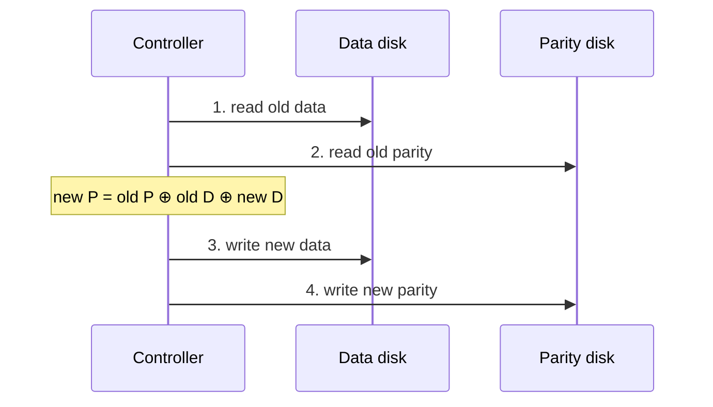

## Mental Model

RAID combines several disks into one logical disk using three tricks:

- **Striping** — split data across disks so they work in parallel (speed, no safety).
- **Mirroring** — write every block to two disks (safety, costs half the capacity).
- **Parity** — store a checksum-like XOR of blocks so any one missing block can be recomputed (safety at lower capacity cost, but writes become expensive).

Every RAID level is a mix of these, trading **capacity**, **performance**, and **how many disk failures you survive**.

## Definition

**RAID (Redundant Array of Independent Disks)** is a technique that presents multiple physical disks as one logical volume, for performance (striping), redundancy (mirroring/parity), or both. Implemented in hardware controllers, software (Linux `md`, ZFS RAID-Z), or cloud storage layers.

## Why It Exists

**The problem.** Individual disks are slow and fail regularly (annualized failure rates of ~1–2% for HDDs). With 100 disks, you lose one or two a year — and losing a disk without redundancy means losing data.

**The idea.** One disk is a single point of failure and a single lane of traffic. Several disks can fix both: spread data across them (more lanes), and store enough extra information that a missing disk can be rebuilt (survive a failure). RAID lets a server keep running through disk failures and aggregate the throughput of many drives.

:::callout[That's all it is]{type=insight}
Spread blocks across disks for speed; keep a copy (mirror) or a XOR (parity) so a dead disk can be recomputed. Each RAID level is just a different mix of those, paying for safety with capacity or write speed.
:::

## How It Works

### Parity with XOR

Mirroring survives a failure by storing everything twice — expensive. Parity asks: what's the *least* extra data that lets me rebuild any one missing block? One XOR of all the blocks is enough. For data blocks D1, D2, D3: `P = D1 ⊕ D2 ⊕ D3`. If D2 is lost: `D2 = D1 ⊕ D3 ⊕ P`. XOR is its own inverse, so any single missing block (data or parity) can be reconstructed.

What a RAID controller computes, byte by byte, in Java:

```java
// Parity over three data blocks of the same stripe
byte[] parity = new byte[BLOCK];
for (int i = 0; i < BLOCK; i++) parity[i] = (byte) (d1[i] ^ d2[i] ^ d3[i]);

// The disk holding d2 dies: rebuild d2 from everything that survived
byte[] rebuilt = new byte[BLOCK];
for (int i = 0; i < BLOCK; i++) rebuilt[i] = (byte) (d1[i] ^ d3[i] ^ parity[i]);
// Arrays.equals(rebuilt, d2) is true
```

### Levels compared (n disks of equal size)

| Level | Technique | Usable capacity | Survives | Read perf | Write perf | Typical use |
|---|---|---|---|---|---|---|
| **RAID 0** | Striping | n | **0 failures** | n× | n× | Scratch data, caches |
| **RAID 1** | Mirroring | n/2 (1 disk for a pair) | 1 per mirror | up to 2× | 1× (write both) | OS disks, small DBs |
| **RAID 5** | Striping + distributed single parity | n − 1 | 1 | (n−1)× | Small writes: **4 I/Os** each | Read-heavy, capacity-focused |
| **RAID 6** | Striping + double parity | n − 2 | 2 | (n−2)× | Small writes: **6 I/Os** each | Large arrays, large disks |
| **RAID 10** (1+0) | Striped mirrors | n/2 | 1 per mirror pair (up to n/2 if lucky) | n× | n/2× | Databases, write-heavy OLTP |

### The RAID-5 small-write penalty

Parity's cheap capacity comes with a bill on writes: the parity depends on every block in the stripe, so changing one block means updating the parity too. Updating one data block requires keeping parity correct:

1. Read old data block.
2. Read old parity block.
3. Compute new parity = old parity ⊕ old data ⊕ new data.
4. Write new data block.
5. Write new parity block.



**4 I/Os per logical write** (2 reads + 2 writes); RAID 6 needs 6 (two parity blocks). Full-stripe writes avoid the penalty (compute parity from new data only). This is why RAID 5/6 are poor for random-write-heavy databases and RAID 10 is preferred.

**Write-hole problem**: a crash between writing data and parity leaves them inconsistent; a later reconstruction produces garbage. Mitigated by battery/flash-backed controller caches, journaling (Linux md write journal), or ZFS RAID-Z's copy-on-write full-stripe writes.

::lab{id=raid}

## Internal Mechanism

### Rebuild risk

When a disk fails in RAID 5, the array runs **degraded**: every read of the missing disk's data reads all other disks. Rebuilding onto a replacement requires reading *every* block of *every* surviving disk — for 16 TB drives, that's days of heavy I/O. During the rebuild:

- a second disk failure (disks from the same batch age together) loses the array;
- an **unrecoverable read error (URE)** on a surviving disk leaves a stripe unrecoverable.

With consumer drives rated at 1 URE per 10¹⁴ bits (~12.5 TB), reading 60 TB during a rebuild makes an error likely. Hence: **RAID 6 or RAID 10 for large drives**, hot spares, and scrubbing (periodically reading everything to catch latent errors early).

:::depth{level=advanced}
### Beyond classic RAID

- **Erasure coding** (Reed–Solomon, e.g., 10+4) generalizes parity: any k of n fragments reconstruct the data. Object stores (S3-class systems, Ceph, HDFS EC) use it across machines and racks for far better storage efficiency than 3× replication.
- **ZFS RAID-Z** avoids the write hole with variable-width COW stripes and checksums every block, so it can tell *which* copy is corrupt.
- In the cloud, you rarely build RAID yourself for durability — the provider replicates volumes — but you may still stripe volumes (RAID 0) to aggregate IOPS/throughput limits.
:::

## Example

Capacity and tolerance with 8 × 4 TB disks:

| Level | Usable | Failures tolerated |
|---|---|---|
| RAID 0 | 32 TB | 0 |
| RAID 5 | 28 TB | 1 |
| RAID 6 | 24 TB | 2 |
| RAID 10 | 16 TB | 1 guaranteed (up to 4 if in different mirror pairs) |

Random write IOPS (each disk ~150 IOPS, 8 disks = 1,200 raw): RAID 10 ≈ 600, RAID 5 ≈ 300, RAID 6 ≈ 200.

## Complexity & Performance

- RAID 0 and 10 scale reads and writes with disks.
- Parity RAID reads scale well; small random writes pay 4× (RAID 5) or 6× (RAID 6) I/O.
- Degraded and rebuilding arrays perform much worse — plan capacity for degraded mode.

## Trade-offs

Capacity efficiency (RAID 5/6) vs write performance and rebuild safety (RAID 10); cost of disks vs cost of downtime and data loss.

## Failure Modes

- Second failure or URE during a long rebuild.
- Write hole after power loss with parity RAID.
- Controller failure (hardware RAID metadata tied to a controller model).
- **Logical errors replicate instantly**: `rm -rf`, application bugs, ransomware and corruption are faithfully mirrored.

## In Production

- **RAID is not a backup.** It protects against disk failure only; backups (point-in-time, off-site, tested restores) protect against deletion, corruption and disasters.
- Databases on bare metal typically use RAID 10 on SSDs; distributed systems (Cassandra, Kafka, HDFS) often skip RAID and rely on replication across machines.

## Deeper Connections

- Replication across machines is RAID 1 at the system level — with network partitions and consistency problems added ([Replication](lesson:db-replication)).
- Quorums and erasure coding generalize "survive k failures" ([Quorums & Consensus](lesson:db-quorums-consensus)).

## Common Misconceptions

- **"RAID is a backup."** It isn't.
- **"RAID 5 is safe for large arrays."** Long rebuilds on large drives make second failures and UREs a real risk.
- **"RAID 10 can survive any two failures."** Only if the two failed disks are in different mirror pairs.

## Interview Questions

### [L1 · compare] Compare RAID 0, 1, 5 and 10.

RAID 0 stripes data for speed with no redundancy — any disk failure loses everything. RAID 1 mirrors data for redundancy at 50% capacity. RAID 5 stripes data with distributed parity: survives one failure with n−1 capacity but has a small-write penalty (4 I/Os). RAID 10 stripes across mirrored pairs: fast reads and writes and good fault tolerance, at 50% capacity — preferred for write-heavy databases.

### [L2 · how] How does parity allow RAID 5 to recover a failed disk?

Each stripe's parity block is the XOR of its data blocks. XOR is reversible: any single missing block equals the XOR of all the remaining blocks in the stripe (including parity), so the controller reconstructs it on reads and rebuilds it onto a replacement disk.

### [L2 · numerical] Why does a small write in RAID 5 cost 4 disk I/Os?

To update one data block and keep parity consistent: read the old data, read the old parity, write the new data, and write the new parity computed as old parity ⊕ old data ⊕ new data — two reads plus two writes.

### [L2 · compare] RAID 5 vs RAID 6: what does the second parity block buy, and what does it cost?

RAID 6 stores two independent parity blocks per stripe (computed differently, e.g. XOR plus a Reed–Solomon syndrome), so it survives any two simultaneous disk failures, or one failure plus an unrecoverable read error during the rebuild. It costs one more disk of capacity (n − 2 usable instead of n − 1) and a bigger small-write penalty: 6 I/Os (read data and both parities, write all three) instead of 4. For large modern drives, where rebuilds take days, that safety is usually worth it.

### [L2 · numerical] Eight disks of 150 random IOPS each. What random-write IOPS do RAID 10 and RAID 5 deliver?

Raw = 8 × 150 = 1,200 IOPS. RAID 10 writes each block twice (both mirrors): 1,200 / 2 = **600**. RAID 5 needs 4 I/Os per small write: 1,200 / 4 = **300**. Reads are about 1,200 for both, since any copy (RAID 10) or the data block itself (RAID 5) can serve them.

### [L3 · why] Why is RAID 5 considered risky with very large disks?

Rebuilding after a failure must read every block of every surviving disk; with multi-TB drives this takes many hours to days, during which the array has no redundancy. A second disk failure or a single unrecoverable read error during the rebuild can make data unrecoverable. RAID 6 or RAID 10 reduce this risk.

## Practice

### [numeric 28] Eight 4 TB disks in RAID 5: usable capacity in TB?

:::answer
(n − 1) × 4 TB = 7 × 4 = **28 TB**.
:::

### [mcq] Which RAID level offers no fault tolerance at all?

- [x] RAID 0
- [ ] RAID 1
- [ ] RAID 5
- [ ] RAID 10

RAID 0 only stripes.

### [numeric 300] An array of 8 disks, each doing 150 random IOPS, is configured as RAID 5. About how many small random writes per second can it sustain?

:::answer
Raw capacity is 8 × 150 = 1,200 disk I/Os per second, and each small write costs 4 (two reads, two writes): 1,200 / 4 = **300** writes per second.
:::

### [numeric 6 unit=TB] Six 2 TB disks are set up as RAID 10. What is the usable capacity?

:::answer
RAID 10 mirrors every block, so half the raw capacity is usable: 6 × 2 TB / 2 = **6** TB.
:::

### [numeric 4.8] Consumer drives are rated at 1 unrecoverable read error (URE) per 10¹⁴ bits read. A RAID 5 rebuild reads 60 TB from the surviving disks. How many UREs would you expect during the rebuild?

:::answer
60 TB = 60 × 10¹² bytes × 8 = 4.8 × 10¹⁴ bits. Expected UREs = 4.8 × 10¹⁴ / 10¹⁴ = **4.8**. With RAID 5 already degraded, each one means an unrecoverable stripe. This is why large arrays use RAID 6.
:::

### [mcq] A RAID 10 array has 4 disks: mirror pair A (disks 1 and 2) and mirror pair B (disks 3 and 4), striped together. Which two simultaneous failures lose data?

- [ ] Disks 1 and 3
- [x] Disks 1 and 2
- [ ] Disks 2 and 4
- [ ] Any two failures lose data

Losing both halves of one mirror destroys every stripe unit on that pair. One disk from each pair is fine: each pair still has a copy.

### [exercise] A stripe holds three 4-bit data blocks: D1 = 1011, D2 = 0110, D3 = 1100. Compute the parity block, then show how D2 is recovered after its disk fails.

:::solution
P = D1 ⊕ D2 ⊕ D3:

```text
D1      1011
D2    ⊕ 0110  → 1101
D3    ⊕ 1100  → 0001   = P
```

Recover D2 = D1 ⊕ D3 ⊕ P:

```text
D1      1011
D3    ⊕ 1100  → 0111
P     ⊕ 0001  → 0110   = D2 ✓
```

XOR works bit by bit, and x ⊕ x = 0, so XORing everything that survived cancels out everything except the missing block. The `rebuilt` loop in the Java code above does the same thing for every byte of a real block.
:::

### [exercise] In the [RAID lab](lab:raid), set up RAID 5 with 5 disks and fail disk 1. Check the rebuilt D1 in stripe 0 by hand. Then fail disk 3 too, and see the array lost. Switch to RAID 6 and fail two disks. Why can RAID 6 rebuild two lost blocks per stripe when RAID 5 can rebuild only one?

:::solution
**By hand:** D1 = D0 ⊕ D2 ⊕ D3 ⊕ P0 = 0x73 ⊕ 0xE1 ⊕ 0x5E ⊕ 0xE4. Step by step:
- 0x73 ⊕ 0xE1 = 0x92;
- 0x92 ⊕ 0x5E = 0xCC;
- 0xCC ⊕ 0xE4 = 0x28, D1's original value.

**Why two failures beat RAID 5.** With two disks gone, each stripe has two unknown blocks. RAID 5 stores one equation per stripe (P = XOR of the data), and one equation can't determine two unknowns.

RAID 6 stores a second, independent equation: Q = g⁰·D0 ⊕ g¹·D1 ⊕ g²·D2 ⊕ …, computed in the finite field GF(2⁸). Each data block has a different coefficient in Q, so P and Q together pin down any two missing values, just as two independent linear equations determine two unknowns. A second plain XOR wouldn't help: it would be the same equation twice.
:::

## Quick Revision

- Striping (speed), mirroring (copy), parity (XOR reconstruction).
- RAID 0: n capacity, 0 failures. RAID 1: n/2, mirrors. RAID 5: n−1, 1 failure, small write = 4 I/Os. RAID 6: n−2, 2 failures, 6 I/Os. RAID 10: n/2, fast writes, 1 per pair.
- Rebuilds on large disks are long and risky (second failure, UREs) → RAID 6/10, scrubbing, hot spares.
- Write hole with parity RAID.
- **RAID is not a backup.**
- Random-write IOPS: RAID 10 = raw / 2, RAID 5 = raw / 4, RAID 6 = raw / 6. Expected UREs in a rebuild = bits read / 10¹⁴.
