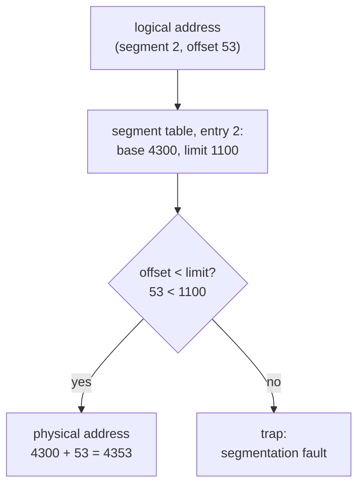

## Mental Model

Paging chops memory into identical boxes regardless of meaning. **Segmentation** instead gives each *logical piece* of a program — code, stack, heap, a large array — its own variable-sized region, like giving each department of a company its own floor sized to its needs. It matches how programmers think ("the stack", "the code"), and protection is natural (code: read/execute; stack: read/write). But floors of different sizes are hard to pack into a building, and after departments move in and out, you're left with awkward empty spaces: **external fragmentation**.

## Definition

**Segmentation** is a memory-management scheme where a logical address is a pair **(segment number, offset)**. A per-process **segment table** stores for each segment a **base** (starting physical address) and **limit** (length), plus protection bits.

Translation: if `offset < limit[s]`, physical address = `base[s] + offset`; otherwise the hardware raises a fault — the origin of the name **segmentation fault**.

## Why It Exists

**The problem.** Early systems gave each process one contiguous region defined by a base and limit register. That wastes the free space between the heap and stack and makes sharing parts of a program impossible. Segmentation generalizes base+limit to many regions:

- each logical unit grows independently,
- sharing is natural (map the same code segment into two processes),
- protection per unit (no-execute data, read-only code).

**The idea.** A program isn't one blob — it's a few distinct pieces with different jobs and different rules. So translate *per piece*: each piece gets its own start address and length.

**Why it matters today even though it lost.** Segmentation is the natural first answer to "how do I divide memory?". Seeing exactly why it fails (variable sizes → fragmentation) makes paging's "everything the same size" choice obvious.

:::callout[That's all it is]{type=insight}
Segmentation = a few (base, length) pairs, one per logical part of the program. Check the offset against the length, add the base. Its only real flaw is that variable-sized pieces leave awkward gaps in RAM — which is the problem paging was invented to fix.
:::

## How It Works

| Segment | Base | Limit | Permissions |
|---|---|---|---|
| 0 (code) | 1400 | 1000 | R-X |
| 1 (data) | 6300 | 400 | RW- |
| 2 (stack) | 4300 | 1100 | RW- |
| 3 (heap) | 3200 | 1000 | RW- |

- Logical (2, 53) → 53 < 1100 ✔ → physical 4300 + 53 = **4353**.
- Logical (1, 852) → 852 ≥ 400 ✘ → **trap: segmentation violation**.
- Logical (0, 500) with a write → permission violation (code is not writable).



## Internal Mechanism

### Why pure segmentation lost

Segments vary in size, so physical memory allocation becomes the dynamic storage-allocation problem ([Dynamic Allocation](lesson:os-dynamic-allocation)): first/best fit, holes, **external fragmentation**, and occasional **compaction**. Compaction moves segments, which is possible because only base registers need updating, but costly. Growing a segment may require moving it. Swapping works only with whole segments.

### Segmentation with paging

Each scheme had something the other lacked: segments match how programs are organised; pages fit RAM without gaps. The fix combines both: segments provide the *logical* structure and protection; each segment is itself **paged**, so physical allocation is in fixed-size frames with no external fragmentation.

```text
logical (segment, offset) → linear address (segment base + offset) → page tables → physical
```

This is exactly the classic **IA-32 (x86 32-bit)** design: segment selectors (CS, DS, SS…) index a descriptor table (GDT/LDT) giving base and limit; the resulting **linear address** is then translated by paging.

A worked translation with 4 KB pages: segment 1 has base `0x10000` in the linear space, and the program accesses offset `0x234`.

```text
linear  = 0x10000 + 0x234 = 0x10234       (after the limit check)
page    = 0x10234 >> 12   = 0x10,  offset = 0x234
page table: page 0x10 → frame 0x7
physical = (0x7 << 12) | 0x234 = 0x7234
```

### Base + offset lives on in the JVM

The JVM uses segmentation's core trick for its own references. On a 64-bit JVM, a full pointer takes 8 bytes. With **compressed oops** (on by default for heaps below about 32 GB), a reference is stored as a 32-bit *offset from the heap's base*, scaled by 8 because objects are 8-byte aligned:

```text
address = heap base + (compressed reference × 8)
largest reachable heap = 2^32 × 8 bytes = 32 GB
```

Every reference field then takes 4 bytes instead of 8, which shrinks object-heavy heaps by a large fraction and fits more objects in the CPU caches. Set `-Xmx` above about 32 GB and the JVM falls back to full 8-byte pointers. A 33 GB heap can then hold *fewer* objects than a 31 GB one.

:::depth{level=advanced}
### What x86-64 did with segmentation

In 64-bit long mode, segmentation is essentially disabled: CS/DS/SS/ES bases are treated as 0 with no limit checks, giving a **flat** address space translated only by paging. Two segment registers survived with a new purpose: **FS and GS** have programmable bases, used for **thread-local storage** (Linux user space uses FS for TLS; the kernel uses GS for per-CPU data). So the "segmentation fault" you get today on Linux is really a page-protection fault reported with a historical name.
:::

## Example

The name persists everywhere:

```bash
$ ./a.out
Segmentation fault (core dumped)
```

On modern Linux, this means the MMU raised a page fault that the kernel decided was invalid (unmapped address or permission violation) and delivered `SIGSEGV` — no segment limit was involved.

## Complexity & Performance

- Pure segmentation: translation is one add + compare (fast); allocation suffers fragmentation and compaction costs.
- Segmentation + paging: two translation stages; hardware caches segment descriptors in hidden registers, so segment translation is nearly free.

## Trade-offs

| | Paging | Segmentation | Segmentation + paging |
|---|---|---|---|
| Unit | Fixed-size page | Variable logical segment | Segments made of pages |
| External fragmentation | None | Yes | None |
| Internal fragmentation | Last page of each region | None | Last page of each segment |
| Programmer-visible | No | Yes | Yes |
| Protection/sharing granularity | Page | Logical unit | Both |
| Used today | Everywhere | Rarely | Historical (IA-32) |

## Failure Modes

- External fragmentation requiring compaction.
- Segment growth collisions (stack segment cannot grow into an occupied area).
- Complex pointer models (near/far pointers in 16-bit x86 programming) — a source of bugs and one reason flat models won.

## In Production

Modern OSes use paging with a flat address space; the *idea* of segments survives as **VMAs** (Linux's list of mapped regions with permissions — [Address Spaces](lesson:os-address-spaces)), as FS/GS-based thread-local storage, and in the naming of `SIGSEGV`.

## Deeper Connections

- The same fixed-vs-variable size trade-off appears in storage: fixed-size database pages vs variable-length records inside them ([Pages & Records](lesson:db-pages-records)), and in allocators (size classes vs general-purpose fits).

## Common Misconceptions

- **"Segmentation fault means the program used segmentation."** On modern x86-64 Linux, it's a page-level protection fault with a historical name.
- **"Segmentation is obsolete, so it's irrelevant."** It's still a common interview topic, and its failure (external fragmentation) is the clearest motivation for paging.

## Interview Questions

### [L1 · compare] What is the difference between paging and segmentation?

Paging divides memory into fixed-size pages/frames invisible to the programmer; it eliminates external fragmentation but has internal fragmentation. Segmentation divides memory into variable-sized logical segments (code, stack, heap) visible to the program, translated with a base and limit per segment; it matches program structure and protection but suffers external fragmentation.

### [L2 · trace] Segment 2 has base 4300 and limit 1100. Translate logical addresses (2, 53) and (2, 1200).

(2, 53): 53 < 1100 → physical 4353. (2, 1200): 1200 ≥ 1100 → out of bounds → trap (segmentation violation).

### [L2 · numerical] With segmentation and 4 KB paging, segment 1's base is `0x10000` and page `0x10` maps to frame `0x7`. What physical address does offset `0x234` in segment 1 reach?

Linear address = `0x10000 + 0x234` = `0x10234`. Page number `0x10`, offset `0x234`. Frame `0x7` → physical = `0x7000 | 0x234` = **`0x7234`**. The segment step adds a base and checks a limit; the paging step replaces the page number with a frame number.

### [L2 · why] Why does a JVM heap of 33 GB often hold fewer objects than one of 31 GB?

Below about 32 GB, HotSpot uses compressed oops: each reference is a 32-bit offset from the heap base, scaled by the 8-byte object alignment, so 2³² × 8 = 32 GB is reachable with 4-byte references. Above that limit the JVM must use full 8-byte pointers, so every reference field and every object header's class pointer gets bigger. An application full of small objects and references can lose 20–40% of its usable heap to the larger pointers. The usual advice is to stay at 31 GB or jump well past it (e.g. 48 GB+).

### [L2 · why] Why was segmentation combined with paging?

To keep segmentation's logical organization and per-segment protection while eliminating external fragmentation: each segment is paged, so physical memory is allocated in fixed-size frames that fit anywhere.

### [L3 · conceptual] Where does the term "segmentation fault" come from, and what does it mean on modern Linux?

From segmented architectures, where accessing beyond a segment's limit or violating its permissions raised a fault. On x86-64 Linux with a flat memory model, it means the MMU raised a page fault for an unmapped or protection-violating address and the kernel delivered SIGSEGV.

## Practice

### [numeric 4353] Segment table entry for segment 2: base = 4300, limit = 1100. What physical address does logical (2, 53) map to?

:::answer
53 < 1100, so physical = 4300 + 53 = **4353**.
:::

### [mcq] Which problem does pure segmentation suffer from that paging avoids?

- [ ] Internal fragmentation
- [x] External fragmentation
- [ ] Lack of protection
- [ ] Inability to share code

Variable-sized segments leave unusable holes between them.

### [numeric 4199] Segment 3 has base 3200 and limit 1000. What physical address does logical (3, 999) map to?

:::answer
999 < 1000, so the access is legal (999 is the last valid offset): physical = 3200 + 999 = **4199**. Offset 1000 would trap.
:::

### [numeric 32 unit=GB] HotSpot's compressed references are 32-bit offsets from the heap base, multiplied by the 8-byte object alignment. What is the largest heap they can address?

:::answer
2³² distinct offsets × 8 bytes = 2³⁵ bytes = **32** GB. Raising object alignment to 16 bytes (`-XX:ObjectAlignmentInBytes=16`) would double the limit at the cost of more padding.
:::

### [mcq] A service's heap is raised from `-Xmx31g` to `-Xmx34g`, yet it hits `OutOfMemoryError` sooner. What is the most likely reason?

- [ ] The kernel limits each process to 32 GB
- [x] Above about 32 GB the JVM can't use compressed (4-byte) references, so every reference grows to 8 bytes and objects take more space
- [ ] The garbage collector stops working above 32 GB
- [ ] Larger heaps always fragment more

It is the base + offset limit of compressed oops. Check with `java -Xmx34g -XX:+PrintFlagsFinal -version | grep UseCompressedOops`.

### [exercise] With segmentation on top of 4 KB paging: segment 0 has base `0x4000` and limit `0x3000`; pages `0x4`, `0x5`, `0x6` map to frames `0x22`, `0x9`, `0x31`. Translate offsets `0x1A40` and `0x3010` in segment 0.

:::solution
- **Offset `0x1A40`**: `0x1A40` < limit `0x3000`, so it is legal. Linear = `0x4000 + 0x1A40` = `0x5A40`. Page `0x5`, offset `0xA40`. Frame `0x9` → physical **`0x9A40`**.
- **Offset `0x3010`**: `0x3010` ≥ `0x3000`, so the segment check fails and the hardware traps before paging is consulted: a segmentation violation.

The limit check comes first; only a legal offset ever reaches the page table.
:::

## Quick Revision

- Segmentation: logical address = (segment, offset); segment table = base + limit + permissions.
- Physical = base + offset if offset < limit, else fault (origin of "segmentation fault").
- Matches program structure; natural sharing/protection; suffers **external fragmentation** (needs compaction).
- Segmentation + paging (IA-32): segment → linear address → paging.
- x86-64: flat model; FS/GS kept for thread-local and per-CPU data.
- JVM compressed oops = base + 32-bit offset × 8 → heaps up to 32 GB use 4-byte references; above that, 8-byte.
