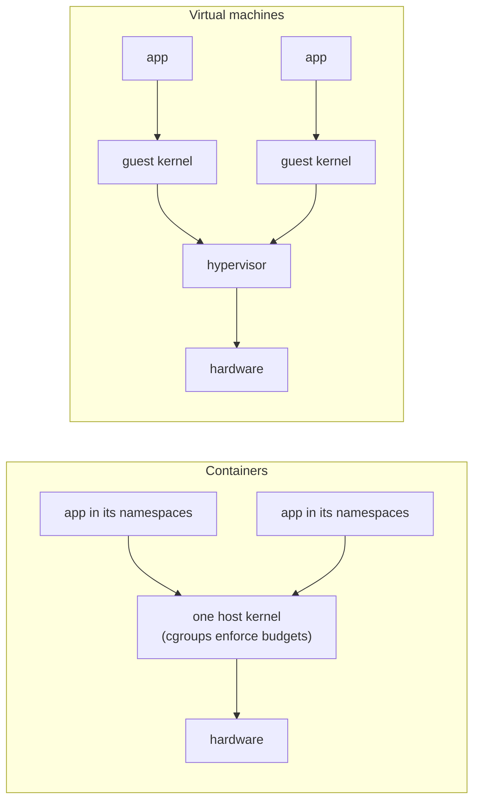

## Mental Model

- A **virtual machine** is a **whole fake computer**: virtual CPUs, virtual RAM, virtual disks and NICs. A complete guest OS kernel boots inside it. The hypervisor underneath multiplexes the real hardware among several fake computers.
- A **container** is **not a computer at all**. It's an ordinary process on the host kernel wearing **blinders**: it sees its own filesystem tree, process list, network interfaces and hostname (namespaces). It also has a **budget** for CPU, memory and I/O (cgroups). There's only one kernel, shared by all containers.

That single difference — **separate kernels vs one shared kernel** — explains nearly every trade-off between them.



## Definition

- **Hypervisor (VMM)**: software that creates and runs virtual machines.
  - **Type 1 (bare-metal)**: runs directly on hardware — KVM (Linux kernel as hypervisor), Xen, VMware ESXi, Hyper-V.
  - **Type 2 (hosted)**: runs as an application on a host OS — VirtualBox, VMware Workstation.
- **Container**: a process (or group) isolated using OS-level mechanisms. On Linux those are **namespaces** (what you can see), **cgroups** (what you can use) and a separate root filesystem (typically **overlayfs** image layers), plus security filters (capabilities, **seccomp**, LSMs like AppArmor/SELinux).

## Why It Exists

**The problem.** One physical server is too big for one application, but programs sharing a machine step on each other: conflicting library versions, one app eating all the memory, one compromise exposing the rest.

**Two ideas, two levels.** You can isolate at the *hardware* level: fake a whole machine, so each tenant has its own kernel. Or you can isolate at the *kernel* level: keep one kernel, but make it lie to each process about what exists and cap what it can use.

- **VMs**: run many OSes on one server (consolidation), isolate tenants strongly, migrate running machines, snapshot entire systems. They made cloud computing possible.
- **Containers**: package an application with its dependencies and run it anywhere with near-native performance and millisecond startup — without the overhead of a full guest OS per app. They made microservices and Kubernetes practical.

:::callout[That's all it is]{type=insight}
A VM is a fake computer with its own kernel. A container is a normal process that the shared kernel shows a private view of the system (namespaces) and a resource budget (cgroups). There's no "container" object in the kernel — just those two features combined.
:::

## How It Works

### How VMs virtualize the CPU and memory

The core problem: a guest kernel expects to own the hardware and run privileged instructions — but it must not actually control the real machine. So those instructions must be caught and faked.

- **Hardware-assisted virtualization** (Intel VT-x, AMD-V): the CPU has a special mode for guests. Guest code runs natively; sensitive operations (I/O port access, certain privileged instructions) cause a **VM exit** to the hypervisor, which emulates them and resumes the guest.
- **Memory**: guests have their own page tables; **nested/extended page tables** (EPT/NPT) let the hardware translate guest-virtual → guest-physical → host-physical, at the cost of longer page walks on TLB misses (huge pages help).
- **I/O**: emulated devices are slow; **paravirtual** drivers (virtio) cooperate with the hypervisor; **SR-IOV** and device passthrough give a VM direct hardware access for near-native network/storage performance.

### How containers are built on Linux

Two separate questions, answered by two separate features: *what can this process see?* (namespaces) and *how much can it use?* (cgroups).

| Namespace | Isolates | Example effect |
|---|---|---|
| PID | Process IDs | The app is PID 1 inside; can't see host processes |
| Mount (mnt) | Mount points / filesystem view | Own root filesystem from the image |
| Network (net) | Interfaces, routes, iptables, ports | Own `eth0`, own `localhost`, own port 80 |
| UTS | Hostname | Own hostname |
| IPC | SysV IPC, POSIX message queues | Isolated shared memory |
| User | UID/GID mappings | Root inside maps to unprivileged UID outside (rootless containers) |
| Cgroup | View of cgroup hierarchy | Sees only its own cgroup |

**cgroups (v2)** limit and account resources:

- `cpu.max` (quota/period — throttling), `cpu.weight` (relative share)
- `memory.max` (hard limit → OOM kill), `memory.high` (throttle/reclaim), `memory.low/min` (protection)
- `io.max`, `io.weight` (block I/O), `pids.max` (fork bombs)

A container runtime (runc, crun) does roughly: create namespaces with `clone()`/`unshare()`, set up the root filesystem (overlayfs layers), configure cgroups, drop capabilities, apply a seccomp profile, then `exec` the entrypoint.

### Java inside a container

Since JDK 10 the JVM reads its cgroup limits (`-XX:+UseContainerSupport`, on by default), and you can see what it detected:

```bash
$ docker run --cpus=2 --memory=1g eclipse-temurin:21 java -XshowSettings:system -version
Operating System Metrics:
    Provider: cgroupv2
    Effective CPU Count: 2
    CPU Period: 100000us
    CPU Quota: 200000us
    Memory Limit: 1.00G
    ...
```

These numbers drive the JVM's defaults:

- `Runtime.getRuntime().availableProcessors()` returns the CPU quota rounded up (1.5 CPUs → 2), and GC threads, JIT compiler threads and the common `ForkJoinPool` are sized from it.
- The default maximum heap is **25%** of the memory limit (`-XX:MaxRAMPercentage=25`). That is safe but often wasteful; services usually set 60–75%, leaving the rest for metaspace, thread stacks, code cache and direct buffers.

```text
┌──────────── Host (one Linux kernel) ─────────────┐
│  containerd/runc                                  │
│  ┌── container A ──┐   ┌── container B ──┐        │
│  │ PID ns: pid 1=app│   │ PID ns: pid 1=app│       │
│  │ net ns: eth0     │   │ net ns: eth0     │       │
│  │ mnt ns: image FS │   │ mnt ns: image FS │       │
│  │ cgroup: 2 CPU,1GB│   │ cgroup: 1 CPU,512MB│     │
│  └──────────────────┘   └──────────────────┘      │
│         all syscalls go to the SAME kernel         │
└───────────────────────────────────────────────────┘
```

## Internal Mechanism

### Comparison

| | Virtual machine | Container |
|---|---|---|
| Kernel | Own guest kernel | Shared host kernel |
| Isolation boundary | Hardware virtualization (small hypervisor attack surface) | Kernel syscall interface (large attack surface) |
| Startup | Seconds (boot OS); microVMs ~100 ms | Milliseconds (start a process) |
| Overhead | Guest OS memory, virtualization exits, nested paging | Near-native; small namespace/cgroup costs |
| Density | Tens per host | Hundreds–thousands per host |
| Can run a different OS | Yes (Windows on Linux host) | No (Linux containers need a Linux kernel) |
| Image size | GBs (full OS) | MBs (app + libraries) |

### Middle ground: sandboxed runtimes

- **gVisor**: a user-space kernel (Sentry) intercepts the container's syscalls and implements them itself, exposing only a small set of host syscalls — stronger isolation, some syscall-heavy overhead.
- **Firecracker / Kata Containers**: lightweight microVMs that boot minimal kernels in ~100 ms, giving VM isolation with container-like ergonomics (AWS Lambda and Fargate use Firecracker).

:::depth{level=senior}
### Performance gotchas inside containers

- **CPU quota throttling** (`cpu.max`) causes latency spikes for bursty multithreaded apps even when the host is idle ([Real Schedulers](lesson:os-mlfq-real-schedulers)).
- **Runtimes that see host resources**: a process reading `/proc/cpuinfo` or `nproc` may see 64 CPUs inside a 2-CPU container and size thread pools accordingly. Modern JVMs and Go read cgroup limits; many older tools don't.
- **Memory accounting includes page cache** charged to the cgroup; writes by the container can push it toward `memory.max`, though clean cache is reclaimable.
- **Noisy neighbors**: cgroups isolate CPU time and memory size but not caches, memory bandwidth or (fully) disk/network — co-located workloads still interfere.
- **Networking overhead**: veth pairs, bridges, NAT and overlay encapsulation add latency and CPU per packet ([Container Networking](lesson:cn-container-networking)).
:::

## Example

See that a container is just a process:

```bash
$ docker run -d --name web --cpus=1 --memory=256m nginx
$ ps -ef | grep "nginx: master"            # visible on the host with a host PID
root  41522 41500  0 10:02 ?  nginx: master process nginx -g daemon off;
$ ls -l /proc/41522/ns                      # its namespaces
lrwxrwxrwx net -> 'net:[4026532611]'
lrwxrwxrwx pid -> 'pid:[4026532609]'
$ cat /sys/fs/cgroup/system.slice/docker-<id>.scope/cpu.max
100000 100000                               # 1 CPU: 100 ms quota per 100 ms period
$ docker exec web cat /proc/1/cmdline        # inside: it's PID 1
```

## Complexity & Performance

- Containers: CPU-bound workloads run at native speed; overheads come from networking stacks, storage drivers (overlayfs copy-up on first write), and throttling.
- VMs: CPU ~native with hardware virtualization; memory-intensive workloads pay for two-dimensional page walks; I/O depends on virtio/SR-IOV.

## Trade-offs

- **Isolation vs efficiency**: VMs isolate tenants at the hardware level; containers pack densely but share the kernel.
- **Speed of iteration**: containers start in ms and images are small, enabling CI/CD and autoscaling.
- In practice, clouds run **containers inside VMs**: VMs separate customers; containers pack a customer's workloads.

## Failure Modes

- **Container escape** via kernel vulnerabilities or dangerous configuration (privileged containers, mounted Docker socket, host PID/network namespaces, `CAP_SYS_ADMIN`).
- **OOMKilled** containers when limits don't account for non-heap memory ([Thrashing & OOM](lesson:os-thrashing-working-set)).
- **PID 1 problems** (signal handling, zombie reaping) ([Signals](lesson:os-signals)).
- **Throttling-induced tail latency**.

## In Production

- Kubernetes pods = containers sharing a network namespace (and optionally IPC/PID); requests/limits map to cgroup settings.
- Security baselines: run as non-root, read-only root filesystem, drop capabilities, default seccomp profile, no privileged mode.
- Multi-tenant platforms running untrusted code use microVMs or gVisor rather than plain containers.

## Deeper Connections

- Namespaces for networking in detail: [Container Networking](lesson:cn-container-networking).
- cgroup CPU scheduling: [Real Schedulers](lesson:os-mlfq-real-schedulers); memory limits and OOM: [Thrashing & OOM](lesson:os-thrashing-working-set).
- The same "illusion of a private resource" idea as virtual memory, now for the whole machine ([What an OS Does](lesson:os-what-an-os-does)).

## Common Misconceptions

- **"Containers are lightweight VMs."** They're isolated processes on a shared kernel — no guest OS, no hardware virtualization.
- **"Containers are as secure as VMs."** The shared kernel is a much larger attack surface.
- **"A container limited to 1 CPU sees 1 CPU."** It may see all host CPUs in `/proc`; limits are enforced by throttling.
- **"Docker is the container."** Docker is tooling; containers are a kernel feature combination (namespaces + cgroups) used by many runtimes.

## Interview Questions

### [L1 · compare] What is the difference between a virtual machine and a container?

A VM virtualizes hardware: each VM runs its own full guest OS kernel on virtual CPUs/memory/devices provided by a hypervisor, giving strong isolation but higher overhead and slower startup. A container is a process (or group) on the host kernel isolated with namespaces and constrained with cgroups: it shares the host kernel, starts in milliseconds and runs near-native, but has a weaker isolation boundary.

### [L2 · how] What Linux kernel features make containers possible?

Namespaces (PID, mount, network, UTS, IPC, user, cgroup) to give each container its own view of system resources; cgroups to limit and account CPU, memory, I/O and process counts; a separate root filesystem (often overlayfs image layers); and security mechanisms — capabilities, seccomp syscall filters, and LSMs like AppArmor/SELinux.

### [L2 · compare] Type 1 vs Type 2 hypervisors?

Type 1 runs directly on hardware and manages guests itself (KVM, Xen, ESXi, Hyper-V) — used in data centers and clouds. Type 2 runs as an application on a conventional host OS (VirtualBox, VMware Workstation) — convenient for desktops, with more overhead.

### [L3 · why] Why are containers considered less secure than VMs for untrusted code?

All containers share the host kernel, so any exploitable kernel bug reachable through the (large) syscall interface can compromise the host and every other container. A VM guest must break out through the much smaller hypervisor interface. Mitigations: seccomp, dropping capabilities, user namespaces, and sandboxed runtimes like gVisor or microVMs (Firecracker, Kata).

### [L3 · debugging] A Go service in a container limited to 2 CPUs shows latency spikes of ~100 ms every so often, while average CPU is low. What's a likely cause?

CFS quota throttling: with many threads (e.g., GOMAXPROCS defaulting to the host's 64 cores in older Go versions), bursts consume the 200 ms/100 ms quota early in the period and all threads are throttled until the next period. Check cgroup `cpu.stat` throttling counters. Fix: align GOMAXPROCS with the quota (Go 1.25+ does this automatically; otherwise automaxprocs), raise or remove the limit, or reduce burst parallelism.

### [L4 · design] You're building a platform that runs customer-submitted code snippets. How do you isolate them?

Don't rely on plain containers. Run each execution in a microVM (Firecracker) or a gVisor sandbox, with a minimal image, no network or an egress-restricted network namespace, read-only filesystem with a small tmpfs, strict cgroup limits (CPU, memory, pids, time), seccomp even inside, non-root users, and teardown after each run. Pre-warm a pool of sandboxes to hide startup latency, and monitor for abuse (crypto mining, fork bombs).

## Practice

### [mcq] Which mechanism limits how much memory a container can use?

- [ ] PID namespace
- [ ] Mount namespace
- [x] cgroups (memory controller)
- [ ] seccomp

Namespaces isolate what a process sees; cgroups limit what it can use.

### [mcq] Can a standard Linux container run a Windows application requiring the Windows kernel on a Linux host?

- [ ] Yes, containers include their own kernel
- [x] No, containers share the host's kernel
- [ ] Yes, if the image is large enough
- [ ] Only with cgroups v2

A VM (or a compatibility layer) is required.

### [numeric 512 unit=MB] A Java 21 service runs in a container with a 2 GB memory limit and no heap flags. What is its default maximum heap size?

:::answer
The default `MaxRAMPercentage` is 25% of the container's limit: 0.25 × 2,048 MB = **512** MB. Most of the container's memory sits unused unless you raise the percentage.
:::

### [numeric 2] A container's `cpu.max` is `150000 100000` (150 ms of CPU per 100 ms period). What does `Runtime.getRuntime().availableProcessors()` return inside it?

:::answer
The quota is 150,000 / 100,000 = 1.5 CPUs, and the JVM rounds up: **2**. Thread pools sized from it get 2 threads, while the kernel still throttles the container to 1.5 CPUs' worth of time per period.
:::

### [mcq] Which Linux feature makes a containerized Java process see itself as PID 1?

- [ ] cgroups
- [ ] The mount namespace
- [x] The PID namespace
- [ ] seccomp

A new PID namespace numbers its first process 1. Seen from the host, the same process has an ordinary PID. Being PID 1 brings the duties covered in [Signals](lesson:os-signals): handling SIGTERM and reaping zombies.

### [exercise] A Spring Boot service will run in Kubernetes with a 4 GB memory limit and a 2-CPU limit. Choose the JVM memory settings, explain how the JVM will size its thread pools, and say what you'd watch to confirm the pod isn't being OOM-killed or throttled.

:::solution
**Memory**: the pod's limit covers the whole process, not just the heap. Set `-XX:MaxRAMPercentage=70` (about 2.8 GB of heap), leaving about 1.2 GB for metaspace (often 150–250 MB for Spring), thread stacks (about 200 Tomcat threads × up to 1 MB), JIT code cache, GC structures and direct buffers. Optionally cap them with `-XX:MaxMetaspaceSize` and `-XX:MaxDirectMemorySize`. Verify with `-XX:NativeMemoryTracking=summary` and `jcmd <pid> VM.native_memory summary` under load.

**CPU**: the JVM sees 2 CPUs (`availableProcessors()` = 2), so it starts 2 parallel GC threads and a 1-thread common `ForkJoinPool` (cores − 1). Pools you size yourself (Tomcat's 200 threads, a fixed executor) don't adapt; for CPU-bound work keep them near 2, while I/O-bound pools can be larger.

**Watch**: container restarts with reason `OOMKilled` (exit 137) and the container's RSS against its limit; cgroup `cpu.stat` (`nr_throttled`, `throttled_usec`) for CPU throttling; GC logs for heap pressure. If throttling appears during bursts, raise the CPU limit or remove it and keep only a CPU request.
:::

## Quick Revision

- VM = virtual hardware + own guest kernel (hypervisor; VT-x/AMD-V, EPT, virtio/SR-IOV). Type 1 (bare metal) vs Type 2 (hosted).
- Container = process + **namespaces** (see) + **cgroups** (use) + rootfs (overlayfs) + capabilities/seccomp/LSM.
- Shared kernel → fast, dense, weaker isolation; VMs → strong isolation, more overhead.
- Middle ground: gVisor, Firecracker/Kata microVMs.
- Gotchas: CPU throttling, host-sized thread pools, OOMKilled, PID 1 duties.
- JVM in containers: limits detected since JDK 10 (`-XshowSettings:system`); `availableProcessors()` = quota rounded up; default max heap = 25% of the limit → set `MaxRAMPercentage` (≈ 60–75%).
