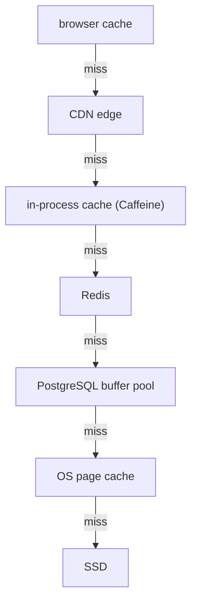

## Mental Model

Every cache exists because **two storage levels differ in speed and cost**, and programs reuse data (**locality**). A cache keeps a small, hot subset of the slow level in the fast level. Every cache, from an L1 cache line to a CDN edge, must answer the same five questions:

1. **What to keep?** (admission, locality)
2. **What to throw out when full?** (eviction: LRU, LFU, CLOCK, TTL)
3. **What happens on writes?** (write-through, write-back, write-around, invalidate)
4. **How does it learn the source changed?** (invalidation, TTL, coherence protocols)
5. **What happens when it's cold, wrong or down?** (misses, stampedes, staleness)

## Definition

| Layer | Fast level | Slow level | Unit | Hit cost vs miss cost |
|---|---|---|---|---|
| CPU L1/L2/L3 | SRAM | DRAM | 64-byte line | ~1–40 ns vs ~100 ns |
| TLB | TLB entries | page-table walk | page mapping | ~1 ns vs ~10–100 ns |
| OS page cache | RAM | disk/SSD | 4 KB page | ~µs vs 100 µs–10 ms |
| DB buffer pool | RAM | data files | 8–16 KB page | ~µs vs 100 µs+ |
| App in-process cache | heap | DB/service | object | ~100 ns vs ms |
| Redis/Memcached | remote RAM | DB | key/value | ~0.3 ms vs 5–50 ms |
| CDN edge | nearby server | origin | HTTP response | ~10–30 ms vs 100–300 ms |
| Browser cache | local disk/RAM | network | HTTP response | ~0–5 ms vs RTTs |
| DNS caches | resolver memory | authoritative servers | record | ~0 ms vs 20–100 ms |

Latency numbers are orders of magnitude, not benchmarks; the ratio between levels is what makes caching pay off.

## Why It Exists

**The problem.** The **memory hierarchy** is a fact of physics and economics: faster storage is smaller and more expensive per byte. Locality — recently used data is likely reused (temporal), nearby data is likely used next (spatial) — means a small fast level can serve most accesses. Average access time = hit time + miss rate × miss penalty; with a 1,000× miss penalty, going from 95% to 99% hits makes a large difference.

**Why one lesson for all caches.** CPU caches, the TLB, the page cache, buffer pools, Redis, browsers and CDNs look unrelated. But each exists for the same reason and must answer the same five questions. Learn the questions once and every new cache is familiar.

:::callout[That's all it is]{type=insight}
Every cache is a small fast copy of a slow source. The design is always the same five choices: what to keep, what to evict, how to handle writes, how to learn about changes, and what happens on a miss.
:::

## How It Works

One read of a product's price can be answered at any of these levels. Each level is checked only when the one above it misses:



### Eviction: the same algorithms everywhere

| Policy | Idea | Where you met it |
|---|---|---|
| LRU | evict least recently used | Redis approx-LRU, many app caches |
| CLOCK / second chance | cheap LRU approximation with reference bits | OS page replacement, PostgreSQL clock-sweep ([Page Replacement](lesson:os-page-replacement), [Buffer Pool](lesson:db-buffer-pool)) |
| LFU / TinyLFU | evict least frequently used; resists one-time scans | Redis allkeys-lfu, Caffeine |
| Scan-resistant LRU variants | protect hot items from one-pass scans | InnoDB midpoint insertion, Linux active/inactive lists |
| TTL-based | expire after time | DNS, HTTP max-age, Redis TTL |
| Set-associative replacement | limited choice per set | CPU caches |

### Write policies

| Policy | Where | Trade-off |
|---|---|---|
| Write-back (dirty, flush later) | CPU caches, page cache, buffer pool | fast writes; must flush in the right order (WAL rule, fsync) |
| Write-through | some CPU caches, write-through app caches | always consistent source; slower writes |
| Write-around / invalidate | cache-aside with Redis | writes go to source; cache entry deleted |
| No write caching | HTTP caches (responses only) | simple |

### Invalidation and consistency

- **Hardware**: coherence protocols (MESI) keep CPU caches consistent automatically — at the cost of cache-line ping-pong under contention (false sharing — [CPU Caches](lesson:os-cpu-caches-contention)).
- **OS**: the page cache *is* the file's contents; all processes see one copy.
- **DB**: the buffer pool is the only copy in memory; replicas are caches of the primary with lag ([Replication](lesson:db-replication)).
- **Application / distributed**: no automatic coherence — you choose TTLs, delete-on-write, CDC-driven invalidation, versioned keys.
- **HTTP/DNS**: TTL-based freshness + validation (ETags) — staleness bounded by time, not events ([HTTP Caching](lesson:cn-http-caching)).

The further a cache is from the source, the weaker and slower its invalidation — and the more you rely on TTLs and accepting staleness.

### Cache patterns by name

System-design interviews use these names for the write and load policies above:

| Pattern | Reads | Writes | Risk |
|---|---|---|---|
| **Cache-aside** (lazy loading) | the app checks the cache; on a miss it reads the database and fills the cache | the app writes the database, then deletes the cache entry | a short window of stale reads; every miss pays a round trip to the cache first |
| **Read-through** | the cache library loads missing entries itself (Caffeine's `LoadingCache`) | as cache-aside | the same, with the loading logic in one place |
| **Write-through** | as read-through | every write goes to the cache and the database before it returns | slower writes, but the cache never lags |
| **Write-behind** (write-back) | as read-through | writes land in the cache and reach the database later, in batches | fast, but writes are lost if the cache dies first |
| **Refresh-ahead** | entries close to expiry are reloaded in the background (Caffeine's `refreshAfterWrite`) | as cache-aside | wasted reloads of entries nobody asks for again |

Cache-aside with delete-on-write is the usual default. *Delete* rather than update: two writers updating the cache can apply their values in the wrong order, while a delete just forces the next read to load fresh data.

### Stampedes: when a hot key expires

When a hot entry expires, every request that arrives before it is reloaded misses at once. At 2,000 requests per second and a 50 ms reload, that is about 100 identical queries hitting the database together. The defenses:

- **Request coalescing** (single-flight): the first miss loads the value; later misses wait for that same load.
- **Stale-while-revalidate**: serve the old value while one background reload runs.
- **Early refresh**: reload a little before expiry, with some randomness, so the entry never expires under load.
- **TTL jitter**: entries filled together get slightly different TTLs, so they don't expire together.

Coalescing in Java needs only a map of in-flight loads. Caffeine's `LoadingCache` does the same for you, per key:

```java
final class SingleFlight<K, V> {
    private final ConcurrentHashMap<K, CompletableFuture<V>> inFlight = new ConcurrentHashMap<>();

    V get(K key, Function<K, V> loader) {
        CompletableFuture<V> mine = new CompletableFuture<>();
        CompletableFuture<V> running = inFlight.putIfAbsent(key, mine);
        if (running != null) return running.join();   // someone else is loading it: share the result
        try {
            V value = loader.apply(key);              // only this caller reaches the database
            mine.complete(value);
            return value;
        } catch (RuntimeException e) {
            mine.completeExceptionally(e);
            throw e;
        } finally {
            inFlight.remove(key, mine);
        }
    }
}
```

## Internal Mechanism

:::depth{level=advanced}
### Recurring failure patterns

| Pattern | CPU / OS | Database | Distributed |
|---|---|---|---|
| Thrashing (working set > cache) | page thrashing, cache misses | buffer pool too small | cache hit ratio collapse |
| Scan pollution | streaming reads evicting hot lines | seq scan flooding buffer pool | batch job flooding Redis |
| Cold start | cold CPU caches after context switch | empty buffer pool after restart/failover | empty cache after deploy → DB overload |
| Stampede / herd | — | — | many misses for one expired key |
| Stale data | (coherence prevents) | replica lag | TTL windows, invalidation races |
| Contention | false sharing | hot page latch | hot key on one node |

### Cache hierarchies compound

A read of a row may hit: CPU cache (row bytes) ← buffer pool (page) ← OS page cache (file block) ← SSD's own DRAM cache ← NAND. Double caching (buffer pool + page cache) wastes memory; databases choose O_DIRECT or tune sizes accordingly ([Buffer Pool](lesson:db-buffer-pool)).

### Measuring a hit ratio

Every cache exposes hits and misses somewhere. In Redis they are two counters:

```text
$ redis-cli INFO stats | grep keyspace
keyspace_hits:91234567
keyspace_misses:4802345
```

Hit ratio = 91,234,567 / (91,234,567 + 4,802,345) ≈ 0.95. So 5% of reads reach the database. If the ratio falls to 90%, the database's read load doubles, although the cache "still hits 90%". Watch the miss *rate* in requests per second next to the ratio: it is what the layer below actually receives.

### Caches change failure modes

Adding a cache improves the normal case and creates a new abnormal one: the system is now sized for the hit ratio. When the cache fails or goes cold, the load behind it multiplies — the database must survive it or requests must be shed ([Overloaded Server](lesson:x-overloaded-server)).
:::

## Example

A product page request benefits from caches at seven layers:

- the browser (static assets, marked `immutable`);
- the CDN (images, and an HTML fragment cached for 30 seconds);
- the load balancer (reused connections and TLS sessions);
- the app's in-process cache (feature flags);
- Redis (product data, 5-minute TTL);
- the database buffer pool (index pages);
- the OS page cache and the CPU caches (hot code and data).

A price change must propagate through the layers that hold it. Invalidate Redis on write, and purge the CDN or wait out its 30 s. Never cache the price in the browser, and read the authoritative price from the database at checkout.

## Complexity & Performance

Average access time = Σ over levels (probability of reaching that level × its cost). Improving the hit ratio at a level with a huge miss penalty (remote → local) matters far more than shaving the hit time.

## Trade-offs

- Freshness vs load/latency (TTL length, invalidation effort).
- Memory cost vs hit ratio (diminishing returns once the working set fits).
- Write-back speed vs durability/consistency risk (and the need for flush ordering).
- Caching closer to users (faster) vs harder invalidation.

## Failure Modes

- Caching data you can't be stale on (balances, permissions, prices at checkout).
- Missing invalidation paths (a second writer bypasses the cache).
- Sizing downstream capacity for the hit ratio with no plan for cold/failed caches.
- Personalized data in shared caches → data leaks ([HTTP Caching](lesson:cn-http-caching)).

## In Production

- Monitor hit ratio *and* miss rate × miss cost at each layer; alert on sudden hit-ratio drops (often the first sign of a deploy that changed keys).
- Document, for each cached datum: owner, TTL, invalidation mechanism, acceptable staleness.

## Deeper Connections

- MVCC snapshots and replicas are "caches of the past"; materialized views are caches of query results ([Views](lesson:sql-views-programmability)).
- Caching and concurrency meet in coherence and invalidation races ([Concurrency Everywhere](lesson:x-concurrency-everywhere)).

## Common Misconceptions

- **"Caching is an application-level feature."** It's everywhere from silicon to CDNs; the application layer is just the one you control directly.
- **"A higher hit ratio is always worth more memory."** Past the working set, returns vanish.
- **"Caches make systems more reliable."** They add capacity and a new failure mode.

## Interview Questions

### [L2 · conceptual] What properties of programs make caching work, and what limits it?

Temporal locality (recently used data is reused soon) and spatial locality (nearby data is used next) mean a small fast store can serve most accesses. Limits: working sets larger than the cache (thrashing), access patterns without locality (random or one-pass scans), invalidation/consistency requirements, and the cost of misses (cold starts, stampedes).

### [L2 · compare] Compare write-back and write-through caching, with examples at different layers.

Write-back caches modify data in the fast layer and write it to the slow layer later (CPU caches, the OS page cache, database buffer pools): fast writes, but data can be lost on failure unless ordering/flush protocols exist (fsync, WAL). Write-through writes to both immediately (some CPU caches, write-through application caches): the source is always current, writes are slower. Cache-aside application caches typically write to the source and invalidate the cache.

### [L3 · design] A cache in front of your database has a 99% hit ratio. What risks does that create, and how do you mitigate them?

The database is effectively sized for 1% of the read load; if the cache is flushed, restarted, loses a node, or a hot key expires, load on the database can spike 10–100×. Mitigate with replicated/persistent caches and rolling restarts, prewarming, request coalescing and stale-while-revalidate, TTL jitter, load shedding on the miss path, and database capacity (or graceful degradation) for a realistic cold-cache scenario.

### [L2 · compare] Cache-aside vs read-through vs write-through vs write-behind?

**Cache-aside**: the application checks the cache, loads from the database on a miss and fills the cache; on writes it updates the database and deletes the entry. **Read-through**: the same, but the cache library does the loading (Caffeine's `LoadingCache`). **Write-through**: writes go to both the cache and the database before returning, so the cache is always current but writes are slower. **Write-behind**: writes go to the cache and reach the database later in batches; fastest, but writes can be lost if the cache fails first. Cache-aside with delete-on-write is the common default for Redis in front of a database.

### [L2 · how] How do you stop a cache stampede when a hot key expires?

Make sure only one request reloads the key, and keep the others from hitting the database while it does. Request coalescing (single-flight, or Caffeine's `LoadingCache`) makes concurrent misses wait for one shared load. In Redis, a short lock (`SET key:lock NX PX 5000`) lets one instance reload while the others serve the stale value. Serving stale data during the reload (stale-while-revalidate), refreshing a little before expiry, and adding jitter to TTLs keep hot entries from expiring under load in the first place.

### [L3 · design] A Java service caches products in Caffeine (in-process) in front of Redis, in front of PostgreSQL. How do you keep the levels consistent enough?

Decide the staleness each level may have, then pick a mechanism per level. Redis: delete on every write, plus a TTL as a safety net. The in-process caches are the hard part: there's one per instance and nothing invalidates them by itself. Give them a short TTL (seconds), and publish invalidations (Redis pub/sub or a Kafka topic) that every instance applies to its local cache. Versioned keys (`product:42:v17`) avoid races between a delete and a slow reload. Never serve money or permissions from the local cache: at checkout, read the price from the database.

## Practice

### [numeric 1 unit=ms] A cache has a 99% hit ratio, a 0.5 ms hit time and a 50 ms miss penalty (the extra time a miss costs). What is the average access time in milliseconds?

:::answer
Average = hit time + miss rate × miss penalty = 0.5 + 0.01 × 50 = **1** ms. At a 95% hit ratio it would be 0.5 + 0.05 × 50 = 3 ms — three times slower from a four-point drop.
:::

### [mcq] Which pair describes the same idea at two different layers?

- [x] PostgreSQL's clock-sweep buffer replacement and the OS CLOCK page-replacement algorithm
- [ ] HTTP ETags and CPU branch prediction
- [ ] TLB entries and database foreign keys
- [ ] DNS TTLs and TCP sequence numbers

Both approximate LRU with per-entry usage bits and a sweeping hand.

### [numeric 0.301 ±0.001 unit=ms] Every request first checks an in-process cache (0.001 ms, 80% hits). Misses go to Redis (0.5 ms, and 90% of those hit), and Redis misses go to the database (10 ms). What is the average access time?

:::answer
0.001 + 0.2 × 0.5 + 0.2 × 0.1 × 10 = 0.001 + 0.1 + 0.2 = **0.301** ms. The database is reached by only 2% of requests, yet it contributes two-thirds of the average.
:::

### [numeric 100] A hot key receives 2,000 requests per second, and rebuilding its value takes 50 ms. When it expires with no stampede protection, about how many requests go to the database before the first rebuild fills the cache?

:::answer
2,000 × 0.05 = **100** requests, all running the same expensive query. Request coalescing cuts it to one.
:::

### [exercise] In the [page replacement lab](lab:page-replacement), run the reference string `1 2 3 4 1 2 3 4 1 2 3 4` with 3 frames under LRU, Clock and Optimal, then LRU with 4 frames. Count the faults. What does it say about caches whose working set is slightly bigger than the cache?

:::solution
With 3 frames, LRU and Clock fault on all 12 references: each page is evicted just before it is needed again. Optimal faults 6 times. With 4 frames, LRU faults only 4 times, once for each page.

A loop that is one page bigger than the cache is LRU's worst case: the hit ratio falls from almost 100% to 0. The same happens to a buffer pool or Redis whose hot set grows a little past its memory. That is why databases use scan-resistant policies, and why "the hit ratio collapsed after a small data increase" is a real incident pattern.
:::

### [exercise] Two hundred request threads ask for the same product right after its cache entry expired. Describe what reaches the database (a) with a cache-aside cache built on a plain `ConcurrentHashMap`, and (b) with Caffeine's `LoadingCache`, or the `SingleFlight` class above.

:::solution
(a) Each thread finds no entry, runs the query and puts the result back, so up to 200 identical queries reach the database at once. The map is thread-safe, but nothing makes the *loading* happen only once.

(b) The first thread starts the load. The other 199 find a load already in progress and wait for its result, so one query reaches the database and all 200 threads get its answer. Add `refreshAfterWrite` (or stale-while-revalidate) and even that one load happens in the background, while the threads keep getting the old value.
:::

### [mcq] Writes go to the cache and are flushed to the database later, in batches. Which pattern is this, and what is its main risk?

- [ ] Cache-aside; stale reads after a write
- [ ] Write-through; slower writes
- [x] Write-behind; writes are lost if the cache fails before flushing
- [ ] Refresh-ahead; wasted reloads

Write-behind turns many writes into a few batched ones, the same idea as a write-back CPU cache or the page cache. Like them, it needs a durability story for the data that hasn't been flushed yet.

## Quick Revision

- Every cache: what to keep, what to evict, how writes work, how invalidation works, what happens cold/down.
- Hierarchy: CPU → TLB → page cache → buffer pool → app cache → Redis → CDN → browser/DNS; ratios make it pay.
- Eviction families recur (LRU, CLOCK, LFU, TTL, scan resistance); write-back needs flush ordering.
- The farther from the source, the weaker the invalidation → TTLs and accepted staleness.
- Caches create new failure modes: cold starts, stampedes, stale data, leaks — size the backend for cache failure.
- Patterns: cache-aside (default; delete on write), read-through, write-through (cache never lags), write-behind (fast, can lose writes), refresh-ahead.
- Stampede: coalesce misses (single-flight, Caffeine `LoadingCache`), serve stale while one reload runs, refresh early, jitter TTLs.
- A working set slightly bigger than the cache can drop LRU's hit ratio to zero.
