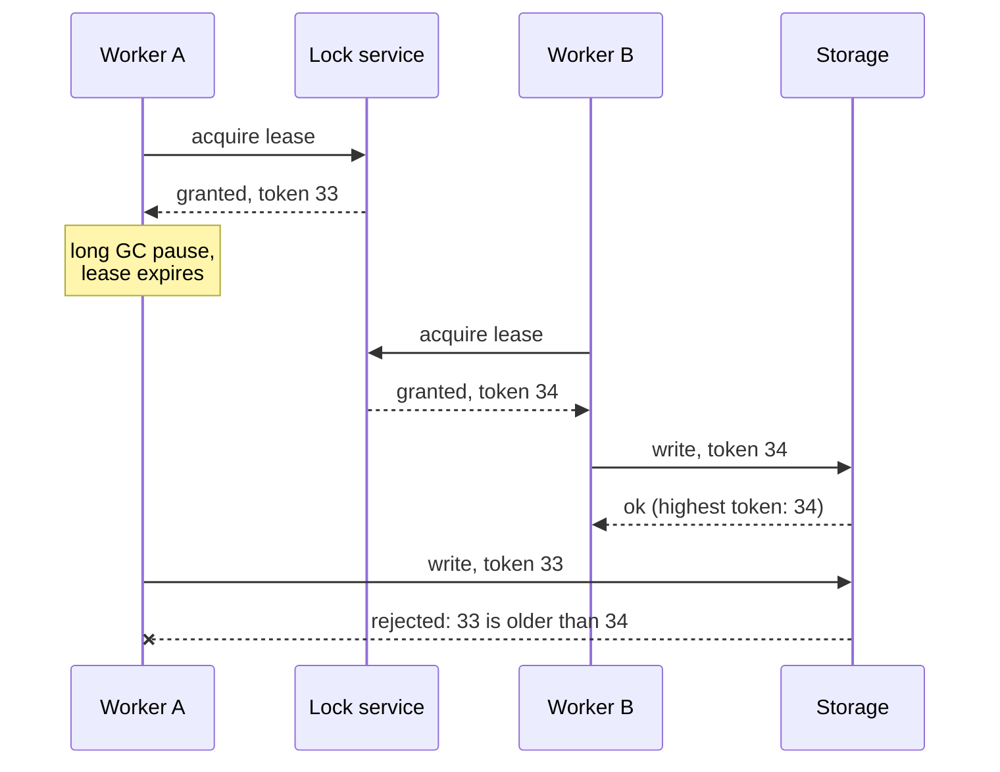

## Mental Model

Whenever two actors can touch the same state at the same time, you get the same three problems and the same three families of solutions. It doesn't matter whether the actors are **threads** sharing memory, **transactions** sharing rows, or **services** sharing a database or a cloud resource.

**Problems**: lost updates (read-modify-write races), inconsistent views (reading a half-updated state), and deadlocks (waiting in a cycle).

**Solutions**:

1. **Mutual exclusion** — take a lock first (pessimistic).
2. **Optimistic conflict detection** — do the work, then commit only if nothing changed (compare-and-swap).
3. **Versioning** — never modify shared data in place; readers see immutable snapshots (copy-on-write, MVCC).

## Definition

| Concept | Threads (OS) | Database | Distributed systems |
|---|---|---|---|
| Shared state | memory | rows/tables | database records, object storage, leader role |
| Race / anomaly | data race, lost update | lost update, write skew | double processing, split brain |
| Lock | mutex, rwlock | row/table lock, `SELECT … FOR UPDATE` | distributed lock / lease (etcd, ZooKeeper, Redis) |
| Optimistic check | CAS instruction | `UPDATE … WHERE version = ?` | ETag + If-Match, conditional put |
| Versioning | copy-on-write, RCU | MVCC snapshots | immutable event logs, versioned objects |
| Deadlock handling | lock ordering, trylock | detection + victim abort | timeouts, leases, ordering |
| Atomic "do it once" | atomic increment | unique constraint, upsert | idempotency keys |

## Why It Exists

**The problem.** Concurrency is how systems get throughput — more threads, more connections, more instances. Every added actor sharing state reintroduces the same hazards.

**The idea.** The hazards come from one situation: two actors, one piece of state, and no agreed order. So the fixes are the same three at every layer:

- make them take turns (locks);
- let them race, but check at the end (compare-and-swap);
- stop sharing mutable state (versions).

Recognizing the common pattern lets you transfer solutions across layers, instead of rediscovering them (often badly) at each one.

:::callout[That's all it is]{type=insight}
Threads, transactions and services all hit the same three problems (lost updates, inconsistent reads, deadlocks) and use the same three fixes (lock first, check-and-retry, or immutable versions). Only the names change between layers.
:::

## How It Works

### Lost update, three times

```text
Threads:      x = counter; x = x + 1; counter = x;           (two threads interleave → one increment lost)
Database:     SELECT stock → app computes stock − 1 → UPDATE stock = …   (two requests → one sale lost)
Distributed:  GET object → modify → PUT object                (two services → one change overwritten)
```

Fixes, layer by layer:

| Fix style | Threads | Database | Distributed |
|---|---|---|---|
| Atomic operation | `AtomicLong.incrementAndGet()` | `UPDATE … SET stock = stock − 1 WHERE stock > 0` | server-side atomic ops (Redis `INCR`, DynamoDB update expressions) |
| Lock | mutex around the sequence | `SELECT … FOR UPDATE` | lease-based lock + fencing token |
| Optimistic | `compareAndSet` loop | version column (JPA `@Version`) | ETag/If-Match, conditional writes |

([Atomic Instructions](lesson:os-atomic-instructions), [Optimistic vs Pessimistic](lesson:db-optimistic-pessimistic))

### Compare-and-swap three times, in Java

The optimistic fix looks the same at all three layers: read a version, write only if it hasn't changed, and retry or report on a conflict.

```java
// CPU: decrement stock without a lock; compareAndSet fails if another thread got there first
AtomicLong stock = new AtomicLong(10);
long seen;
do {
    seen = stock.get();
    if (seen == 0) throw new IllegalStateException("sold out");
} while (!stock.compareAndSet(seen, seen - 1));

// Database: 0 rows updated means someone changed the row since we read version `versionRead`
try (PreparedStatement ps = conn.prepareStatement(
        "UPDATE products SET stock = ?, version = version + 1 WHERE id = ? AND version = ?")) {
    ps.setInt(1, newStock);
    ps.setLong(2, productId);
    ps.setInt(3, versionRead);
    if (ps.executeUpdate() == 0) throw new IllegalStateException("conflict: re-read and retry");
}

// HTTP: 412 Precondition Failed means the resource changed since we read its ETag
HttpRequest put = HttpRequest.newBuilder(URI.create("https://api.example.com/carts/7"))
        .header("If-Match", etagRead)
        .PUT(HttpRequest.BodyPublishers.ofString(cartJson))
        .build();
HttpResponse<String> resp = client.send(put, HttpResponse.BodyHandlers.ofString());
if (resp.statusCode() == 412) throw new IllegalStateException("conflict: re-read and retry");
```

JPA writes the middle version for you: give the entity a `@Version` field, and Hibernate adds `AND version = ?` to every update and throws `OptimisticLockException` when no row matches.

### Deadlock, three times

- Threads: T1 holds mutex A wants B; T2 holds B wants A — hangs forever unless you order locks ([Deadlocks](lesson:os-deadlocks)).
- Database: two transactions update rows in opposite order — the database detects the cycle and aborts one ([Locking](lesson:db-locking)).
- Distributed: service A holds lock X waiting for B's response; B needs lock X — usually resolved by timeouts/lease expiry (no global waits-for graph).

The prevention is identical: **acquire resources in a consistent global order**, hold them briefly, and bound waits.

### Readers without locks: versioning

- **Copy-on-write / RCU** (OS, languages): writers create a new version and atomically publish a pointer; readers keep using the old one until done ([Copy-on-Write](lesson:os-cow-mmap)).
- **MVCC** (databases): writers create row versions; readers use snapshots ([MVCC](lesson:db-mvcc)).
- **Immutable logs** (distributed): append events; consumers read at their own offsets.

All three trade memory and garbage collection for reader concurrency — and all three need cleanup of versions nobody can see anymore (grace periods, vacuum, log retention).

### Distributed locks are different

A local mutex holder can't vanish without the OS knowing. A distributed lock holder can pause (a GC pause, a frozen VM) or be cut off by a network partition, while still believing it holds the lock. Hence **leases**, which are locks that expire, and **fencing tokens**: increasing numbers that the protected resource checks. It is the same idea as Raft's term numbers ([Quorums & Consensus](lesson:db-quorums-consensus), [Failover](lesson:db-failover)).



Worker A still believes it holds the lock when it wakes up. Only the storage, by refusing the older token, stops its stale write.

## Internal Mechanism

:::depth{level=advanced}
### Hardware underneath everything

Database latches, OS mutexes and language-level locks are built from CPU atomic instructions (CAS, LL/SC, atomic exchange) plus memory barriers; contention shows up as cache-line bouncing between cores ([CPU Caches](lesson:os-cpu-caches-contention)). A "hot row" in a database is a hot lock and a hot cache line at the same time.

### Isolation levels ⇔ memory models

Database isolation levels and CPU/language memory models answer the same question — which interleavings may readers observe? Serializability ⇔ sequential consistency (roughly); weaker isolation ⇔ relaxed memory ordering. In both worlds, the default is weaker than programmers assume, and bugs appear only under load ([Isolation Levels](lesson:db-isolation-levels), [Race Conditions](lesson:os-race-conditions)).

### Contention is the universal limit

Whatever the mechanism, operations on one hot item serialize:

- a mutex held for 1 µs caps that critical section at about 1M operations per second;
- a row lock held for 5 ms caps updates to that row at about 200 per second;
- a single-partition leader caps writes at its own throughput.

Scaling requires **splitting** the hot item (sharded counters, per-core structures such as `LongAdder`, partitioned keys) rather than a faster lock.
:::

## Example

"Charge a customer exactly once" in three designs:

| Design | Mechanism | Pitfall |
|---|---|---|
| In-memory mutex in the payment service | local lock | useless with 2+ instances |
| Redis lock with TTL around the charge | distributed lease | lock expires during a long GC pause → second instance charges too |
| Idempotency key with a UNIQUE constraint in the payments table, charge API called with the same key | atomic insert-once + provider-side idempotency | none of the above — correctness no longer depends on timing |

The robust solution turns the concurrency problem into a **constraint** checked atomically by the system of record ([Keys & Constraints](lesson:db-keys-constraints)).

## Complexity & Performance

- Locks: waiting ∝ contention × hold time; deadlock detection cost ∝ waits.
- Optimistic: wasted work ∝ conflict rate × work per attempt.
- Versioning: memory/storage for versions + cleanup work.

## Trade-offs

Pessimistic (predictable under contention, blocking), optimistic (no blocking, retries under contention), versioned (lock-free reads, garbage collection) — the same three-way trade-off at every layer.

## Failure Modes

- Check-then-act sequences without atomicity (in code, in SQL, across services).
- Locks held across slow I/O (network calls inside critical sections or transactions).
- Inconsistent lock ordering → deadlocks.
- Distributed locks treated like local mutexes (no fencing) → double execution.
- Hot items that no locking strategy can scale.

## In Production

- Review every read-modify-write path: which mechanism makes it safe? Prefer atomic statements and constraints; then optimistic checks; then locks.
- Monitor contention: lock waits, deadlocks, serialization failures, CAS retry counts.

## Deeper Connections

- Caches add concurrency problems of their own: invalidation races are lost updates on the cache ([Caching Everywhere](lesson:x-caching-everywhere)).
- Anomalies are race conditions with a database vocabulary ([Anomalies](lesson:db-anomalies)).

## Common Misconceptions

- **"Transactions make concurrent code safe."** Only at sufficient isolation, or with explicit locking/atomic statements.
- **"A distributed lock with a TTL is as safe as a mutex."** Pauses and clock issues break it without fencing.
- **"Optimistic is always faster."** Only when conflicts are rare.

## Interview Questions

### [L2 · compare] Show how a compare-and-swap appears at the CPU, database and HTTP layers.

CPU: `CAS(addr, expected, new)` atomically updates memory only if it still holds the expected value — used in lock-free loops. Database: `UPDATE t SET v = ?, version = version + 1 WHERE id = ? AND version = ?` — zero rows updated means someone else changed it. HTTP: `PUT` with `If-Match: <ETag>` — 412 Precondition Failed if the resource changed. Same pattern: read a version, write conditionally, retry or report on conflict.

### [L3 · design] How would you ensure a scheduled job runs on only one of ten instances at a time, safely?

Use leader election or a lease from a consensus-backed store (etcd/ZooKeeper) or a database advisory lock held for the job's duration; make the job itself idempotent and have side effects check a fencing token (e.g., the lease revision) so a paused former holder can't commit stale work. Alternatively claim work items with `SELECT … FOR UPDATE SKIP LOCKED`, which naturally lets only one instance process each item.

### [L2 · how] How does JPA's `@Version` implement optimistic locking, and what should the application do on a conflict?

The entity gets a version column. Hibernate reads it with the entity, and every update becomes `UPDATE ... SET ..., version = version + 1 WHERE id = ? AND version = ?`. If another transaction committed a change in between, the version no longer matches, zero rows are updated, and Hibernate throws `OptimisticLockException`, which Spring wraps as `ObjectOptimisticLockingFailureException`. The application should re-read the entity, re-apply the change and retry a few times, or tell the user that someone else edited the record. No lock is held between the read and the write, so it suits long user "think time" and low contention.

### [L2 · compare] When would you choose `SELECT ... FOR UPDATE` over a version column?

Choose the lock (pessimistic) when conflicts are frequent or a retry is expensive. Examples are a hot inventory row, or work that calls an external system and can't simply be redone. Waiting in a queue for the lock beats repeatedly failing and redoing the work. Choose the version column (optimistic) when conflicts are rare, when the read and the write are far apart in time (a form a user edits for minutes), or when holding a database lock across that gap would be unacceptable. Under heavy contention, optimistic schemes waste work on retries; under light contention, locks pay a waiting cost that is rarely needed.

### [L3 · why] Why does a distributed lock need a fencing token, and who has to check it?

Because the holder can lose the lock without knowing it. A long GC pause or a network partition lets the lease expire, another worker acquires it, and the first worker wakes up and acts as if it still holds the lock. A fencing token is a number that increases with every grant. The holder sends it with every write, and the **protected resource** rejects any write carrying a token lower than one it has already seen. The check must live in the resource: the paused worker can't detect its own staleness, and the lock service isn't on the write path.

### [L2 · how] How do you prevent deadlocks between transactions that your own code starts?

Lock rows in one global order. For example, when transferring between two accounts, lock the lower id first, or lock all of them in one statement: `SELECT ... WHERE id IN (...) ORDER BY id FOR UPDATE`. Keep transactions short, and never wait for a user or a remote call while holding locks. Some deadlocks will still happen, and PostgreSQL then aborts one transaction with error 40P01, so retry deadlock and serialization failures automatically, a small number of times. The same rules apply to Java locks: a fixed acquisition order, `tryLock` with a timeout, and short critical sections.

### [L3 · design] A "likes" counter on a viral post receives 5,000 increments per second. Updating one row can't keep up. Design around it.

One row serializes all increments behind its lock: at about 2 ms per update, the ceiling is about 500 per second. Split the hot item:

- **Sharded counter**: N rows per post (`post_id`, `shard`); each increment picks a random shard, and a read sums the N rows. 16 shards raise the ceiling sixteenfold.
- **Buffer and flush**: `INCR` in Redis, which is single-threaded and fast, with a periodic job adding the deltas to the database.
- **Append and aggregate**: insert one row per like and count asynchronously, which also prevents duplicate likes with a unique key.

All three trade an exact, instant count for throughput, which is fine for likes and not fine for money.

## Practice

### [numeric 500] Every update to a hot row holds its lock for 2 ms. What is the maximum number of updates per second to that row, regardless of how many servers you add?

:::answer
Updates to one row serialize: 1000 ms / 2 ms = **500** updates per second. To go faster, split the hot row (sharded counters) or shorten the hold time.
:::

### [mcq] Which mechanism makes "charge exactly once" correct even if two instances race and one pauses for 60 seconds?

- [ ] A local mutex in each instance
- [ ] A Redis lock with a 30-second TTL
- [x] An idempotency key protected by a unique constraint (and passed to the payment provider)
- [ ] Running the job at Read Committed

The atomic constraint doesn't depend on timing; leases can expire during pauses.

### [numeric 8] Every increment of a hot counter row holds its lock for 4 ms. Into how many rows (a sharded counter) must you split it to handle 2,000 increments per second?

:::answer
One row handles 1,000 / 4 = 250 increments per second, so 2,000 / 250 = **8** rows. Reads now sum 8 rows instead of reading one.
:::

### [numeric 1.25] With optimistic concurrency, each attempt conflicts with probability 0.2, independently of other attempts. On average, how many attempts does one successful update take?

:::answer
The number of attempts is geometric with success probability 0.8, so its mean is 1 / 0.8 = **1.25**. At a conflict probability of 0.8 it would be 5, which is when a lock becomes the better choice.
:::

### [exercise] In the [race condition lab](lab:race-condition), find an interleaving that loses an update, then turn on the mutex. Map the lost update onto a web shop: two requests read a product's stock, compute stock − 1, and write it back. Give the SQL that fixes it without an explicit lock.

:::solution
A losing interleaving: T1 LOAD (0), T2 LOAD (0), T1 ADD, T2 ADD, T1 STORE (1), T2 STORE (1). Both increments ran, but the counter ends at 1. With the mutex, the LOAD–ADD–STORE sequence of one thread can't be interleaved with the other's, so the result is always 2.

In the shop, the two requests both `SELECT stock` (10), both compute 9, and both `UPDATE ... SET stock = 9`: one sale is lost. Fix it by letting the database do the read-modify-write atomically:

`UPDATE products SET stock = stock - 1 WHERE id = ? AND stock > 0`

The database takes the row lock for the duration of the update, so the second request reads the first one's result. Zero rows updated means the product is sold out.
:::

### [exercise] In the [lock manager lab](lab:db-locks), build a deadlock by locking two rows in opposite order, and see what the detector does. Then fix it with consistent ordering. What is the same rule for Java locks and for distributed locks?

:::solution
T1 holds row A and requests row B, while T2 holds row B and requests row A. The graph of who waits for whom has the cycle T1 → T2 → T1, so the detector aborts one transaction (the victim) and releases its locks, and the other one proceeds. With both transactions locking A before B, the second simply waits for the first and no cycle can form.

The rule is the same everywhere: acquire locks in one global order. For Java locks, always take `ReentrantLock`s in the same order (for example by account id), or use `tryLock` with a timeout. For distributed locks there is no detector at all, so ordering and lease expiry are the only protection.
:::

### [mcq] Who must check a fencing token for it to protect against a paused lock holder?

- [ ] The lock holder, before each write
- [ ] The lock service, when the lease expires
- [x] The storage or resource being written to
- [ ] Nobody: the lease's TTL is enough

The paused holder can't know it lost the lock, and the lock service isn't on the write path. Only the resource sees both writers' tokens, so it alone can refuse the older one.

## Quick Revision

- Same problems everywhere: lost updates, inconsistent views, deadlocks.
- Same fixes everywhere: atomic operations, locks, optimistic CAS/versions, copy-on-write/MVCC.
- Deadlock prevention: consistent ordering, short holds, bounded waits.
- Distributed locks need leases + fencing tokens; prefer constraints and idempotency.
- Hot items serialize at any layer — split them.
- Java at three layers: `AtomicLong.compareAndSet` loop, `UPDATE ... WHERE version = ?` (JPA `@Version`), HTTP `If-Match` (412 on conflict).
- Pessimistic when conflicts are frequent or retries expensive; optimistic when conflicts are rare or the read and write are far apart.
- Fencing tokens are checked by the resource; hot rows are split (sharded counters, `LongAdder`, Redis `INCR`).
