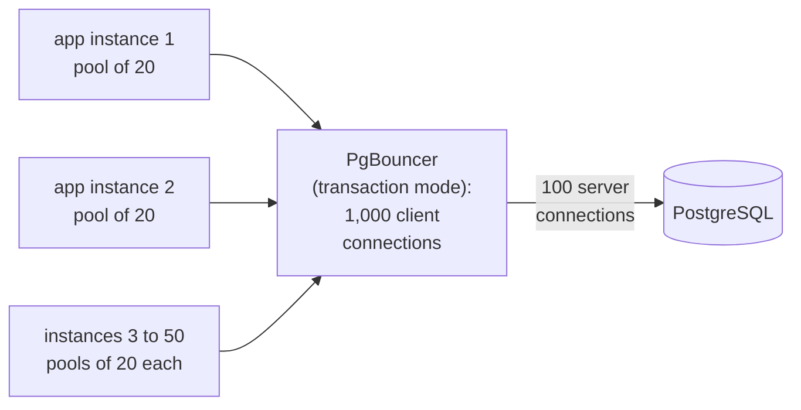

## Mental Model

A connection is **an expensive, stateful pipe** between two processes, and every layer has a limited number of them. Creating one costs round trips (TCP, TLS, authentication). It also costs resources: a file descriptor on each side, kernel buffers and, on PostgreSQL, a whole backend process with its own memory. So systems **reuse** connections through **pools**. Most connection problems are about pools that are the wrong size, held too long, or exhausted.

The pool is a queue in front of a scarce resource. **Little's law** tells you how big it must be: `connections in use = throughput × time each request holds one`.

## Definition

- **Connection pool**: a set of open connections handed out to requests and returned after use.
- **Pool size / max**: the most connections the pool will open; **checkout timeout**: how long a request waits for one.
- **Server-side limits**: `max_connections` (PostgreSQL), `max_connections` (MySQL), Redis `maxclients`, OS file-descriptor limits (`ulimit -n`), ephemeral port range.
- **External pooler**: a proxy multiplexing many client connections onto few database connections (PgBouncer, pgcat, RDS Proxy, ProxySQL).
- **Pooling modes** (PgBouncer): session (a server connection per client session), **transaction** (a server connection only for the duration of a transaction), statement.
- **Keep-alive**: reusing an HTTP/TCP connection for several requests ([HTTP Connections](lesson:cn-http-connections)).
- **Little's law**: L = λ × W (items in system = arrival rate × time in system).

## Why It Exists

**The problem.** Opening a database connection per request would add several round trips (TCP + TLS + auth ≈ 3–5 RTT). For PostgreSQL it would also fork a process, which takes milliseconds and several MB of memory. At hundreds of requests per second, connection setup would dominate. Thousands of simultaneous connections would exhaust memory, file descriptors and CPU (context switching, snapshot overhead). Pools amortize the setup and cap the concurrency.

**The idea.** It's the same trick as thread pools: pay the expensive setup once, then hand the finished object to whoever needs it next. A pool is also a deliberate limit — it decides how many requests can be talking to the database at once, which protects the database when traffic spikes.

:::callout[That's all it is]{type=insight}
Connections are expensive to open and limited in number, so keep a few open and lend them out. Size the pool with Little's law (throughput × hold time), remember that every app instance has its own pool, and put timeouts on every wait.
:::

## How It Works

### Cost of a new connection (PostgreSQL, same region)

| Step | Cost |
|---|---|
| TCP handshake | 1 RTT |
| TLS handshake | 1 RTT (TLS 1.3) |
| Startup + authentication (SCRAM) | 1–2 RTT + CPU (key derivation is deliberately expensive) |
| Backend process fork + catalog cache warm-up | ~1–5 ms, several MB RAM |

A pooled checkout costs microseconds.

### Sizing a pool with Little's law

Required connections ≈ requests per second that use the DB × seconds each request holds a connection.

- 2,000 requests/s, each holding a connection 5 ms → 2,000 × 0.005 = **10 connections** busy on average. A pool of ~20 absorbs bursts.
- Same load, but code holds the connection while calling an external API for 200 ms → 2,000 × 0.205 ≈ **410 connections**. The problem isn't the pool size; it's holding connections during unrelated work.

And the database side has its own optimum: throughput peaks when active connections ≈ a small multiple of CPU cores (plus some for I/O waits). Beyond that, extra connections add contention (locks, context switches, cache thrashing) and **reduce** throughput. A 16-core database rarely benefits from more than ~50–100 truly active connections.

### The multiplication problem

Each instance sizes its pool for itself, but the database sees the sum. 50 application instances × pool size 20 = 1,000 database connections, although each instance is mostly idle. Autoscaling to 150 instances makes it 3,000, and the database answers `FATAL: sorry, too many clients already`. Solutions:

- Smaller per-instance pools, sized by Little's law.
- An **external pooler** in transaction mode: thousands of client connections share, say, 100 server connections, because a server connection is only needed *during* a transaction. Caveat: session state doesn't survive across transactions. That covers session-level prepared statements, `SET`, advisory locks, `LISTEN` and temp tables; use transaction-scoped equivalents such as `SET LOCAL`.



### Timeouts at every layer

Without timeouts, one stuck dependency ties up connections forever and the whole system freezes.

| Timeout | Guards against |
|---|---|
| Pool checkout timeout | waiting forever for a connection (fail fast, return 503) |
| TCP connect timeout | unreachable host (default OS SYN retries can take ~2 minutes) |
| Statement timeout (`statement_timeout`) | runaway queries holding connections and locks |
| `idle_in_transaction_session_timeout` | leaked transactions holding locks/snapshots ([Transactions](lesson:db-transactions-acid)) |
| `lock_timeout` | long lock waits (e.g., migrations) |
| HTTP client/read timeouts | slow downstream services |
| Load balancer idle timeout | idle connections held open forever. The backend's keep-alive timeout must be *longer* than the load balancer's; otherwise the backend may close a connection just as the load balancer sends a request on it, and the user gets a 502 |

Rule: timeouts should shrink as you go deeper (edge 30 s > app 10 s > DB statement 5 s). Then inner work is abandoned before the caller gives up, not after.

### Keep-alive, TIME_WAIT and ephemeral ports

Opening and closing many short outbound connections leaves sockets in **TIME_WAIT** for ~60 s on the side that closed first ([TCP Termination](lesson:cn-tcp-termination)). It happens with any database, cache or HTTP API used without pooling. Each outbound connection to the same destination IP:port uses a distinct ephemeral port (~28,000 by default on Linux). At ~500 new connections/s you can run out: `connect: cannot assign requested address`. Keep-alive and pooling fix it.

### File descriptors

Every socket is a file descriptor ([File Descriptors](lesson:os-file-descriptors)). Default per-process limits (often 1,024 soft) are too low for servers handling many connections; raise `ulimit -n` / systemd `LimitNOFILE`. "Too many open files" (EMFILE) on accept means new connections are refused while the process may otherwise be healthy.

### The Java pool: HikariCP

Spring Boot's default pool is HikariCP. Its settings map directly onto this lesson:

| Setting | Default | What it controls | A sensible choice |
|---|---|---|---|
| `maximumPoolSize` | 10 | the most connections, idle or in use | Little's law plus headroom, and small |
| `minimumIdle` | same as the maximum | idle connections kept open | leave it equal: a fixed-size pool |
| `connectionTimeout` | 30 s | how long `getConnection()` waits before throwing | 1–5 s, so a request fails fast with a 503 |
| `maxLifetime` | 30 min | retire each connection at this age | a little shorter than any database, proxy or firewall limit |
| `leakDetectionThreshold` | 0 (off) | log a stack trace when a connection is held longer than this | 2–5 s in staging |

In Spring Boot these are `spring.datasource.hikari.*` properties:

```properties
spring.datasource.hikari.maximum-pool-size=20
spring.datasource.hikari.connection-timeout=2000
spring.datasource.hikari.max-lifetime=1740000
spring.datasource.hikari.leak-detection-threshold=3000
```

HikariCP's guide suggests starting from **connections ≈ cores × 2 + effective spindle count** on the database server, then measuring. For a 16-core database on SSDs, that is about 32–35 connections for the *whole fleet*, which is far fewer than most teams configure.

**What exhaustion looks like in Java.** Requests fail with `SQLTransientConnectionException: HikariPool-1 - Connection is not available, request timed out after 30000ms`. The metric `hikaricp.connections.pending` (threads waiting for a connection) climbs, and a thread dump shows request threads parked inside the pool:

```text
"http-nio-8080-exec-87" #143 daemon prio=5 TIMED_WAITING (parking)
    at jdk.internal.misc.Unsafe.park(Native Method)
    at java.util.concurrent.SynchronousQueue.poll(SynchronousQueue.java:...)
    at com.zaxxer.hikari.util.ConcurrentBag.borrow(ConcurrentBag.java:...)
    at com.zaxxer.hikari.pool.HikariPool.getConnection(HikariPool.java:...)
    at com.example.orders.OrderRepository.findRecent(OrderRepository.java:41)
```

Dozens of threads with that stack mean the pool is the queue. The next question is always the same: which code is *holding* the connections, and for how long?

**The usual cause, and its fix.** A connection is held for the whole block it was borrowed in, including any slow call made inside it:

```java
// Before: the connection is held while the partner API answers (200 ms, or 8 s in an incident)
try (Connection c = pool.getConnection()) {
    insertOrder(c, order);
    Payment p = payments.charge(order);          // slow external call, connection still held
    markPaid(c, order.id(), p.id());
}

// After: two short borrows, and nothing held during the call
try (Connection c = pool.getConnection()) { insertOrder(c, order); }
Payment p = payments.charge(order);              // no connection held
try (Connection c = pool.getConnection()) { markPaid(c, order.id(), p.id()); }
```

In Spring, the first version is a `@Transactional` method that calls the partner inside it. The second needs the order to have a PENDING state, and a payment call that is safe to retry ([SQL Query Journey](lesson:x-sql-query-journey)).

## Internal Mechanism

:::depth{level=advanced}
### Why PostgreSQL connections are heavyweight

Each connection is a forked process with private memory: `work_mem` allocations, catalog caches and prepared statements. Taking a snapshot scans the array of running transactions, which is O(connections), and lock and latch contention grows with active backends. PostgreSQL 14 improved snapshot scalability substantially. Still, thousands of *active* connections remain inefficient, and idle ones still cost memory. MySQL uses threads, which are lighter, with a thread pool plugin for very high counts.

### Pool behavior details

- **Validation**: pools test connections (on checkout or periodically) to discard ones killed by a failover, proxy idle timeout or network change.
- **Max lifetime**: recycle connections periodically (e.g., 30 min) so load rebalances after failovers and DNS changes, and server-side memory is released.
- **Fairness**: FIFO waiting avoids starvation; bounded wait queues avoid unbounded latency.
- **Prepared statement caches** are per connection — another reason transaction pooling needs protocol-level support (PgBouncer 1.21+ supports protocol-level prepared statements).
:::

## Example

**Pool exhaustion incident** — an e-commerce API:

1. A payment provider slows from 200 ms to 8 s.
2. The checkout handler calls it *inside* a database transaction (holding a pooled connection).
3. Little's law: 50 checkouts/s × 8 s = 400 connections needed; the pool has 40.
4. Every other endpoint (browse, search) now waits for a connection → pool checkout timeouts → 503s across the whole site, while the database itself is nearly idle.

Fix: move the external call outside the transaction and the connection checkout. Add a short timeout and a circuit breaker on the provider, and separate pools (bulkheads) for critical and non-critical paths ([Overloaded Server](lesson:x-overloaded-server)).

## Complexity & Performance

- Pooled checkout: µs. New connection: ms to tens of ms.
- Database throughput vs active connections: rises until ~cores × small factor, then falls.
- Required pool size = throughput × hold time; reduce hold time before raising size.

## Trade-offs

- Bigger pools absorb bursts but can overload the database and hide slow code.
- External poolers (transaction mode) scale client counts but restrict session features and add a hop.
- Long-lived connections are efficient but stick to one backend after scaling/failover — use max lifetime.

## Failure Modes

- **Pool exhaustion** from slow queries, external calls inside transactions, or leaked connections (not returned on error paths).
- **Connection storms** after deploys or failovers: every instance reconnects at once. Add jitter and backoff.
- **max_connections exceeded** from autoscaling × per-instance pools.
- **Ephemeral port exhaustion / TIME_WAIT** from not reusing connections.
- **EMFILE** from low file-descriptor limits.
- **Missing timeouts** turning a slow dependency into a full outage.

## In Production

- Metrics: pool active/idle/waiting, checkout wait time, connection creation rate, DB connection count by state (`pg_stat_activity`), errors like "too many clients", EMFILE, EADDRNOTAVAIL.
- A reasonable default: small app pools (5–20), a transaction-mode pooler in front of PostgreSQL for large fleets, explicit timeouts everywhere.

## Deeper Connections

- The pool is a bounded queue in front of a server — queueing theory applies directly ([Overloaded Server](lesson:x-overloaded-server)).
- File descriptors, TIME_WAIT and keep-alive connect the OS and TCP lessons ([File Descriptors](lesson:os-file-descriptors), [TCP Termination](lesson:cn-tcp-termination)).
- Thread pools have the same sizing logic as connection pools ([Thread Pools](lesson:os-thread-pools)).

## Common Misconceptions

- **"More connections = more database throughput."** Past a point, fewer active connections do more work.
- **"The pool is too small" is the usual root cause.** Usually connections are held too long.
- **"Idle connections are free."** They cost memory, file descriptors and (for PostgreSQL) processes.

## Interview Questions

### [L2 · why] Why use a database connection pool?

Creating a connection costs several network round trips (TCP, TLS, authentication) and server resources (a process or thread and memory per connection). A pool keeps a bounded set of open connections for reuse, making checkout nearly free and capping the concurrency the database sees, which protects its throughput.

### [L2 · numerical] An API handles 1,500 requests/s; each request holds a DB connection for 20 ms. What pool size is needed on average, and what would you configure?

:::answer
Little's law: 1,500 × 0.020 = **30** connections in use on average. Configure headroom for bursts and variance (e.g., 40–50 total across instances), check that it fits the database's max_connections and core count, and first try to reduce hold time (shorter transactions, no external calls while holding a connection).
:::

### [L3 · incident] During a partner API slowdown, your entire site returned 503s although the database was idle. Explain.

Handlers held pooled database connections (or worker threads) while waiting on the slow partner API, so hold time exploded; by Little's law the pool needed far more connections than it had. All requests — including unrelated ones — queued for connections and timed out. Fixes: don't hold connections across external calls, set tight timeouts and circuit breakers on the partner, and isolate pools per dependency (bulkheads).

### [L3 · design] You're autoscaling to 200 app pods against a PostgreSQL primary with max_connections = 500. Design the connection setup.

Per-pod pools must be small (Little's law per pod) but 200 × even 5 = 1,000 > 500. Put a transaction-mode pooler (PgBouncer/pgcat, highly available) between pods and the database with a server pool sized near the database's optimum (~2–4× cores), let pods connect to the pooler, avoid session-level features, add connection jitter/backoff for deploy storms, and route read-only traffic to replicas with their own pools.

### [L2 · how] How would you configure HikariCP for a service, and why is a small, fixed-size pool the usual advice?

Size `maximumPoolSize` from Little's law (requests per second × seconds each request holds a connection), plus headroom, and check that the sum over all instances fits the database. Leave `minimumIdle` equal to the maximum so the pool doesn't grow and shrink under bursts. Set `connectionTimeout` to a few seconds so callers fail fast instead of piling up for 30 s. Set `maxLifetime` slightly below any proxy, firewall or database connection limit, and turn on `leakDetectionThreshold` in staging.

Small pools are the advice because the database's throughput peaks at a modest number of active connections, roughly a few per core. Beyond that, extra connections add lock contention, context switches and memory without adding work done. A bigger pool mostly moves the queue from the application into the database, where it is harder to see.

### [L2 · debugging] A Spring Boot service logs "Connection is not available, request timed out after 30000ms". What do you check?

That message means `getConnection()` waited the full `connectionTimeout`: every connection was lent out for 30 s. Check, in order:

1. Pool metrics: `hikaricp.connections.active` at the maximum and `pending` high confirm exhaustion.
2. Hold time: which code holds connections? A thread dump shows threads parked in `HikariPool.getConnection`, and the threads *not* parked there are the ones holding connections. Look for slow queries, lock waits, and external calls inside transactions.
3. Leaks: a connection not closed on an error path never comes back; `leakDetectionThreshold` logs where it was borrowed.
4. The database side: `pg_stat_activity` for long transactions, `idle in transaction` sessions and lock waits.

Raising the pool size is the last step, and only if the database has headroom.

### [L2 · why] Behind a load balancer, a few requests fail with 502 right after the service has been idle. What is going on, and how do you fix it?

The load balancer keeps idle keep-alive connections to the backend and reuses them for new requests. If the backend's keep-alive timeout is *shorter* than the load balancer's idle timeout, the backend closes an idle connection at the moment the load balancer sends a request on it. The request hits a closed socket, and the load balancer returns 502. Fix it by making the backend's keep-alive timeout longer than the load balancer's idle timeout (for example 75 s against 60 s), so the load balancer always closes first.

## Practice

### [numeric 40] A service handles 400 requests/s and each request holds a database connection for 100 ms. On average, how many connections are in use?

:::answer
L = λ × W = 400/s × 0.1 s = **40** connections.
:::

### [mcq] Which error most directly indicates ephemeral port exhaustion on a client making many short outbound connections?

- [ ] ECONNREFUSED
- [x] EADDRNOTAVAIL ("cannot assign requested address")
- [ ] EMFILE ("too many open files")
- [ ] ETIMEDOUT

The kernel has no free local port for another connection to the same destination; reuse connections.

### [numeric 470 ±2] Linux's default ephemeral port range gives 28,232 ports, and a closed connection stays in TIME_WAIT for 60 s on the side that closed first. Without connection reuse, how many new connections per second can a client open to one destination IP and port before it runs out of ports?

:::answer
28,232 / 60 ≈ **470** per second. Above that, `connect()` fails with EADDRNOTAVAIL. Keep-alive and pooling avoid the problem by not opening new connections at all.
:::

### [numeric 0.8 unit=s] During the payment incident, 50 checkouts arrive per second and the pool has 40 connections. What is the longest average hold time per checkout that the pool can sustain?

:::answer
From L = λ × W: W = L / λ = 40 / 50 = **0.8** s. Each checkout held a connection for 8 s, ten times too long, which is why the pool ran dry.
:::

### [numeric 20] HikariCP's guide suggests starting from cores × 2 + effective spindle count. What pool size does that give for a database server with 8 cores and an effective spindle count of 4?

:::answer
8 × 2 + 4 = **20** connections, shared by every application instance. It's a starting point to measure from, not a law.
:::

### [exercise] An API serves 1,500 requests per second, and each holds a connection for 20 ms. In the [Speedup & Queueing lab](lab:speedup-queueing), use Little's law to find the average number of connections in use. Then, in the queueing tab, try pools of 30, 35 and 40 connections (S = 20 ms, λ = 1,500 per second). How often must a request wait for each, and which size would you choose?

:::solution
Little's law gives 1,500 × 0.02 = 30 connections in use on average. That is only the average: arrivals are random, so a pool of exactly 30 is 100% busy and the queue grows without limit.

- 35 connections: 85.7% busy, 28.5% of requests have to queue, mean response 21.14 ms.
- 40 connections: 75% busy, 5.5% have to queue, mean response 20.11 ms.

Choose about 40. It keeps queueing rare and costs only ten more connections, as long as the database can take them. That matches the "40–50" rule of thumb in the interview answer above.
:::

### [exercise] An application runs behind PgBouncer in transaction mode and runs `SET search_path = tenant_42` once when it opens each connection. Some queries then read another tenant's tables. Explain why, and give two fixes.

:::solution
In transaction mode, PgBouncer lends a server connection to a client only for one transaction. The `SET` ran on whichever server connection served that first transaction, and it stays there. The client's later transactions may run on other server connections with a different `search_path`, and the next client to get the first connection inherits `tenant_42`.

Fixes:

1. Use `SET LOCAL search_path = ...` inside every transaction; it ends with the transaction.
2. Don't rely on session state: qualify table names with the schema, or give each tenant its own database role with `ALTER ROLE ... SET search_path`.

Session-level prepared statements, advisory locks, `LISTEN` and temp tables break the same way.
:::

### [mcq] Behind a load balancer with a 60-second idle timeout, which backend keep-alive timeout avoids sporadic 502s?

- [ ] 30 seconds, so the backend frees idle connections sooner
- [ ] Exactly 60 seconds, to match
- [x] 75 seconds, longer than the load balancer's
- [ ] Keep-alive off, so every request opens a new connection

The side that closes first must be the load balancer. If the backend closes first, the load balancer can send a request on a connection that is already closing.

## Quick Revision

- Connections are expensive (RTTs + process/memory); pools reuse and cap them.
- Pool size ≈ throughput × hold time (Little's law); fix hold time before growing pools.
- DB throughput peaks at a modest number of active connections; use external transaction-mode poolers for large fleets.
- Timeouts at every layer, decreasing inward; max lifetime + validation for pooled connections.
- Watch for pool exhaustion, connection storms, max_connections, TIME_WAIT/ephemeral ports, EMFILE.
- HikariCP: `maximumPoolSize` (10), fixed size, `connectionTimeout` (30 s by default; set a few seconds), `maxLifetime` below infrastructure limits, leak detection in staging.
- Exhaustion in Java: "Connection is not available, request timed out"; threads parked in `HikariPool.getConnection`; find who *holds* connections.
- Backend keep-alive timeout > load balancer idle timeout, or you get 502s.
