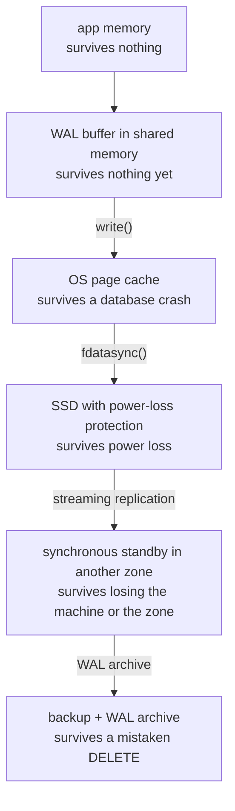

## Mental Model

"Saved" is not one event; it's a **chain of copies**, each surviving a larger class of failure:

```text
app memory → DB WAL buffer → OS page cache → device write cache → persistent media → another machine → another zone → a backup
   (process crash)   (DB crash)      (kernel crash / power loss)   (disk failure)   (machine loss)  (zone loss)  (human error)
```

A write is only as durable as the **last link it has reached** when you acknowledge it. Every "fast" setting (async commit, no fsync, async replication, a volatile disk cache) shortens the chain — sometimes a reasonable trade, sometimes silent data loss.

## Definition

- **Durability**: once acknowledged, a write survives the failures you designed for.
- **`write()`**: copies data into the kernel page cache — survives the process crashing, not the machine losing power ([Page Cache](lesson:os-page-cache)).
- **`fsync()` / `fdatasync()`**: forces file data (and metadata, for fsync) to stable storage and waits for the device to confirm.
- **Device write cache**: DRAM on the SSD/controller; volatile unless protected by capacitors/battery (**power-loss protection**, PLP).
- **FUA / flush commands**: how the kernel asks the device to persist data rather than cache it.
- **Failure domain**: the scope of a failure — process, OS, machine, rack, zone, region, human.

## Why It Exists

**The problem.** Each layer buffers writes to be fast: databases batch WAL, the OS delays writeback, disks cache in DRAM. Buffering is only safe if something forces data through before claiming success. Knowing the chain lets you answer the real question behind "is it durable?": **durable against what?**

**The idea.** Durability isn't yes/no; it's "how far down the chain has this write travelled before I said OK?". Each extra link survives a bigger disaster and costs more latency, so you choose the link that matches the failure you care about.

:::callout[That's all it is]{type=insight}
"Saved" means "copied to somewhere that survives failure X". Each layer (log, fsync, disk, replica, other zone, backup) survives a bigger X. A write is only as safe as the last layer it reached before you acknowledged it.
:::

## How It Works

Each step down the chain makes a copy that survives a bigger failure:



### Walking the chain for one COMMIT

| Link | What happens | Survives |
|---|---|---|
| 1. Application | builds the transaction | nothing yet |
| 2. DB WAL buffer | change + commit records in shared memory | nothing yet (DB process crash loses it) |
| 3. `write()` to WAL file | bytes in the OS page cache | DB process crash ✔; OS crash/power loss ✘ |
| 4. `fdatasync()` | kernel sends data + flush/FUA to the device; filesystem journal may commit metadata ([Journaling](lesson:os-journaling)) | power loss ✔ **if** the device honors flushes |
| 5. Device | data persisted in NAND (or in PLP-protected cache) | power loss ✔; device failure ✘ |
| 6. Synchronous replica | standby has flushed the WAL too | primary machine/disk loss ✔ |
| 7. Replica in another zone/region | same, farther away | zone/region loss ✔ (at latency cost) |
| 8. Backup + WAL archive | copies in object storage, retained over time | accidental DELETE, corruption, ransomware ✔ (via PITR) ([Crash Recovery](lesson:db-crash-recovery)) |

A default PostgreSQL COMMIT waits for link 4 (and 6 if synchronous replication is configured). Links 7–8 are asynchronous in most deployments, which is why RPO for regional disasters is usually seconds, not zero.

### Settings that cut the chain

| Setting | Effect | Risk |
|---|---|---|
| `synchronous_commit = off` (PG), `innodb_flush_log_at_trx_commit = 2` | ack after write() / periodic flush | lose last ~0.2–1 s of commits on OS crash/power loss; no corruption |
| `fsync = off` | never flush | **database corruption** on crash — never in production |
| Volatile disk cache without PLP, flushes ignored ("write cache enabled", some virtual disks) | device lies about persistence | lost or torn writes on power loss despite fsync |
| Async replication only | ack before replicas have data | lose the replication lag on primary failure ([Failover](lesson:db-failover)) |
| No off-site backups / untested restores | — | human error and disasters are unrecoverable |

### Group commit: making the chain affordable

An fsync costs ~0.05–2 ms on NVMe (more on network block storage, ~5–10 ms on HDDs). If each commit needed its own fsync, a device doing 1,000 flushes/s would cap you at 1,000 commits/s. Group commit makes one flush cover every commit waiting at that moment, so throughput grows with concurrency ([WAL](lesson:db-wal-durability)).

### The same chain from Java

Your own files go through the same links. Each call below moves the data one link further:

```java
try (FileChannel log = FileChannel.open(Path.of("orders.log"),
        StandardOpenOption.CREATE, StandardOpenOption.WRITE, StandardOpenOption.APPEND)) {
    log.write(ByteBuffer.wrap(record));   // page cache: survives a JVM crash, not a power loss
    log.force(false);                     // fdatasync: survives a power loss, if the device honours flushes
}
// A newly created file also needs its directory entry flushed
try (FileChannel dir = FileChannel.open(Path.of("."), StandardOpenOption.READ)) {
    dir.force(true);                      // fsync on the directory (Linux; Windows doesn't allow it)
}
```

`force(false)` flushes the data and only the metadata needed to read it back, like `fdatasync`; `force(true)` flushes all metadata too, like `fsync`. Writing through a `BufferedWriter` without `flush()` stays at the first link: still inside the JVM.

Message queues have chains too. A Kafka producer with `acks=all` gets its acknowledgement when every in-sync replica has the record, and `min.insync.replicas=2` refuses writes when fewer than two replicas are in sync. But Kafka doesn't fsync each message by default: "acknowledged" means "in the memory of two or more machines". That survives losing a broker, but not a power cut that takes every replica down at once. Durable against what, again.

## Internal Mechanism

:::depth{level=advanced}
### fsync's sharp edges

- `fsync` on a file doesn't make a newly created file's **directory entry** durable — you must also fsync the directory (databases and careful applications do).
- After an fsync **error**, Linux may have already dropped the dirty pages; retrying fsync can report success while data is gone. PostgreSQL now treats fsync failure as a PANIC and recovers from WAL ("fsyncgate", 2018).
- `O_DIRECT` bypasses the page cache but does **not** imply durability; you still need `O_DSYNC`/fsync or FUA semantics.

### Measuring the flush link

PostgreSQL ships `pg_test_fsync`, which times the flush methods on the disk you point it at. On a data-center NVMe drive with power-loss protection, the output looks like this (abridged):

```text
Compare file sync methods using one 8kB write:
(in wal_sync_method preference order, except fdatasync is Linux's default)
        open_datasync                     27891.204 ops/sec      36 usecs/op
        fdatasync                         27540.330 ops/sec      36 usecs/op
        fsync                             26102.877 ops/sec      38 usecs/op
        fsync_writethrough                              n/a
        open_sync                         25987.115 ops/sec      38 usecs/op
```

About 36 µs per flush means at most about 27,500 flushes per second, before group commit multiplies the commits per flush. A drive *without* power-loss protection that honours flushes typically shows 1–2 ms per operation here. If such a drive shows tens of microseconds, it is probably acknowledging flushes from its volatile cache, which is exactly the "device lies" row of the table above.

### Atomicity at the device level

Devices guarantee atomic writes only at some granularity (often 512 B or 4 KB sectors). A database page (8–16 KB) can tear; hence full-page writes (PostgreSQL) and the doublewrite buffer (InnoDB) ([Pages & Records](lesson:db-pages-records)).

### Consensus as a durability link

In Raft-replicated systems, "committed" means a majority of nodes have **fsync'd** the entry. A cluster that acknowledges before fsync (for speed) can lose committed entries if a majority crashes simultaneously (e.g., a power event in one data center) ([Quorums & Consensus](lesson:db-quorums-consensus)).

### Applications have chains too

Message queues (acks after replication or not), object stores (acknowledge after N copies), and even `logger.info()` (buffered in the process) all have their own points of "durable enough". Ask each dependency the same question: acknowledged after what?
:::

## Example

An order service writes to PostgreSQL (NVMe with PLP, synchronous standby in another zone, asynchronous replica in another region, WAL archived to object storage every minute):

| Failure | Data lost? |
|---|---|
| App process crashes after COMMIT OK | no |
| PostgreSQL crashes | no (WAL replay) |
| Primary host loses power | no (fsync'd to PLP-protected SSD) |
| Primary zone destroyed | no (synchronous standby has every commit) |
| Whole region lost | up to the async replica's lag (seconds) |
| Engineer runs `DELETE FROM orders` | no — PITR from base backup + WAL archive to just before it (minus ≤ 1 minute of unarchived WAL if the primary is also lost) |

Each row is a link in the chain, chosen deliberately with its latency and cost.

## Complexity & Performance

- Commit latency ≈ fsync latency (+ synchronous replication RTT); throughput ≈ flushes/s × commits per flush.
- Every additional synchronous link adds its latency to every commit.

## Trade-offs

Durability against larger failure domains costs latency (synchronous links) or money (replicas, backups, PLP hardware). Choose per data class: payments demand long chains; analytics events may accept async commit.

## Failure Modes

- Consumer-grade or misconfigured storage ignoring flushes.
- Disabling fsync for benchmarks and forgetting.
- Assuming replicas are backups (they replicate deletes instantly).
- Backups never restored in a test — discovered broken during the disaster.
- Acknowledging to users before the chain reaches the promised link (e.g., queueing writes in memory).

## In Production

- Write down RPO/RTO per system and map each to chain links (sync replica? archive frequency? backup retention?).
- Verify: `pg_test_fsync` for storage flush latency, replication state (`sync_state`), archive success, periodic restore drills.

## Deeper Connections

- The same "log first, then apply" idea runs through filesystem journals, database WALs, LSM trees and Raft logs ([Journaling](lesson:os-journaling), [LSM Trees](lesson:db-lsm-trees), [Quorums & Consensus](lesson:db-quorums-consensus)).
- The durability chain is the "D" of ACID made physical ([Transactions](lesson:db-transactions-acid)).

## Common Misconceptions

- **"write() returned, so it's on disk."** It's in the page cache.
- **"fsync always means persistent."** Only if the device and virtualization layers honor flushes.
- **"We have replicas, so we don't need backups."** Replicas don't protect against logical errors.

## Interview Questions

### [L2 · how] What exactly makes a database COMMIT durable?

The commit record and all preceding WAL records are written and flushed to stable storage (fdatasync or O_DSYNC writes) before the database acknowledges the commit; the device must actually persist the data (not keep it in a volatile cache). With synchronous replication, a standby must also confirm it has flushed the WAL. Data pages are written later; recovery replays the WAL.

### [L3 · scenario] After a power outage, a database lost the last few seconds of acknowledged transactions despite fsync being on. What could explain it?

The storage stack acknowledged flushes without persisting data: a volatile write cache without power-loss protection, a RAID controller cache without battery, or a virtualization/storage layer ignoring flush requests. Alternatively, durability settings were relaxed (synchronous_commit off, innodb_flush_log_at_trx_commit = 2). Verify hardware PLP, controller/virtual disk cache settings and database configuration; test with pull-the-plug experiments.

### [L2 · how] How do you write a file durably from Java, so that a crash leaves either the old version or the new one?

Write the new contents to a temporary file in the same directory, and call `FileChannel.force(true)` on it. Then rename it over the old file with `Files.move(tmp, target, StandardCopyOption.ATOMIC_MOVE)`, and finally fsync the directory (`FileChannel.open(dir, READ).force(true)` on Linux) so the rename itself is durable. A crash before the rename leaves the old file; a crash after it leaves the new one, complete. Writing the file in place could leave a mix of old and new bytes, because a crash can interrupt a multi-block write anywhere.

### [L2 · compare] What are RPO and RTO, and which links of the chain set each?

RPO (recovery point objective) is how much recent data you can afford to lose; RTO (recovery time objective) is how long you can afford to be down. RPO is set by how far down the chain a write must get before it's acknowledged. A synchronous standby gives an RPO of zero for losing a machine; asynchronous replication gives an RPO of the replication lag; WAL archiving every minute gives an RPO of up to a minute for a restore. RTO is set by how recovery happens: automatic failover to a standby takes seconds to a minute, while restoring a large base backup and replaying WAL can take hours.

### [L3 · why] A Kafka producer uses `acks=all`. Is a message durable once it is acknowledged?

Durable against losing one broker, yes; against everything, no. `acks=all` means every in-sync replica has appended the record, but by default Kafka writes to the page cache and lets the OS flush later, relying on replication instead of fsync. A power cut that takes down all replicas at once can lose acknowledged messages. `min.insync.replicas=2` (with a replication factor of 3) ensures at least two machines have each acknowledged record, and putting replicas in different racks or zones makes a simultaneous loss unlikely. Forcing fsync per message (`flush.messages=1`) exists but costs a lot of throughput.

### [L2 · why] Why does group commit raise throughput without weakening durability?

Every transaction still gets its COMMIT acknowledged only after its commit record is on stable storage. Group commit just lets one flush cover all the commit records that are waiting at that moment. A device that completes 500 flushes per second can then commit 500 × (commits per flush) transactions per second, instead of 500. The price is a little latency, since a commit may wait for the flush that is already in progress, which is why the gain appears only when many transactions commit concurrently.

## Practice

### [numeric 25000] An SSD completes one WAL flush every 2 ms. With group commit, each flush covers 50 transactions on average. What is the maximum commit throughput per second?

:::answer
500 flushes/s (1000 ms / 2 ms) × 50 commits per flush = **25,000** commits/s. Without group commit, it would be 500 commits/s.
:::

### [mcq] Which setting can corrupt a PostgreSQL database after a crash (rather than just losing recent commits)?

- [ ] synchronous_commit = off
- [x] fsync = off
- [ ] Asynchronous replication
- [ ] A longer checkpoint_timeout

Without fsync, data pages and WAL can reach disk in any order, violating the write-ahead rule; async commit only shortens the durability window.

### [numeric 15 unit=ms] A synchronous standby is 1,500 km from the primary, and light in fiber covers about 200 km per millisecond. Ignoring all processing, what is the minimum time a COMMIT must wait for the standby?

:::answer
A round trip covers 3,000 km: 3,000 / 200 = **15** ms. Physics alone puts every synchronous commit at 15 ms or more, so synchronous replicas usually live in another zone of the same region, a few milliseconds away, and cross-region copies stay asynchronous.
:::

### [numeric 3000] With `synchronous_commit = off`, PostgreSQL acknowledges commits before flushing them; the WAL writer flushes every `wal_writer_delay` (200 ms), and the documented worst-case window is three times that. At 5,000 commits per second, at most how many acknowledged commits can a power loss erase?

:::answer
3 × 0.2 s × 5,000 per second = **3000** commits. Nothing is corrupted (the WAL rule still holds), but those transactions were reported as committed and are gone. That is acceptable for some data, such as analytics events, and not for payments.
:::

### [exercise] In the [journaling lab](lab:journaling), use ordered mode and crash after the journal commit but before the checkpoint. What does recovery do? Then switch to writeback mode and find the crash point that leaves stale data in the file. Relate both to the durability chain.

:::solution
Ordered mode writes the data block first and commits the metadata (inode and bitmap) to the journal after it. Crashing after the commit but before the checkpoint is safe: the journal holds a complete transaction, so replay copies the metadata to its home locations, and it points at a data block that was already written. The append survives.

Writeback mode doesn't order the data before the metadata. If the journal commit (and replay) makes the inode point at the new block before the data reaches that block, the file ends with the block's old contents. The filesystem is consistent, but the file holds stale data, and fsck can't notice.

In chain terms, the journal is a log-first link, like a database WAL. The ordering rule decides which copy a "saved" write can depend on: a pointer must never become durable before the data it points to.
:::

### [exercise] In the [replication lab](lab:replication), load "Async failover loses writes", then "Synchronous replication: RPO 0". Which acknowledged writes survive the primary's death in each, and what does the synchronous setup cost?

:::solution
With async replication, five writes were acknowledged but replica A had only three when the primary died. Promoting A loses the last two acknowledged writes: they existed only on the dead node. That is an RPO equal to the replication lag.

With semi-synchronous replication, every commit waited until at least one replica had flushed it, so the promoted replica has every acknowledged write: an RPO of zero for this failure. The cost is a network round trip on every commit. Also, if no replica can confirm, commits stall: the primary refuses to acknowledge rather than risk losing writes.
:::

### [mcq] A Kafka producer with `acks=all` gets an acknowledgement. Which failure can still lose that message with default settings?

- [ ] The leader broker crashing right after the acknowledgement
- [ ] One follower falling out of the in-sync replica set
- [x] A power cut that takes down every in-sync replica at the same moment
- [ ] The producer crashing after it received the acknowledgement

The record is in the memory of all in-sync replicas, so losing any one machine is survivable. Kafka doesn't fsync each message by default, so losing them all at once can drop it. Spreading replicas across racks or zones makes that unlikely.

## Quick Revision

- Durability is a chain: WAL buffer → page cache (write) → device (fsync) → persistent media → replicas → other zones → backups.
- Acknowledge only after the link that covers your failure model; COMMIT waits for fsync (+ sync replicas).
- Weak links: async commit (lose recent), fsync off (corrupt), lying caches, async replication (lose lag), no tested backups.
- Group commit makes fsync-per-commit affordable.
- Always ask: durable against what?
- Java: `write()` → page cache; `FileChannel.force(false)` ≈ fdatasync; fsync the directory for new files; temp file + `ATOMIC_MOVE` for atomic replacement.
- Kafka `acks=all` + `min.insync.replicas=2`: replicated in memory, not fsync'd; survives losing a broker, not losing all replicas at once.
- RPO = how far down the chain before the ack; RTO = how recovery happens. Synchronous replicas pay a round trip (15 ms per 1,500 km).
