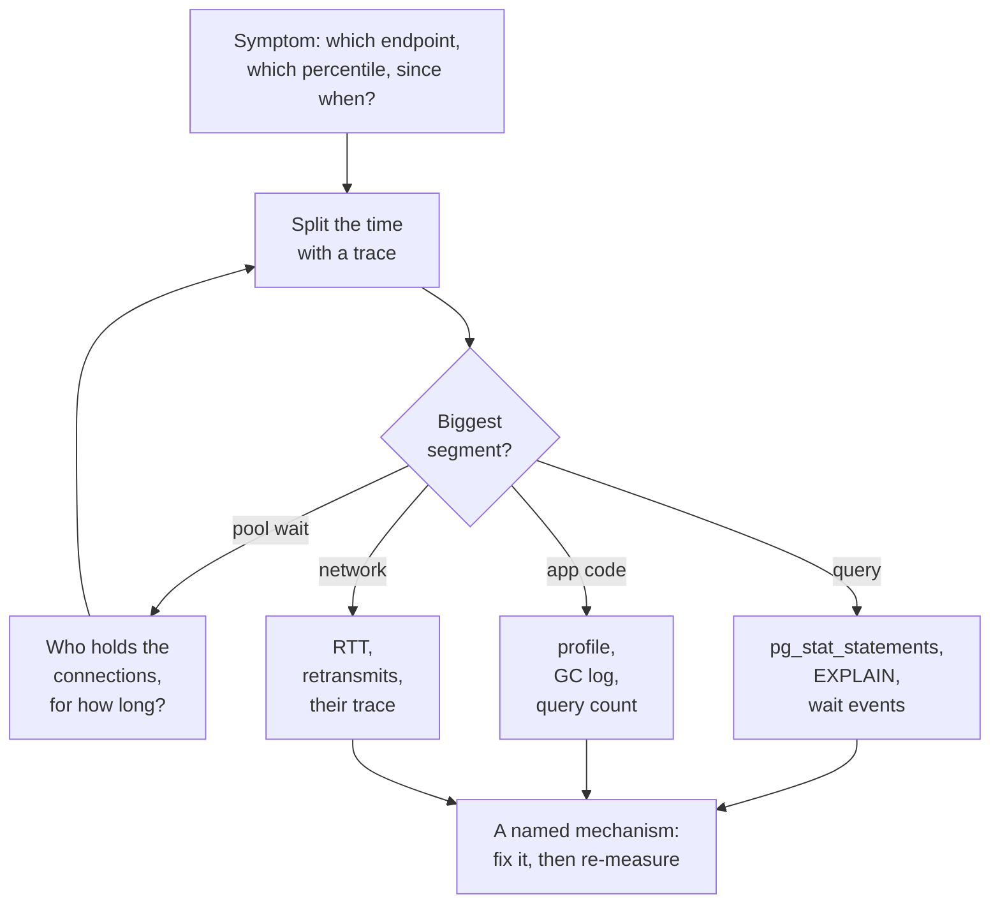

## Mental Model

"It's slow" is a symptom, not a diagnosis. Latency is a **sum of waits along a path** — network, queueing for a thread, queueing for a connection, planning, I/O, locks, downstream calls. An investigation is a **binary search over that path**. Measure where the time goes, zoom into the biggest piece, and repeat until you reach one mechanism you can name. For example: "sequential scan because of an implicit cast", "lock wait behind a batch job", "GC pause", "retransmits on one NIC".

Two rules keep you honest:

1. **Measure before changing anything.** Guesses ("add an index", "add servers") fix the wrong thing half the time.
2. **Look at distributions, not averages.** p50 tells you about typical requests; p99 tells you about the ones users complain about ([Tail Latency](lesson:cn-tail-latency)).

## Definition

- **Latency percentiles**: p50/p95/p99 of request duration.
- **RED method** (per service): Rate, Errors, Duration.
- **USE method** (per resource): Utilization, Saturation, Errors ([Performance Method](lesson:os-performance-method)).
- **Distributed trace**: spans for each step of one request (edge → service → DB → cache → downstream), showing where time went.
- **Wait event**: what a database backend is waiting on (I/O, lock, client, WAL flush…).

## Why It Exists

**The problem.** Modern requests cross many components owned by different teams. Without a method, each team proves its component is "fine" while users wait. A shared, layered approach — following the request — finds the actual bottleneck quickly and avoids fixes that move the problem elsewhere.

**The idea.** Latency is additive: total time is the sum of the times of the steps. So you never need to understand the whole system at once. Measure the split, take the biggest piece and split *it* again, until what's left is one mechanism you can name and fix.

:::callout[That's all it is]{type=insight}
Measure first, then binary-search the request path: split the time by layer, zoom into the biggest part, repeat until you reach a named mechanism. Fix it, then check the latency distribution actually moved.
:::

## How It Works

The method in one picture:



### Step 1 — Characterize the symptom

- Which endpoint(s)? All or some? All users or some (a tenant, a region)?
- Since when? Correlate with deploys, traffic changes, data growth, config changes, dependency incidents.
- Which percentile moved? p50 up (everything slower — saturation, a plan change affecting all calls) vs only p99 up (contention, GC, a slow shard, retries, cold caches).
- Latency up *and* throughput down? That smells like saturation of a shared resource.

### Step 2 — Split the time

A trace of a slow request might read:

```text
GET /orders                                 1,840 ms
├─ auth middleware (Redis GET)                   2 ms
├─ pool checkout                             1,190 ms   ← waiting for a DB connection
├─ SELECT orders … (DB)                         610 ms
│    └─ (server-side: 598 ms)
└─ serialize JSON                               18 ms
```

Now there are two leads: why do requests wait 1.2 s for a connection, and why does the query take 600 ms? The first is usually a *consequence* of the second (slow queries hold connections longer → pool exhaustion — [Connection Management](lesson:x-connection-management)).

### Step 3 — Zoom into the layer

**Database.**

- `pg_stat_statements`: is this query's mean time up, or its call count (N+1)? Rows per call?
- `EXPLAIN (ANALYZE, BUFFERS)` with production parameters: estimate vs actual, rows removed by filter, loops, spills, buffer reads ([EXPLAIN](lesson:db-explain)).
- Wait events in `pg_stat_activity`: `Lock:*` (contention — [Locking](lesson:db-locking)), `IO:DataFileRead` (cache misses), `LWLock:*` (internal contention), `Client:ClientRead` (the app is slow to send — idle in transaction?).
- Recent changes: statistics (auto-analyze), data volume, new index or dropped index, plan flip ([Query Optimization](lesson:db-query-optimization)).

**Application.**

- CPU profile (flame graph) for hot code paths, serialization costs, regex/JSON parsing ([Profiling](lesson:os-profiling-observability)).
- GC logs / pauses; thread pool queue lengths; event-loop lag (a CPU-heavy callback blocks everything — [epoll & Event Loops](lesson:os-epoll-event-loops)).
- Number of queries per request (N+1), payload sizes.

In a Java service the same checks have standard tools:

| Question | Tool |
|---|---|
| Where is CPU time going? | a JFR recording (`jcmd <pid> JFR.start duration=60s filename=slow.jfr`) or async-profiler's flame graph |
| Are there long GC pauses? | the GC log (`-Xlog:gc*`), or the GC events in the same JFR recording |
| Where are request threads stuck *right now*? | a thread dump (`jcmd <pid> Thread.print`): threads parked in `HikariPool.getConnection` are queueing for a connection |
| Is a pool the queue? | Micrometer metrics such as `hikaricp.connections.pending` and Tomcat's busy-thread count |
| How many queries does one request run? | Hibernate statistics or a JDBC proxy that counts statements per request |

With JPA, N+1 usually comes from a lazy association read in a loop: loading 50 orders, then touching `order.getCustomer()` on each. Fix it with a `JOIN FETCH` query, an entity graph or `@BatchSize`, so the customers arrive in one query, or a few.

**OS / host.**

- USE: CPU utilization and run-queue length, memory pressure and swapping, disk latency and queue depth, network errors.
- `vmstat`, `iostat -x`, `pidstat`, `ss -ti` (retransmits, RTT per connection).

**Network.**

- RTT between tiers (cross-zone traffic after a failover?), retransmissions, DNS resolution time, TLS handshakes per request (no keep-alive?) ([Latency & Bandwidth](lesson:cn-latency-bandwidth)).

### Step 4 — Confirm the mechanism, fix, verify

State the root cause as a mechanism, predict what the fix changes, apply it, and verify with the same measurements (before/after percentiles, plan, wait events).

## Internal Mechanism

:::depth{level=advanced}
### Common root causes by signature

| Signature | Likely mechanism | Confirm with |
|---|---|---|
| One query slow for all parameters, started after data growth | seq scan / missing index / bad column order | EXPLAIN: Seq Scan, Rows Removed by Filter |
| Suddenly slow after ANALYZE or a deploy | plan flip, misestimate | auto_explain before/after; estimate vs actual |
| Slow only for some tenants/users | data skew, generic plan, big tenant | per-parameter EXPLAIN; plan_cache_mode |
| p99 spikes, p50 fine, CPU fine | lock waits, GC pauses, cold cache, one slow replica/shard | wait events, GC logs, per-host latency |
| Latency grows with load, then collapses | saturation + queueing (pool, threads, CPU) | utilization near 100%, queue lengths ([Overloaded Server](lesson:x-overloaded-server)) |
| Many tiny queries per request | N+1 | query count per request in traces |
| Every request pays ~3 RTT extra | no connection reuse (TLS per request) | TCP/TLS handshakes in traces / ss |
| Periodic spikes every N minutes | checkpoints, cron jobs, cache expiry, backups | correlation with schedules |

### Coordinated omission

Load generators and some latency metrics under-report tail latency. If the tool waits for a slow response before sending the next request, it silently skips the requests that *would* have queued behind it. Use tools that send at a fixed rate (wrk2, k6 constant-arrival-rate) and record latency from the intended send time.

### Amdahl's law for latency work

Speeding up a step that takes 5% of the request by 10× improves the total by <5%. Always attack the largest segment of the trace first.
:::

## Example

**Symptom**: `/orders` p99 from 180 ms to 2.1 s since Tuesday; p50 from 40 ms to 90 ms. Throughput unchanged.

1. Traces: 70% of the slow time is pool checkout; the query span itself rose from 8 ms to 350 ms.
2. `pg_stat_statements`: the orders query's mean time up 40×; calls unchanged → not N+1.
3. EXPLAIN ANALYZE: `Seq Scan on orders`, with `Filter: ((customer_id)::numeric = '42'::numeric)` and `Rows Removed by Filter: 38000000`. The index on `orders.customer_id` (a `bigint`) isn't used.
4. Cause: Tuesday's deploy changed the DTO's `customerId` from `Long` to `BigDecimal`, so the driver now binds the parameter as `numeric`. PostgreSQL has no `bigint = numeric` operator, so it casts the *column* to `numeric` on every row. An index on the plain column can't serve that expression, so the condition is no longer sargable ([Index Design](lesson:db-index-design-practice)).
5. Fix: bind the parameter as a `Long` again. Verify: the plan is back to an Index Scan, the query takes 3 ms, pool waits vanish, and p99 is 170 ms.

A string parameter wouldn't cause this in PostgreSQL: `bigint = text` is rejected with an error. (In MySQL, comparing a string column with a number *does* silently cast the column.)

Note how the loudest symptom (pool waits) was a consequence, not the cause.

## Complexity & Performance

The investigation cost is dominated by observability: without traces and per-query statistics, each hypothesis needs a reproduction. Investing in tracing, `pg_stat_statements`, and host metrics pays back on the first incident.

## Trade-offs

- Sampling traces (cheap, may miss rare slow requests) vs tail-based sampling (keep slow traces) vs full tracing (expensive).
- Quick mitigations (kill the query, add capacity, roll back) vs root-cause fixes — do both, in that order during incidents.

## Failure Modes

- Fixing the symptom (bigger pool, more pods) and overloading the database further.
- Tuning averages while p99 stays bad.
- Benchmarks with coordinated omission declaring victory.
- Testing plans on small datasets that choose different plans than production.

## In Production

- Standard kit: RED dashboards per endpoint, traces with DB spans, `pg_stat_statements`, `auto_explain` for slow queries, host USE metrics, deploy markers on graphs.
- Keep a runbook: "latency up → check deploys → traces → DB top queries/waits → host saturation → dependencies".

## Deeper Connections

- The path being investigated is [The SQL Query Journey](lesson:x-sql-query-journey) and [Website Journey](lesson:x-website-journey); saturation dynamics are in [Overloaded Server](lesson:x-overloaded-server).
- The OS-level method is [Performance Method](lesson:os-performance-method); the DB-level tools are [EXPLAIN](lesson:db-explain) and [Query Optimization](lesson:db-query-optimization).

## Common Misconceptions

- **"The component with the longest span is the root cause."** It may be waiting on something else (pool waits caused by slow queries).
- **"Average latency is fine, so users are fine."** Tail latency determines user experience at scale.
- **"Add an index" is the answer to slow queries.** Only when EXPLAIN shows a missing access path.

## Interview Questions

### [L2 · debugging] An API endpoint became slow. Walk me through your investigation.

Characterize it: which endpoint, which percentiles, since when, correlated with what (deploys, traffic, data growth). Split the time with traces: network, app code, pool wait, DB queries, downstream calls. Zoom into the largest segment with layer-specific tools: for DB, pg_stat_statements, EXPLAIN (ANALYZE, BUFFERS), wait events; for app, profiles, GC, queue lengths; for hosts, USE metrics; for network, RTT and retransmits. Identify the mechanism, apply a fix, and verify with the same measurements.

### [L3 · scenario] p50 latency is flat but p99 tripled. What classes of causes do you consider?

Things that affect a minority of requests: lock contention on hot rows, GC or stop-the-world pauses, a slow instance/shard/replica behind the load balancer, cache misses for cold keys or after evictions, retries and timeouts to a flaky dependency, noisy neighbours, periodic jobs (checkpoints, vacuum, backups), and queueing near saturation. Break latency down by host, shard, endpoint and time to find which subset is slow.

### [L3 · debugging] Traces show most time in "waiting for DB connection", yet DB CPU is 20%. What do you look for?

What's holding connections: long transactions (idle in transaction, external calls inside transactions), slow queries waiting on locks or I/O rather than CPU, connection leaks, or a pool too small for throughput × hold time. Check pg_stat_activity (states, wait events, xact ages), pool metrics, and code paths that hold connections across non-DB work.

### [L2 · how] How do you find and fix an N+1 query problem in a Java service that uses JPA?

Symptoms first: a trace with dozens or hundreds of near-identical fast queries under one request, or `pg_stat_statements` showing a cheap query with an enormous call count. Hibernate statistics, or a JDBC proxy that counts statements per request, confirm it.

The cause is usually a lazy association read in a loop: load 50 orders, then call `order.getCustomer().getName()` on each, which fires one query per order. Fix it by fetching what the code needs in the first query: `JOIN FETCH` in JPQL, an entity graph, or `@BatchSize` so lazy loads are grouped into `IN (...)` queries. For read-only pages, a DTO projection query is often simplest. Add a test that asserts the query count for the endpoint, so the problem doesn't come back.

### [L3 · debugging] A query takes 5 ms in psql but 900 ms from the application. Give the likely reasons and how to check each.

- **Different parameters or plan.** The app uses a prepared statement, which may get a generic plan that's bad for some values; or it binds a different type (a `numeric` against a `bigint` column) that disables the index. Check with `auto_explain` capturing the app's real plan.
- **Waiting before the query runs.** Pool checkout time, or a lock held by another transaction of the app. Traces and `pg_stat_activity` wait events show this.
- **Moving the result.** The app fetches every row (JDBC reads the whole result unless a fetch size is set with autocommit off) and maps each into objects. Compare rows returned and time to the last row.
- **The network.** psql ran on the database host; the app is a zone away and makes several round trips.

Reproduce with the app's exact SQL, parameter types and values, and compare `EXPLAIN (ANALYZE, BUFFERS)` output.

### [L3 · scenario] p99 latency spikes every 5 minutes, for about 20 seconds, with no deploys and steady traffic. What do you suspect?

Something periodic. The usual suspects:

- PostgreSQL checkpoints (`checkpoint_timeout` defaults to 5 min): a burst of writes, plus extra WAL from full-page writes right after.
- Cron jobs or batch work on the same hosts or database.
- Cache entries created together and expiring together, so many misses hit the database at once.
- Scheduled metric scrapes, backups or log rotation.
- A JVM with a regular full GC.

Line the spike times up with checkpoint logs (`log_checkpoints`), cron schedules, cache TTLs and GC logs. The one that matches to the second is the cause. Then spread the work out (checkpoint tuning, TTL jitter) rather than adding capacity.

## Practice

### [mcq] Traces show 1.2 s in pool checkout and 600 ms in the SQL query itself. What should you investigate first?

- [ ] Increase the pool size
- [x] Why the query takes 600 ms — slow queries hold connections longer, causing the pool waits
- [ ] Network latency to the database
- [ ] JSON serialization

Pool waits are often a consequence of slow queries (hold time ↑ → required connections ↑).

### [mcq] Which observation most strongly suggests an N+1 query problem?

- [ ] One query with a sequential scan
- [ ] High lock wait time
- [x] Hundreds of nearly identical fast queries per request
- [ ] High CPU on the database host

Each item triggers its own query; round trips add up.

### [numeric 346 unit=ms] A request takes 400 ms: 300 ms in a database query, 60 ms serializing JSON and 40 ms elsewhere. You make the JSON step 10 times faster. What is the new latency?

:::answer
300 + 6 + 40 = **346** ms: a 13.5% gain from a 10× speedup. Making the query twice as fast instead gives 150 + 60 + 40 = 250 ms. Attack the largest segment first.
:::

### [numeric 76.5 ±0.1 unit=ms] An endpoint loads 50 orders with one query, then each order's customer with its own query. Every query costs 1 ms in the database plus a 0.5 ms network round trip. How long do the queries take in total?

:::answer
51 queries × 1.5 ms = **76.5** ms. One query that joins the customers would cost about one round trip plus a few milliseconds. The N+1 cost grows with the number of rows, so the page gets slower as customers place more orders.
:::

### [exercise] In the [Query Plan lab](lab:query-plan), create the index on `customer_id`, then run `SELECT * FROM orders WHERE customer_id = 4242`. Now run it with `customer_id = 4242.0`. Compare the two plans and explain the difference.

:::solution
With `4242`, the planner uses the index on `customer_id` (an index or bitmap scan) and reads only that customer's handful of orders.

With `4242.0`, the literal is `numeric`. PostgreSQL has no `integer = numeric` operator, so it casts the column instead, and the plan shows a Seq Scan with `Filter: ((customer_id)::numeric = 4242.0)` reading all 200,000 orders. The index stores plain integers, so it can't answer a condition on `customer_id::numeric`.

This is the mechanism behind the lesson's example. In Java, binding a `BigDecimal` (or a `double`) to an integer column has the same effect.
:::

### [exercise] A thread dump of a slow Spring Boot service shows 180 of its 200 Tomcat threads parked in `HikariPool.getConnection`, and 10 threads inside the PostgreSQL driver's `PGStream.receiveChar`, waiting for the database. The pool has 10 connections. What is happening, and where do you look next?

:::solution
The 10 threads in `PGStream.receiveChar` hold all 10 connections and are waiting for PostgreSQL to answer their queries. The 180 parked threads are queueing for a connection. So the pool is the visible queue, but the cause is whatever makes those 10 queries slow.

Next, look at those sessions in `pg_stat_activity`: their queries, how long they've run, and their wait events (`Lock:*` for lock waits, `IO:DataFileRead` for cache misses). Then use `EXPLAIN (ANALYZE, BUFFERS)` on the query if it's a plan problem, or find the blocker with `pg_blocking_pids` if it's a lock. A bigger pool would only let more slow queries pile onto the database.
:::

### [mcq] Which tool shows where a Java service's request threads are blocked right now?

- [ ] The GC log
- [x] A thread dump (`jcmd <pid> Thread.print`)
- [ ] `pg_stat_statements`
- [ ] `ss -ti`

A thread dump prints every thread's stack at one moment. Take two or three a few seconds apart: threads stuck at the same frame in all of them show where requests are queueing.

## Quick Revision

- Measure first; percentiles over averages; correlate with changes.
- Split time along the path (traces), attack the biggest segment, repeat to a named mechanism.
- DB: pg_stat_statements, EXPLAIN (ANALYZE, BUFFERS), wait events. App: profiles, GC, queues, N+1. Host: USE. Network: RTT, retransmits, handshakes.
- Loud symptoms (pool waits) are often consequences.
- Verify fixes with the same measurements; beware coordinated omission.
- Java tools: JFR or async-profiler (CPU), GC log (pauses), `jcmd Thread.print` (where threads are stuck), `hikaricp.connections.pending` (pool queue).
- JPA N+1: a lazy association read in a loop. Fix with JOIN FETCH, an entity graph or `@BatchSize`.
- In PostgreSQL, a `numeric` parameter against an integer column casts the column and disables its index; `bigint = text` is an error, not a slow query.
