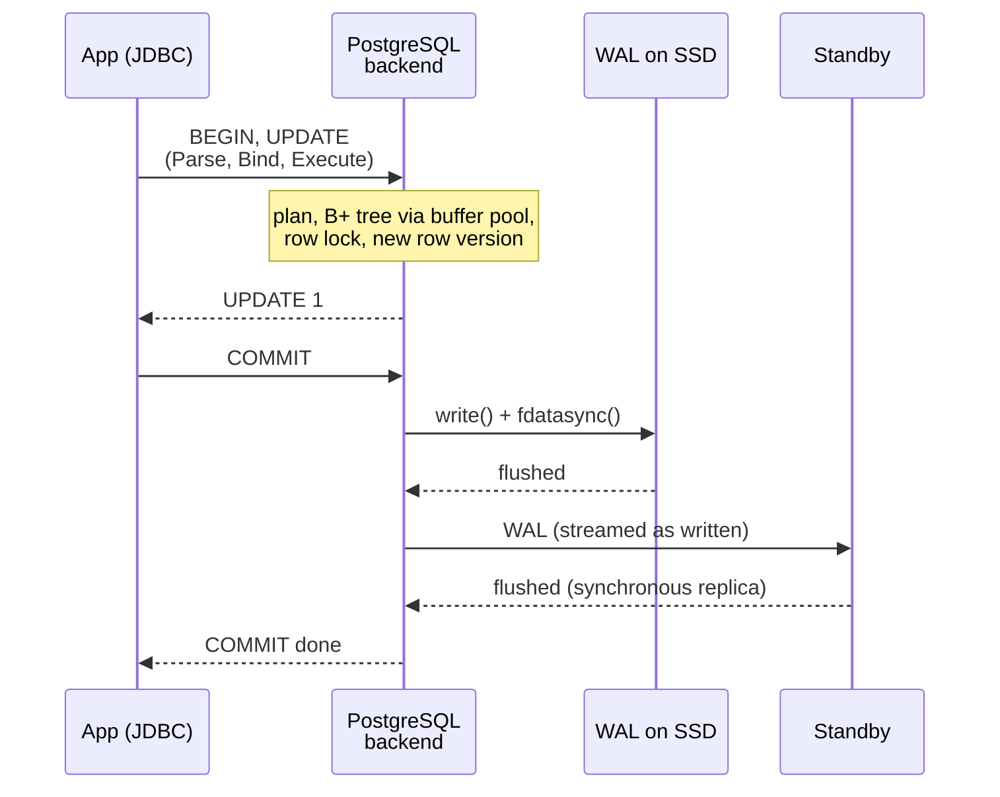

## Mental Model

A few lines of Java —

```java
try (Connection conn = dataSource.getConnection()) {      // borrow from the pool
    conn.setAutoCommit(false);
    try (PreparedStatement ps = conn.prepareStatement(
            "UPDATE accounts SET balance = balance - 100 WHERE id = ?")) {
        ps.setLong(1, 42);
        ps.executeUpdate();     // network, plan, B+ tree, row lock, new version
    }
    conn.commit();              // WAL flush (and replicas)
}                               // close() returns the connection to the pool
```

— touch almost every concept in this academy:

- a **connection pool** hands out a socket;
- the **kernel** moves bytes through **TCP**;
- a **database backend process** parses and plans;
- the **B+ tree** finds the row via the **buffer pool**;
- a **row lock** and an **MVCC** version protect concurrent readers and writers;
- the **WAL** and **fsync** make the change durable;
- **replication** ships it elsewhere;
- and the result travels back the same way.

Knowing this path lets you answer "where could this be slow?" and "what if X fails here?" for any query.

## Definition

The stations, in order:

| # | Station | Subject |
|---|---|---|
| 1 | Driver + connection pool | app / [Connection Management](lesson:x-connection-management) |
| 2 | Wire protocol over TCP (maybe TLS) | CN |
| 3 | Kernel send/receive paths, syscalls, interrupts | OS |
| 4 | Backend process: parse → analyze → plan → execute | DB ([Query Lifecycle](lesson:db-query-lifecycle)) |
| 5 | Index lookup via B+ tree through the buffer pool | DB ([B+ Trees](lesson:db-btree), [Buffer Pool](lesson:db-buffer-pool)) |
| 6 | Row lock + new row version | DB ([Locking](lesson:db-locking), [MVCC](lesson:db-mvcc)) |
| 7 | WAL append; COMMIT flushes WAL (fsync) | DB + OS ([WAL](lesson:db-wal-durability)) |
| 8 | Replication to standbys | DB + CN ([Replication](lesson:db-replication)) |
| 9 | Response back to the app | CN + OS |

## Why It Exists

**The problem.** Performance and reliability problems rarely respect subject boundaries. "The UPDATE is slow" may mean any of these:

- pool exhaustion (the application);
- packet loss (the network);
- CPU saturation (the OS);
- a sequential scan (the planner);
- a lock wait (concurrency);
- a slow fsync (storage);
- synchronous replication to a distant replica (distribution).

Seeing the whole path is what lets you locate the problem.

**The idea.** Each station on the path exists to solve one problem:

- reuse connections (the pool);
- move bytes (TCP and the kernel);
- choose a method (the planner);
- find the row fast (B+ tree, buffer pool);
- keep concurrent users apart (locks, MVCC);
- survive a crash (WAL) and the loss of a machine (replication).

Know which problem each station solves, and you know what it looks like when it fails.

:::callout[That's all it is]{type=insight}
A query borrows a connection, crosses the network and gets planned. It finds its row through an index and the cache, takes a lock and writes a new version. At commit it flushes the log, ships it to replicas and returns. A slow query is one of those steps taking longer than usual.
:::

## How It Works

The whole journey, seen from the database's side:



### 1. Application: driver and pool

The driver asks the pool for a connection. If all are busy, the request **waits**, which is often the first hidden source of latency. With a connection in hand, the driver serializes the statement in the database's wire protocol. For PostgreSQL that is a `Parse`/`Bind`/`Execute` sequence for prepared statements, or a single `Query` message.

Here is what the Java code above sends with PostgreSQL's JDBC driver (pgJDBC):

| Java call | What goes over the wire |
|---|---|
| `dataSource.getConnection()` | nothing: HikariCP lends out a connection that is already open |
| `setAutoCommit(false)` | nothing yet: the driver sends `BEGIN` together with the first statement |
| `prepareStatement(sql)` | nothing yet |
| `executeUpdate()` | `Parse` (the SQL with `$1`), `Bind` (the value 42), `Execute` and `Sync`, in one write |
| `commit()` | a `COMMIT` statement, which returns once the WAL is flushed |
| `close()` | nothing: HikariCP takes the connection back, rolling back anything left uncommitted |

Once the same `PreparedStatement` has run five times (pgJDBC's `prepareThreshold`), the driver switches to a named server-side statement. From then on it sends only `Bind` and `Execute`, and PostgreSQL skips parsing and can reuse a cached plan.

### 2–3. Network and kernel (client side)

`send()` is a system call. The CPU switches to kernel mode and copies the bytes into the socket's send buffer. TCP then segments them, adds headers and hands them to the NIC driver ([Syscalls & Interrupts](lesson:os-syscalls-interrupts), [Sockets](lesson:cn-sockets)). Same-datacenter RTT ≈ 0.1–0.5 ms; cross-zone ≈ 1 ms.

Server side: the NIC raises an interrupt, the kernel processes the TCP segment, places bytes in the backend's socket receive buffer and wakes the backend process blocked in `recv()`.

### 4. Backend: parse, plan, execute

PostgreSQL has one OS process per connection; it parses the SQL, resolves `accounts` in the catalog, and plans: `Index Scan using accounts_pkey` (or reuses a cached plan for prepared statements). The executor runs the `ModifyTable` node over that scan.

Walkthrough: [SQL execution](uth:sql-execution).

### 5. Finding the row

The B+ tree descent reads the root, an internal page and a leaf of `accounts_pkey`. Each read is a **buffer pool** lookup. A hit costs about a microsecond. A miss costs a `pread()` system call, which the OS page cache may serve; otherwise the SSD does, in about 100 µs ([Page Cache](lesson:os-page-cache)). The leaf gives the row's TID (its page and slot), and the heap page is fetched the same way.

Walkthrough: [Index lookup](uth:index-lookup).

### 6. Locking and versioning

The backend checks the row version is visible and not locked by another writer. If another transaction is updating account 42, it **waits** on that transaction's lock (a lock wait — [Locking](lesson:db-locking)). Otherwise it writes a new row version (xmin = its transaction id) and marks the old one with xmax; concurrent readers keep seeing the old version from their snapshots ([MVCC](lesson:db-mvcc)). The buffer page is now dirty — in memory only.

### 7. Durability: WAL and COMMIT

Each change produced a WAL record in the in-memory WAL buffer. `COMMIT` appends a commit record and then **waits for the WAL to be flushed**. That means a `write()` to the WAL file, then `fdatasync()`, which travels through the filesystem and the block layer to the SSD. The SSD must persist the data, not just cache it ([Durability Chain](lesson:x-durability-chain)). Group commit lets one flush serve many concurrent commits. The data page itself is written later by the checkpointer.

Walkthrough: [COMMIT](uth:commit).

### 8. Replication

WAL sender processes stream the new WAL to standbys. With synchronous replication, the COMMIT also waits until a standby confirms it has flushed the WAL — adding a network round trip ([Replication](lesson:db-replication)).

### 9. Response

The backend sends `CommandComplete ("UPDATE 1")` and `ReadyForQuery`; the kernel and network carry it back; the driver returns to the application, which releases the connection to the pool.

## Internal Mechanism

:::depth{level=advanced}
### Latency budget of a fast UPDATE (same zone, warm cache)

| Step | Typical time |
|---|---|
| Pool checkout (no contention) | ~0.01 ms |
| Client → server network | ~0.2 ms |
| Parse/plan (prepared: skipped) | 0–0.2 ms |
| Index lookup + heap access (cached) | ~0.02 ms |
| Lock + new version + WAL record | ~0.01 ms |
| WAL fsync (NVMe with power-loss protection) | ~0.05–0.5 ms |
| Sync replication (optional, same region) | +0.5–2 ms |
| Server → client network | ~0.2 ms |
| **Total** | **≈ 0.5–1 ms** (≈ 1.5–3 ms with sync replication) |

When the same statement takes 800 ms, some step deviated: a pool wait, a lock wait, a cache miss storm, an fsync stall, or a lagging synchronous replica. `pg_stat_activity.wait_event` names the step a backend is waiting on.

### Reading the stations from `pg_stat_activity`

During an incident, one query shows which station each backend is stuck at:

```sql
SELECT pid, state, wait_event_type, wait_event,
       now() - query_start AS running, left(query, 40) AS query
FROM pg_stat_activity
WHERE backend_type = 'client backend';
```

```text
 pid  | state               | wait_event_type | wait_event    | running  | query
------+---------------------+-----------------+---------------+----------+------------------------------------------
 4711 | idle in transaction | Client          | ClientRead    | 00:04:12 | UPDATE accounts SET balance = balance -
 4802 | active              | Lock            | transactionid | 00:00:41 | UPDATE accounts SET balance = balance -
 4803 | active              | Lock            | transactionid | 00:00:38 | UPDATE accounts SET balance = balance -
 4890 | active              | IO              | WALSync       | 00:00:00 | COMMIT
```

Read it station by station. Backend 4711 ran its UPDATE four minutes ago and never committed: it still holds the row lock (step 6) while its application does something else. Backends 4802 and 4803 queue behind that lock, and `SELECT pg_blocking_pids(4802)` returns `{4711}`. Backend 4890 is at step 7, flushing the WAL for its COMMIT, which is normal for a fraction of a millisecond. The fix is in the application that left 4711 open; `idle_in_transaction_session_timeout` limits the damage next time.

### Context switches along the way

The client thread blocks in `recv()`, and the backend process is woken. The WAL writer, or the backend itself, blocks in `fdatasync()`, and the walsender processes wake. Each block and wake-up is a scheduler event. Under heavy load, with thousands of connections, this machinery itself becomes overhead ([Context Switch](lesson:os-context-switch)).
:::

## Example

The same UPDATE observed in three incidents:

| Symptom | Where on the path | Evidence | Fix |
|---|---|---|---|
| p99 1.5 s, DB CPU idle | pool checkout wait | app metrics: pool wait time; all connections busy | fix slow transactions holding connections; size pool correctly |
| Many backends `wait_event = Lock:transactionid` | step 6 | `pg_blocking_pids` points to an idle-in-transaction session | kill it; fix transaction scoping |
| Every commit ~40 ms | step 7/8 | `WALSync` waits or `SyncRep` waits | storage flush latency / distant synchronous replica |

## Complexity & Performance

The fast path is ~1 ms and dominated by network round trips and one fsync. The slow paths are waits: pool, lock, I/O, replication. Throughput is bounded by the slowest shared resource (connections, a hot row, WAL flush rate).

## Trade-offs

- Synchronous replication and full durability add latency to every commit; relaxing them trades a bounded risk of losing recent commits.
- Prepared statements save planning but can pick generic plans ([Query Lifecycle](lesson:db-query-lifecycle)).
- More connections ≠ more throughput: beyond cores × small factor, contention and context switching dominate ([Connection Management](lesson:x-connection-management)).

## Failure Modes

- Crash after `COMMIT` returned: WAL is durable → recovery replays it; the update survives ([Crash Recovery](lesson:db-crash-recovery)).
- Crash before the WAL flush: the transaction is lost — and the application never got "COMMIT OK".
- Network failure after commit, before the reply: the application doesn't know whether it committed → idempotent retries or checking state are required.

## In Production

- Tracing spans around pool checkout, query execution and commit separate app-side from DB-side time.
- Database wait events, `pg_stat_statements` and OS metrics (fsync latency, CPU, network retransmits) localize the slow station.

## Deeper Connections

- The browser-side prelude of this journey is [What Happens When You Open a Website](lesson:x-website-journey).
- Durability's full stack is [The Durability Chain](lesson:x-durability-chain); the pool station is [Connection Management](lesson:x-connection-management).

## Common Misconceptions

- **"COMMIT writes the table to disk."** It flushes the WAL; pages follow later.
- **"If the query is fast in psql, the app is slow."** The app path adds pool waits, network and serialization — measure each.
- **"A timeout means the transaction didn't happen."** It may have committed; the reply was lost.

## Interview Questions

### [L2 · trace] Trace an UPDATE statement from the application to durable storage.

:::answer
The app borrows a pooled connection; the driver encodes the statement in the wire protocol and sends it via a send() syscall; TCP carries it to the database host, whose kernel wakes the backend. The backend parses, plans (index scan on the primary key), and executes: descends the B+ tree through the buffer pool (reading pages from disk on misses), checks visibility, acquires the row lock, writes a new row version (dirtying the page in memory) and appends WAL records. On COMMIT it appends a commit record and waits for the WAL to be fsync'd (and for synchronous replicas, if configured). It replies to the client; dirty pages are written later by the checkpointer.
:::

### [L2 · debugging] The same UPDATE usually takes 1 ms but sometimes 2 seconds. List where on its path the time could go and how you'd check each.

Pool wait (app metrics for checkout time), network (retransmits, cross-zone routing), planning (rare), lock waits on the row (pg_locks / wait_event Lock), I/O misses (buffer reads in EXPLAIN (ANALYZE, BUFFERS), storage latency), WAL fsync (wait_event WALSync / IO metrics), synchronous replication (SyncRep waits, replica health), and CPU saturation on either host. Correlate slow instances with these metrics.

### [L3 · scenario] The app received a timeout on COMMIT. Did the transaction commit?

Unknown: the commit might have been durably recorded and only the reply lost, or never executed. The application must either make the operation idempotent (unique request/idempotency key, so a retry is harmless) or check the resulting state before retrying. Never assume failure.

### [L2 · how] What does pgJDBC send to PostgreSQL for `executeUpdate()` and `commit()`, and what changes once a `PreparedStatement` has run five times?

With autocommit off, the first statement goes out together with a `BEGIN`. `executeUpdate()` sends `Parse` (the SQL text with `$1`), `Bind` (the parameter values), `Execute` and `Sync` in one write, then reads back `CommandComplete` ("UPDATE 1") and `ReadyForQuery`. `commit()` sends a `COMMIT` statement, which returns only after the WAL is flushed.

For the first four runs the driver uses an unnamed statement, which PostgreSQL parses every time. From the fifth (`prepareThreshold` = 5), it creates a named server-side statement once and afterwards sends only `Bind` and `Execute`. Parsing is skipped, and a cached plan can be reused.

### [L2 · what-if] The row's index leaf page and its heap page are not in memory. What does that add to the UPDATE?

The root and internal pages of a busy index are almost always cached, so typically two reads miss: the leaf and the heap page. Each miss is a `pread()` system call. If the OS page cache has the block, that costs only a few microseconds of copying. If not, an SSD reads it in roughly 100 µs, so the UPDATE gets about 0.2 ms slower; on a hard disk, two random reads of about 8 ms add about 16 ms. That is why a cold buffer pool after a restart or failover makes every query slower until the working set is back in memory.

### [L3 · debugging] Every COMMIT has started taking 40 ms, although the UPDATE itself is fast. How do you find out why?

COMMIT waits for the local WAL flush and, with synchronous replication, for a standby's flush. Look at the wait events of backends sitting in COMMIT:

- `IO:WALSync` or `IO:WALWrite`: local storage is slow to flush. Check `pg_test_fsync`, disk latency, and noisy neighbours on network storage.
- `IPC:SyncRep`: the primary is waiting for the standby. Check `pg_stat_replication` (flush lag), where the standby now lives, and its disk.
- Many `LWLock:WALWrite` waits: backends are queueing to write the WAL at a very high commit rate.

40 ms is typical of a cross-region round trip or a slow network disk, so a synchronous standby that moved regions is a common answer.

## Practice

### [mcq] During an UPDATE, which step must complete before COMMIT is acknowledged (default PostgreSQL settings)?

- [ ] Writing the modified heap page to its data file
- [x] Flushing the WAL up to the commit record
- [ ] Vacuuming the old row version
- [ ] Updating table statistics

Only the log must be durable; everything else is deferred.

### [mcq] Many sessions show wait_event `Lock:transactionid`. Which station of the journey is slow?

- [ ] Connection pool checkout
- [ ] Network transfer
- [x] Waiting for another transaction's row lock
- [ ] WAL fsync

They're queued behind a transaction that holds a lock on rows they need.

### [numeric 1.74 ±0.02 unit=ms] A same-zone UPDATE costs: pool checkout 0.01 ms, network 0.2 ms each way, cached index and heap access 0.02 ms, row lock and WAL record 0.01 ms, WAL fsync 0.3 ms, and a synchronous standby 1 ms. Planning is skipped (prepared statement). What is the total?

:::answer
0.01 + 0.2 + 0.02 + 0.01 + 0.3 + 1 + 0.2 = **1.74** ms. The synchronous standby is more than half of it; without it the UPDATE takes 0.74 ms.
:::

### [numeric 16 unit=ms] The UPDATE's index leaf page and heap page both miss the buffer pool and the OS page cache, and the data lives on a hard disk that needs 8 ms per random read. How many milliseconds does that add?

:::answer
Two random reads × 8 ms = **16** ms, about twenty times the whole cached UPDATE. On an SSD at about 0.1 ms per read, it would add 0.2 ms.
:::

### [exercise] In the [WAL recovery lab](lab:wal-recovery), load "Crash after COMMIT" and run recovery. Which pages were on disk at the crash, what does redo do, and which station of the query journey made the transfer survive?

:::solution
T1 moved 50 from P1 to P2 and committed, but neither page reached disk before the crash: only the WAL was durable. Redo replays T1's log records, so P1 and P2 are rebuilt from the log, and the transfer is present after recovery.

The station that made it survive is step 7: COMMIT returned only after the WAL was flushed. The data pages are written later by the checkpointer, and until then the log is the only durable copy of the change.
:::

### [exercise] A Java service inserts a payment, and `commit()` throws a timeout. Write the SQL and the Java method that make a retry safe.

:::solution
Give each payment an idempotency key chosen by the caller, unique in the table, and make the insert a no-op if the key already exists:

```java
static boolean recordPayment(Connection conn, String key, long accountId, long cents) throws SQLException {
    String sql = "INSERT INTO payments (idempotency_key, account_id, amount_cents) VALUES (?, ?, ?) "
               + "ON CONFLICT (idempotency_key) DO NOTHING";
    try (PreparedStatement ps = conn.prepareStatement(sql)) {
        ps.setString(1, key);
        ps.setLong(2, accountId);
        ps.setLong(3, cents);
        return ps.executeUpdate() == 1;   // false: an earlier attempt already committed it
    }
}
```

The table needs `UNIQUE (idempotency_key)`. After a timeout, call the method again with the same key, on a fresh connection. If it returns `true`, the first attempt never committed; if `false`, it did, and the service reads the existing row to answer. Either way the payment exists exactly once.
:::

### [mcq] With pgJDBC and `setAutoCommit(false)`, when does `BEGIN` reach the server?

- [ ] When `setAutoCommit(false)` is called
- [x] Together with the first statement after it
- [ ] When `commit()` is called
- [ ] Never: PostgreSQL starts a transaction on its own

The driver sends `BEGIN` lazily, in the same write as the first statement, so turning autocommit off costs no round trip. In autocommit mode PostgreSQL wraps each statement in its own implicit transaction.

## Quick Revision

- Pool → driver/wire protocol → syscalls/TCP → backend (parse/plan/execute) → B+ tree via buffer pool → lock + MVCC version → WAL → fsync on COMMIT → (sync replica) → reply.
- Fast path ≈ 1 ms: network + one fsync. Slow paths are waits: pool, lock, I/O, replication.
- Durable = WAL flushed; data pages later; crash after COMMIT is safe.
- Timeouts leave outcomes unknown → idempotency.
- JDBC on the wire: `executeUpdate()` = Parse/Bind/Execute/Sync in one write; `BEGIN` rides with the first statement; after 5 runs pgJDBC uses a named statement (Bind/Execute only).
- Cold reads: each buffer-pool and page-cache miss is one disk read (SSD ~0.1 ms, HDD ~8 ms).
- Slow COMMIT: `IO:WALSync` (local flush) vs `IPC:SyncRep` (waiting for the standby).
