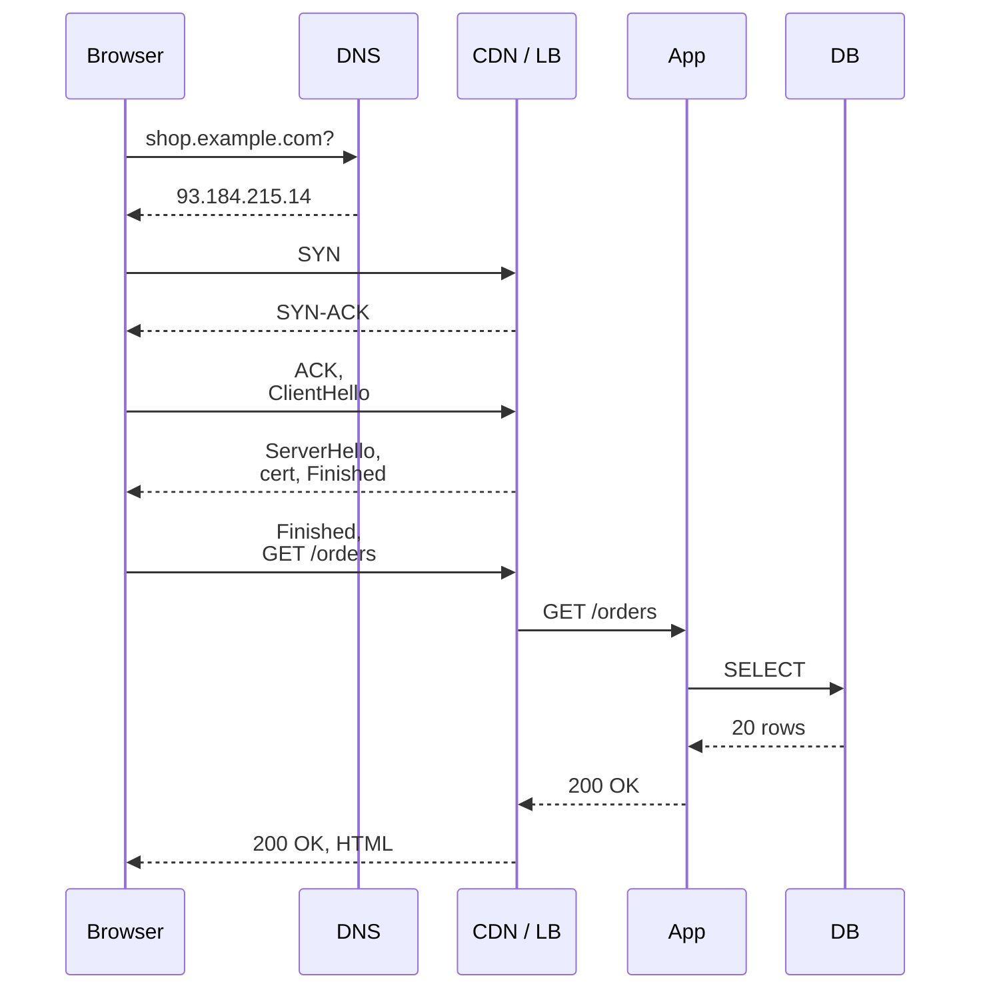

## Mental Model

Opening `https://shop.example.com/orders` is a relay race across **five systems** (browser, network, server kernel, application, database) and **four protocols** (DNS, TCP, TLS, HTTP). Each runner hands a well-defined object to the next:

- a name becomes an IP address;
- the address becomes a connection;
- the connection becomes a secure channel;
- the channel carries a request;
- the request becomes a query;
- rows become JSON, and JSON becomes pixels.

A strong answer is **ordered, layered and quantified**: say what happens, which layer does it, and roughly how long it takes — then go deep wherever the interviewer points.

## Definition

The latency budget of a first visit (typical, same continent, RTT ≈ 30 ms):

| Step | Layer | Cost |
|---|---|---|
| Parse URL, check caches (HSTS, HTTP cache, service worker) | browser | ~0–1 ms |
| DNS resolution (if not cached) | CN, DNS | 0 ms (cached) … 20–100 ms (recursive) |
| TCP handshake | CN, transport | 1 RTT (30 ms) |
| TLS 1.3 handshake | CN, security | 1 RTT (30 ms) |
| HTTP request → response (server time included) | CN + app + DB | 1 RTT + server time (30 ms + 20–200 ms) |
| Download HTML, discover and fetch CSS/JS/images | browser + CN | several RTTs, bandwidth-bound |
| Parse, style, layout, paint, run JS | browser (CPU) | tens–hundreds of ms |

Round trips dominate network time; that's why HTTP/2 connection reuse, TLS 1.3, HTTP/3 (0-RTT resumption) and CDNs (shorter RTT) exist ([Latency & Bandwidth](lesson:cn-latency-bandwidth)).

## Why It Exists

**The problem it reveals.** Loading a page looks like one action, but it needs *five independent problems* solved in sequence:

1. find the machine (DNS);
2. get a reliable pipe to it (TCP);
3. make the pipe private and authentic (TLS);
4. say what you want (HTTP);
5. have the server produce it (kernel, app, database).

Each protocol in the chain exists because the one before it left exactly one problem unsolved.

**Why interviewers ask it.** This question tests whether you see the system as connected layers rather than memorized facts. Every follow-up opens a door into one of the academy's subjects. What if DNS fails? Where can it be slow? What does the kernel do? How does the server handle 10,000 of these?

:::callout[That's all it is]{type=insight}
Name → address (DNS), address → connection (TCP), connection → secure channel (TLS), channel → request (HTTP), request → rows (app + database), rows → pixels (browser). Each step costs round trips, which is why caching and connection reuse matter so much.
:::

## How It Works

The whole cold visit at a glance, before the steps one by one:



### 1. Browser: before any network I/O

- Parse the URL; `https` → port 443. **HSTS** list may force HTTPS for `http://` URLs.
- Check the **HTTP cache** / service worker: a fresh cached response means no network at all ([HTTP Caching](lesson:cn-http-caching)).
- Check for a reusable **connection** to this origin (keep-alive pool, HTTP/2 connection): if one exists, skip to step 5 ([HTTP Connections](lesson:cn-http-connections)).

### 2. DNS: name → IP address

*Why this step:* routers only understand numeric addresses, and humans only remember names.

The lookup tries the nearest cache first:

1. the browser's own DNS cache;
2. the OS resolver (`/etc/hosts`, then a local cache such as systemd-resolved);
3. a recursive resolver (the ISP's, 8.8.8.8 or 1.1.1.1);
4. if the resolver hasn't cached the name: the root servers, then the `.com` servers, then `example.com`'s authoritative servers.

The answer may be a CNAME to a CDN hostname with a short TTL ([DNS](lesson:cn-dns-fundamentals)). The result, `93.184.215.14`, is cached for its TTL.

Walkthrough: [DNS resolution](uth:dns-resolution).

### 3. TCP: a reliable byte stream

*Why this step:* IP only delivers loose packets that can be lost or reordered; HTTP needs an ordered, complete stream.

The browser calls `connect()`. The kernel picks an ephemeral source port, creates a socket and sends a SYN. The server's kernel answers with a SYN-ACK, and the client's ACK completes the handshake. **No application code on the server has run yet** ([TCP Handshake](lesson:cn-tcp-handshake)).

On the way, the packets cross the home router: ARP finds the gateway's MAC, and NAT rewrites the source address. ISP routers then forward them by longest-prefix match until they reach the server's network ([Routing](lesson:cn-routing), [NAT](lesson:cn-nat)).

Walkthrough: [TCP connect](uth:tcp-connect).

### 4. TLS 1.3: authenticated encryption

*Why this step:* the TCP stream crosses networks you don't control — anyone on the path could read or change it, or pretend to be the server.

1. The client sends a ClientHello with its key share, the server name (SNI) and the protocols it speaks (ALPN `h2`).
2. The server answers with a ServerHello and then, already encrypted, its certificate chain, a CertificateVerify signature and Finished.
3. The client verifies the chain up to a trusted root, checks the hostname and derives the keys. It sends its own Finished, followed at once by the first request.

That is one round trip ([TLS Handshake](lesson:cn-tls-handshake)).

Walkthrough: [HTTPS connect](uth:https-connect).

### 5. HTTP request

```http
GET /orders HTTP/2
Host: shop.example.com
Cookie: session=…
Accept-Encoding: br, gzip
```

Over HTTP/2 it's a HEADERS frame on a new stream, HPACK-compressed ([HTTP/2](lesson:cn-http2)).

### 6. The edge: CDN, load balancer, reverse proxy

*Why this step:* one server can't serve everyone and can't be close to everyone, so something in front spreads requests and answers what it can from nearby.

The IP likely belongs to a **CDN or load balancer**, not the app server. A CDN may serve cached static assets itself ([CDN](lesson:cn-cdn)). For dynamic requests, an L7 load balancer terminates TLS and applies its routing rules. It picks a healthy backend (round robin, least connections) and forwards the request over a pooled connection ([Proxies & Load Balancers](lesson:cn-proxies-load-balancers)).

### 7. The server kernel

*Why this step:* the application can't touch the network card directly; the kernel turns raw frames into bytes on a socket the app can read.

The NIC DMA-copies the frames into RAM and raises an interrupt; the kernel's network stack reassembles TCP segments into the socket's receive buffer and marks the socket readable. The application's event loop, sleeping in `epoll_wait()`, wakes up; `read()` copies the bytes into user space ([Syscalls & Interrupts](lesson:os-syscalls-interrupts), [epoll](lesson:os-epoll-event-loops)).

Walkthrough: [HTTP request reaching the server](uth:http-request-server).

### 8. The application

The framework parses the HTTP request and runs middleware, such as authentication that looks up the session, perhaps in Redis ([Redis & Caching](lesson:db-redis-caching)). It routes the request to a handler on a worker thread or an event-loop task ([Thread Pools](lesson:os-thread-pools)). The handler borrows a database connection from its **pool** ([Connection Management](lesson:x-connection-management)).

**The same step in a Spring Boot service on Tomcat.** An acceptor thread accepts the connection, and a poller thread watches all open connections with epoll (Java NIO's `Selector`). When a request's bytes arrive, a worker thread runs the filters, the controller and the repository. The repository borrows a JDBC connection from HikariCP and blocks while the database answers. Then Jackson writes the response as JSON. Each stage has a limit, and a queue behind it:

| Stage | Spring Boot default | Where a request waits when it's full |
|---|---|---|
| Open connections (`server.tomcat.max-connections`) | 8,192 | the kernel's listen backlog (`server.tomcat.accept-count`, 100); after that, new connections time out |
| Worker threads (`server.tomcat.threads.max`) | 200 | Tomcat's task queue: the request has arrived, but no thread runs it yet |
| Database connections (`spring.datasource.hikari.maximum-pool-size`) | 10 | inside `getConnection()`, for up to `connection-timeout` (30 s) |

Notice the mismatch: 200 threads share 10 connections. Under load, most threads end up waiting for a connection, which is where [Overloaded Server](lesson:x-overloaded-server) picks up the story. With virtual threads on (`spring.threads.virtual.enabled=true`, Spring Boot 3.2+), each request gets its own cheap thread instead, but the 10 connections remain the limit.

### 9. The database

`SELECT … FROM orders WHERE customer_id = $1 ORDER BY created_at DESC LIMIT 20` travels over the pooled TCP connection. The database parses and plans it (an index scan on `(customer_id, created_at)`). It reads pages from its buffer pool, or from disk, checks MVCC visibility and streams the rows back ([SQL Query Journey](lesson:x-sql-query-journey)).

### 10. The response and rendering

The app serializes JSON or HTML, and the response flows back through the proxy, perhaps compressed with Brotli. The browser then:

- parses the HTML into the DOM, and the CSS into the CSSOM;
- fetches subresources as parallel streams on the same HTTP/2 connection;
- runs JavaScript, lays out the page and paints it.

CSS blocks rendering until it has loaded, and a plain `<script>` tag stops the HTML parser while it downloads and runs. That is why critical CSS is kept small and scripts are marked `defer` or `async`. Later requests reuse the connection, so they pay no DNS, TCP or TLS cost.

::viz{id=encapsulation}

## Internal Mechanism

:::depth{level=advanced}
### Where the packets actually go

Each hop re-encapsulates. The IP packet stays, with its TTL decremented and its checksum updated, and the home router's NAT rewrites its addresses. The Ethernet or Wi-Fi frame is rebuilt for every link, with new MAC addresses ([Encapsulation](lesson:cn-encapsulation)). Congestion control starts with a small window (slow start), so a large page needs several round trips to arrive. That is another reason to keep the critical HTML small ([Congestion Control](lesson:cn-tcp-congestion-control)).

### Resumption and 0-RTT

Returning visitors resume TLS sessions with PSK tickets. With TLS 1.3 0-RTT (and with QUIC), the request can even ride in the first flight. An attacker could replay that early data, so 0-RTT is limited to idempotent requests ([HTTP/3 & QUIC](lesson:cn-http3-quic)).

### Server-side concurrency

Thousands of such requests arrive concurrently. Event-loop servers (nginx, Node.js, Netty) multiplex sockets with epoll on a few threads, and thread-per-request servers such as Tomcat use pools. Both are bounded by the database connection pool and the CPU ([Overloaded Server](lesson:x-overloaded-server)).

### Measuring each step

`curl` can time each phase of a real request. Its timings are cumulative, counted from the start:

```bash
curl -o /dev/null -s -w 'dns %{time_namelookup}\ntcp %{time_connect}\ntls %{time_appconnect}\nttfb %{time_starttransfer}\ntotal %{time_total}\n' https://shop.example.com/orders
```

```text
dns 0.045212      45 ms resolving the name
tcp 0.085397      +40 ms: one round trip for the TCP handshake
tls 0.125630      +40 ms: one round trip for TLS 1.3
ttfb 0.180114     +55 ms: request out, 15 ms of server time, first byte back
total 0.212480    +32 ms: the rest of the HTML
```

Each difference is one step of the journey; the numbers match the example below. For real users, the browser's Navigation Timing API (`performance.getEntriesByType("navigation")`) records the same phases.
:::

## Example

A cold first visit, 40 ms RTT, uncached DNS:

| Step | Time |
|---|---|
| DNS (recursive, partly cached at resolver) | 45 ms |
| TCP handshake | 40 ms |
| TLS 1.3 | 40 ms |
| Request + server (auth 2 ms, DB query 8 ms, render 5 ms) + response first byte | 40 + 15 = 55 ms |
| Time to first byte | **≈ 180 ms** |
| HTML download + CSS/JS (parallel on the same connection) + render | + 300–800 ms |

Warm repeat visit: DNS cached, connection reused, static assets fresh in cache → TTFB ≈ 55 ms and far fewer bytes. Most web performance work is removing round trips and bytes from the cold path.

Rebuild this budget yourself: change one setting at a time, such as the TLS version, HTTP/3, a CDN or the page size, and watch which round trips disappear.

::lab{id=page-load}

## Complexity & Performance

Latency ≈ (number of sequential round trips × RTT) + server time + transfer time + client CPU. Bandwidth rarely dominates for HTML/API responses; round trips and server time do.

## Trade-offs

- TLS termination at the edge (fast, centralized certs) vs end-to-end encryption to backends (defense in depth, more CPU).
- CDNs and caching (fewer RTTs) vs freshness ([Caching Everywhere](lesson:x-caching-everywhere)).
- Rich client-side rendering (fewer server renders) vs slower first paint on weak devices.

## Failure Modes

What breaks at each layer, and the symptom:

| Layer | Failure | Symptom |
|---|---|---|
| DNS | expired domain, bad record, resolver outage | "site can't be reached", NXDOMAIN, SERVFAIL |
| TCP | firewall drop, server down, SYN backlog full | connection timeout / refused |
| TLS | expired or mismatched certificate, clock skew | browser certificate error |
| HTTP/LB | no healthy backends, overloaded app | 502/503/504 |
| App | exception, pool exhaustion | 500, slow responses |
| DB | slow query, lock wait, failover | 5xx or long latency |

## In Production

- Distributed tracing (a trace id propagated from the edge to the database) shows exactly where time goes in real requests; browser performance APIs show DNS/TCP/TLS/TTFB timings per request.
- Most outages manifest at the edge (5xx, timeouts) but originate deeper (DB, pool, dependency).

## Deeper Connections

- Every step has its own deep lesson; this page is the map. The database portion continues in [SQL Query Journey](lesson:x-sql-query-journey); what happens under load in [Overloaded Server](lesson:x-overloaded-server).
- The same layering appears in reverse for the response; the same caching idea appears at almost every step ([Caching Everywhere](lesson:x-caching-everywhere)).

## Common Misconceptions

- **"The browser connects directly to the app server."** Usually to a CDN or load balancer that terminates TLS.
- **"DNS happens on every request."** Results are cached at several levels until their TTL expires.
- **"The server application accepts the TCP connection."** The kernel completes the handshake; the application later calls accept() on a ready connection.

## Interview Questions

### [L1 · trace] What happens when you type a URL into the browser and press Enter?

:::answer
The browser parses the URL and checks its caches (HSTS, HTTP cache, existing connections). It resolves the hostname via DNS (browser/OS caches, then a recursive resolver querying root, TLD and authoritative servers). It opens a TCP connection (three-way handshake) to the returned IP — usually a CDN or load balancer — and performs a TLS handshake (certificate validation, key exchange). It sends an HTTP request (method, path, headers, cookies). The load balancer forwards it to an application server; the kernel delivers the bytes to the app via its socket; the app authenticates, runs business logic and queries the database over a pooled connection; the response travels back; the browser parses HTML, fetches CSS/JS/images (reusing the connection), executes scripts, lays out and paints the page.
:::

### [L2 · debugging] A website loads fine for most users but one region reports "connection timed out". How do you narrow down the layer?

Check DNS answers from that region (dig from a vantage point there — wrong or stale records, geo-DNS pointing to an unhealthy PoP), then TCP reachability (traceroute/mtr to find where packets stop, firewall or routing/BGP issue for that region's ISPs), then TLS (certificate/SNI issues at a specific edge PoP), then HTTP (edge logs for that PoP). A timeout, unlike a refusal or HTTP error, suggests packets being dropped — routing, firewall, or an overwhelmed edge.

### [L2 · why] Why is the second page load on the same site much faster?

DNS results are cached, the TCP/TLS connection is reused (or TLS resumed), static assets are served from the browser cache or validated with cheap 304s, and the CDN edge is warm. Only the dynamic request and its server time remain on the critical path.

### [L3 · design] How would you cut 200 ms from time-to-first-byte for users far from your servers?

Serve from edges closer to users: a CDN terminating TCP/TLS near the user (short handshakes) with persistent, pre-warmed connections to the origin; cache what's cacheable at the edge (including API responses with short TTLs/stale-while-revalidate); enable TLS 1.3, session resumption, HTTP/2 or HTTP/3; reduce DNS time with long TTLs where safe; and reduce server time (database query optimization, caching). For truly global low latency, deploy regional application replicas with local read replicas.

### [L2 · how] In a Spring Boot service, which threads and pools does one request pass through, and where can it queue?

Tomcat's acceptor thread accepts the TCP connection, up to 8,192 open connections; beyond that, new connections wait in the kernel's listen backlog (100). A poller thread watches the open sockets with epoll and hands each request that arrives to a worker thread from a pool of 200. The worker runs the filters, the controller and the repository code. The repository borrows a JDBC connection from HikariCP (10 by default) and blocks while the query runs.

So a request can queue in three places: the listen backlog, Tomcat's task queue when all 200 workers are busy, and HikariCP's `getConnection()` when all 10 connections are lent out. Under load the last one is the usual culprit, because 200 threads share 10 connections.

### [L2 · what-if] How does the journey change with HTTP/3?

DNS is the same; the browser learns that the site speaks HTTP/3 from an `Alt-Svc` header or an HTTPS DNS record. The connection is QUIC over UDP, which merges the transport and TLS 1.3 handshakes into one round trip. A new connection therefore gets its first response byte after 2 round trips instead of 3, and a resumed one can use 0-RTT for idempotent requests. A lost packet stalls only its own stream, and the connection survives a change of IP address (Wi-Fi to mobile), because it is identified by a connection ID. Behind the load balancer that terminates QUIC, the rest of the journey is unchanged.

### [L3 · debugging] Users see a 2-second time to first byte, but the server's log says the handler took 50 ms. Where can the rest of the time go?

Outside the handler's own timer. Before the handler starts, the time can go to DNS, the TCP and TLS handshakes, queueing at the load balancer, the kernel's accept queue, Tomcat's task queue (all worker threads busy) or a GC pause. Inside the request but outside the timed code, it can go to waiting for a pooled connection, or to filters that run before the timer.

To find it, compare the client's view (`curl -w` or browser timings) with the load balancer's log (total request time vs time spent at the target), the server's access log (Tomcat's `%D` request duration), thread-pool and HikariCP pending-connection metrics, and GC logs. The gap is almost always a queue.

## Practice

### [numeric 3] How many round trips before the first HTTP response byte arrives on a brand-new HTTPS connection using TCP and TLS 1.3 (DNS cached, ignore server time)?

:::answer
TCP handshake (1) + TLS 1.3 handshake (1) + HTTP request/response (1) = **3** round trips. With TLS 1.2 it would be 4; with QUIC/HTTP/3 it's 2 (and 1 with 0-RTT resumption).
:::

### [mcq] Which component typically completes the TCP three-way handshake on the server?

- [ ] The application's request handler
- [x] The server's kernel network stack (the app later calls accept())
- [ ] The database
- [ ] The DNS server

Completed connections wait in the accept queue until the application accepts them.

### [numeric 220 unit=ms] A first visit uses TLS 1.2, which needs two round trips, instead of TLS 1.3. The RTT is 40 ms, DNS takes 45 ms and the server needs 15 ms. What is the time to first byte?

:::answer
DNS 45 + TCP 40 + TLS 1.2 (2 × 40) 80 + request and response 40 + server 15 = **220** ms. TLS 1.3 saves one round trip and gives 180 ms.
:::

### [numeric 500] In a Spring Boot service, 200 Tomcat worker threads share a HikariCP pool of 10 connections, and every request holds a connection for 20 ms. What is the most requests per second the service can complete, however many threads it has?

:::answer
By Little's law, each connection completes 1 / 0.020 = 50 requests per second, so 10 connections complete 10 × 50 = **500**. The other 190 threads can only queue for a connection. To go faster, shorten the hold time or raise the pool size, if the database can take it.
:::

### [exercise] `curl -w` reports, cumulatively: dns 0.012, tcp 0.052, tls 0.131, ttfb 0.389, total 0.402 (seconds). How long did each step take, what does each number suggest, and what would you look at first?

:::solution
Take the differences:

- DNS 12 ms: the resolver had the name cached.
- TCP 40 ms: one round trip, so the RTT is about 40 ms.
- TLS 79 ms: about two round trips. That points to TLS 1.2 or a missed session resumption; TLS 1.3 would take one, 40 ms.
- Request to first byte 258 ms: one round trip (40 ms) plus about 218 ms of server time.
- Download 13 ms: small.

Server time is the largest piece by far, so investigate it first: traces, pool checkout time, query time ([Slow Endpoint](lesson:x-slow-query)). Enabling TLS 1.3 and resumption would save another 40 ms on new connections.
:::

### [exercise] Step through the [encapsulation visualization](viz:encapsulation) until the request reaches the server. At which step does code you wrote first run, and what has already happened to the request by then?

:::solution
Your code runs only at the last step, "Server · application". Before that, at "Server · NIC + kernel", the NIC has checked the CRC, IP has recognized its own address and removed its header, and TCP has found the socket by its 4-tuple. TCP has also put the bytes in the receive buffer in order, sent the ACK and woken the server's `read()`. Then the TLS library, inside the server process, decrypted the record.

So the kernel has already acknowledged the data before any application code sees it. In a real deployment, TLS usually ends earlier still, at the load balancer, and the application receives plain HTTP over a pooled connection from it.
:::

### [mcq] A user types `http://shop.example.com`, and the site is on the browser's HSTS list. What does the browser do first?

- [ ] Sends a plain HTTP request to port 80 and follows the 301 redirect to HTTPS
- [x] Rewrites the URL to `https://` itself and connects to port 443, with no plain-HTTP request at all
- [ ] Asks DNS for the site's TLS certificate
- [ ] Shows a cached copy of the page

HSTS tells the browser to use HTTPS for that host without asking. Skipping the first plain request closes the window in which an attacker could intercept it and keep the user on HTTP.

### [exercise] In the [Page Load Timeline lab](lab:page-load), compare "Far away" with "Far away, with a CDN". The HTML can't be cached at the edge. Where does the CDN still save time, and why does the request phase itself get slightly longer?

:::solution
Time to first byte drops from 660 ms to 295 ms, and the page is ready at 409 ms instead of 1,144 ms.

- The handshakes now end at the edge, 15 ms away: TCP and TLS cost 15 ms each instead of 200 ms.
- The CSS and JS come from the edge's cache: 34 ms instead of 219 ms.
- The HTML download's extra slow-start round costs 15 ms instead of 200 ms, because slow start runs between the browser and the edge.

The request phase grows from 215 ms to 220 ms because the request now takes two hops: 15 ms to the edge, then 190 ms from the edge to the origin, against 200 ms direct. That trip happens once, over a connection the edge keeps open, instead of once per handshake.
:::

### [numeric 3] TCP starts with a window of 10 segments (about 14.6 KB) and doubles it every round trip. How many round trips does a fresh connection need to deliver a 50 KB HTML page?

:::answer
14.6 KB in the first round, then 29.2 KB (43.8 KB in total), which is not enough, then 58.4 KB more: **3** round trips. A page under 14.6 KB arrives in one, which is why critical HTML and CSS are kept that small. The [Page Load Timeline lab](lab:page-load) shows the extra rounds as you change the HTML size.
:::

## Quick Revision

- Browser caches → DNS → TCP (1 RTT) → TLS 1.3 (1 RTT) → HTTP (1 RTT + server time) → render.
- The IP is usually a CDN/load balancer; TLS terminates there.
- Server: NIC → interrupt → kernel TCP → socket buffer → epoll wakes app → handler → pooled DB connection → query → response.
- Round trips dominate; caching and connection reuse remove them.
- Know the failure signature per layer: NXDOMAIN, timeout/refused, cert error, 502/503/504, 500, slow DB.
- Spring Boot path: Tomcat accepts (8,192 connections, backlog 100) → 200 worker threads → HikariCP (10 connections). Under load, requests usually queue at the pool.
- Time a real request with `curl -w` (dns, tcp, tls, ttfb, total): each difference is one step.
- HTTP/3: QUIC merges the transport and TLS handshakes, so a new connection gets its first byte after 2 round trips.
